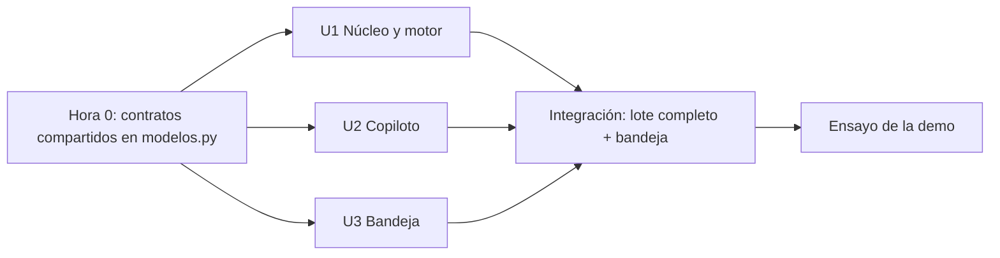

# Dependencias entre unidades

## Matriz

| Unidad (fila depende de columna) | U1 | U2 | U3 | U4 | U5 | U6 |
|---|---|---|---|---|---|---|
| U1 Núcleo y motor | — | | | | | |
| U2 Copiloto | Datos (`Evaluacion`, contexto) | — | | | | |
| U3 Bandeja | Datos (propuestas) | Datos (análisis), opcional | — | | | |
| U4 Infraestructura | Empaqueta | Empaqueta | Empaqueta | — | | |
| U5 Box | Datos (contexto, citas) | | | | — | |
| U6 FHIR | Datos (`Evaluacion`) | Datos (análisis) | Datos (decisiones) | | | — |

U3 funciona sin U2: si no hay análisis, la bandeja muestra la propuesta del motor con "análisis IA pendiente" (degradación de la sección 10.2).

## Orden y paralelismo (U-2 = B, 2–3 personas)

Texto alternativo: primero se fijan los contratos compartidos; después U1, U2 y U3 avanzan en paralelo; al final se integran y se ensaya la demo.

1. **Paso 0 (bloqueante, corto):** fijar en `src/hlf_priorizacion/modelos.py` los modelos Pydantic `ContextoPaciente`, `Evaluacion`, `AnalisisIA` y `Decision`, más un archivo de ejemplo `tests/fixtures/evaluacion_ejemplo.json` con el formato de la sección 6.8 del contexto técnico.
2. **En paralelo:** U1 implementa el motor contra esos modelos; U2 desarrolla contra la evaluación de ejemplo con un cliente de Bedrock falso y después con el real; U3 construye la bandeja leyendo el ejemplo.
3. **Integración:** `hlf-lote --fecha-corte` corre U1 → U2 y escribe en `salidas/`; la bandeja lee desde ahí.

## Comunicación

Toda la comunicación del MVP es por archivos en `salidas/` (U-5 = A), versionados por `fecha_corte` y `version_reglas`. No hay llamadas entre procesos. Al pasar a U4, esos archivos se reemplazan por DynamoDB y S3 sin cambiar los modelos.

## Riesgos de integración

| Riesgo | Mitigación |
|---|---|
| Los modelos compartidos cambian a mitad del día | Cambios solo con aviso al equipo; las pruebas de U2 y U3 usan el fixture y fallan si el esquema cambia |
| Cuota o latencia de Bedrock en el ensayo | El barrido solo corre sobre cambios; respaldo con Haiku 4.5; resultados guardados para la demo |
| Credenciales temporales del workshop vencen | Renovarlas desde el portal del evento antes de la demo y repetir `aws sts get-caller-identity` |
