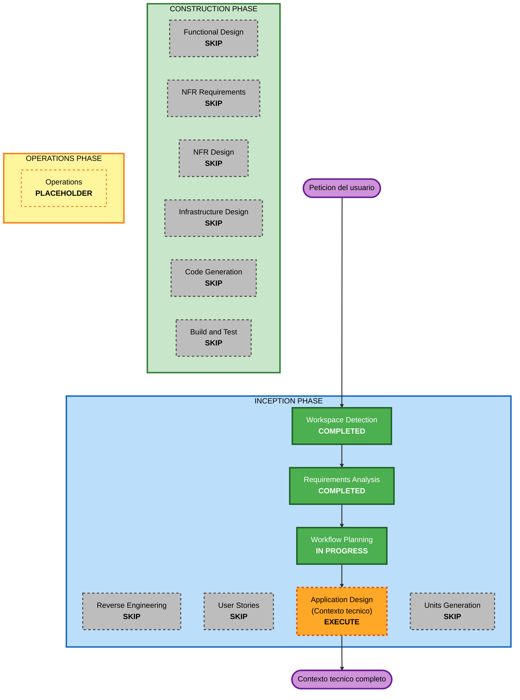

# Execution Plan — Completar el contexto técnico (HLF)

## Detailed Analysis Summary

### Transformation Scope
- **Transformation Type**: Documentación / artefacto de diseño (no transformación de código; greenfield en código).
- **Primary Changes**: Producir `docs/contexto-tecnico.md`, un contexto técnico detallado que completa la sección 12 del Business Context.
- **Related Components**: Ninguno de código. Fuentes de insumo: `docs/*.md`, `CLAUDE.md`, documento de Business Context.

### Change Impact Assessment
- **User-facing changes**: No. Es un documento técnico interno de diseño.
- **Structural changes**: No (no hay sistema construido todavía). Define la arquitectura objetivo.
- **Data model changes**: No en código. Documenta el contrato de datos, esquemas de tablas de salida y mapeo FHIR como diseño.
- **API changes**: No. Documenta contratos previstos (herramientas del copiloto, salida estructurada) a nivel de diseño.
- **NFR impact**: Sí. El documento incorpora Seguridad, Resiliencia y PBT como restricciones de diseño.

### Risk Assessment
- **Risk Level**: Low. El entregable es un documento; no toca sistemas en producción ni datos reales.
- **Rollback Complexity**: Easy (control de versiones git sobre un archivo Markdown).
- **Testing Complexity**: Simple. "Verificación" = validación de contenido (Mermaid/estructura), cobertura de la sección 12.9 y coherencia con el negocio y las extensiones.

## Workflow Visualization



### Alternativa de texto (siempre incluida)

```
INCEPTION
- Workspace Detection ....... COMPLETED
- Reverse Engineering ....... SKIP (no hay codigo)
- Requirements Analysis ..... COMPLETED
- User Stories .............. SKIP (artefacto de diseno, no features)
- Workflow Planning ......... IN PROGRESS
- Application Design ........ EXECUTE  -> produce docs/contexto-tecnico.md
- Units Generation .......... SKIP (un solo entregable, sin descomposicion)

CONSTRUCTION
- Functional Design ......... SKIP (no se genera codigo)
- NFR Requirements .......... SKIP (NFR ya capturadas como restricciones del documento)
- NFR Design ................ SKIP
- Infrastructure Design ..... SKIP (la arquitectura AWS se documenta dentro del contexto tecnico)
- Code Generation ........... SKIP (no se pidio codigo)
- Build and Test ............ SKIP (verificacion = validacion de contenido del documento)

OPERATIONS
- Operations ................ PLACEHOLDER
```

## Phases to Execute

### 🔵 INCEPTION PHASE
- [x] Workspace Detection (COMPLETED)
- [x] Reverse Engineering (SKIPPED — no existe código fuente que analizar)
- [x] Requirements Analysis (COMPLETED)
- [x] User Stories (SKIPPED — el entregable es un documento técnico de diseño, no funcionalidad de cara al usuario)
- [x] Execution Plan (IN PROGRESS)
- [ ] **Application Design — EXECUTE**
  - **Rationale**: La redacción del **contexto técnico detallado** (`docs/contexto-tecnico.md`) es, en términos de AI-DLC, un diseño de aplicación/arquitectura: identifica capas, componentes lógicos, contratos, servicios AWS por capa, mapeo FHIR y las restricciones de Seguridad/Resiliencia/PBT. Aquí se produce el entregable solicitado.
- [ ] Units Generation — **EXECUTE** (activada el 2026-10-15 a pedido del usuario)
  - **Rationale**: El usuario decidió pasar a construir un MVP para la demo. Units Generation parte el diseño en unidades y define el alcance del MVP. Las etapas de Construction se reevalúan por unidad al aprobar las unidades.

### 🟢 CONSTRUCTION PHASE
- [ ] Functional Design — SKIP
  - **Rationale**: No se genera código; la lógica de negocio del motor de reglas y el copiloto se describe como diseño dentro del contexto técnico, no como implementación.
- [ ] NFR Requirements — SKIP
  - **Rationale**: Las NFR (Seguridad, Resiliencia, PBT) y el stack ya quedaron fijadas en Requirements Analysis mediante las extensiones y las decisiones de DR/operación; se reflejan directamente en el documento.
- [ ] NFR Design — SKIP
  - **Rationale**: Los patrones NFR se incorporan como secciones del contexto técnico, no como diseño separado de un componente de código.
- [ ] Infrastructure Design — SKIP
  - **Rationale**: La arquitectura de infraestructura AWS se documenta **dentro** del contexto técnico (es parte del entregable), no como una etapa de diseño de infraestructura para desplegar código.
- [ ] Code Generation — SKIP
  - **Rationale**: El usuario pidió completar el contexto técnico, no generar código. (Se puede retomar en una sesión futura si se decide construir.)
- [ ] Build and Test — SKIP
  - **Rationale**: No hay artefacto de software que compilar/ejecutar. La "verificación" se hace como validación de contenido del documento (ver Quality Gates).

> **Nota sobre la adaptación del flujo**: AI-DLC es adaptativo — ejecuta solo las etapas que agregan valor. Como el objetivo es un documento de diseño y no software, concentramos el trabajo en **Application Design** y omitimos las etapas de construcción de código. Si más adelante decides **construir** el sistema, se reactivan Units Generation → Functional/NFR/Infra Design → Code Generation → Build & Test.

### 🟡 OPERATIONS PHASE
- [ ] Operations — PLACEHOLDER
  - **Rationale**: Fase futura. Los escenarios de pruebas de DR y el proceso de IR quedaron capturados en requisitos para cuando exista despliegue.

## Estimated Timeline
- **Total Phases a ejecutar**: 1 (Application Design) + cierre.
- **Estimated Duration**: 1 iteración de redacción + 1 ronda de revisión/ajustes.

## Success Criteria
- **Primary Goal**: Entregar `docs/contexto-tecnico.md` que complete el contexto técnico a nivel de diseño detallado.
- **Key Deliverables**: `docs/contexto-tecnico.md` (y, si aplica, un diagrama embebido en Mermaid).
- **Quality Gates**:
  - Cobertura del 100 % de los temas de la sección 12.9 del Business Context.
  - Servicios AWS concretos por capa, con justificación.
  - FHIR R4 / CL Core desarrollado como capa de primera clase.
  - Secciones explícitas de cumplimiento de Security / Resiliency / PBT (compliant/N-A con rationale).
  - Coherencia con el negocio (no contradice el principio "la IA no decide") y con las decisiones de DR/operación.
  - Contenido validado (Mermaid parseable; estructura Markdown correcta).
