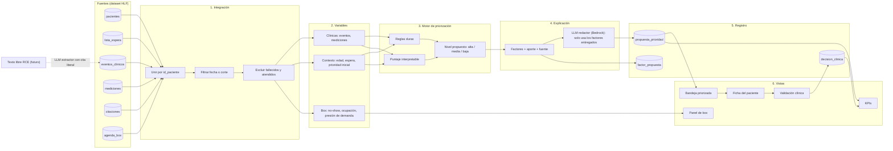
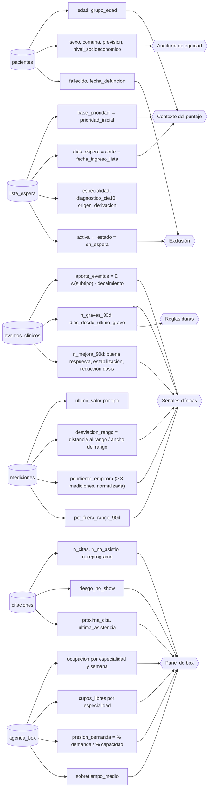
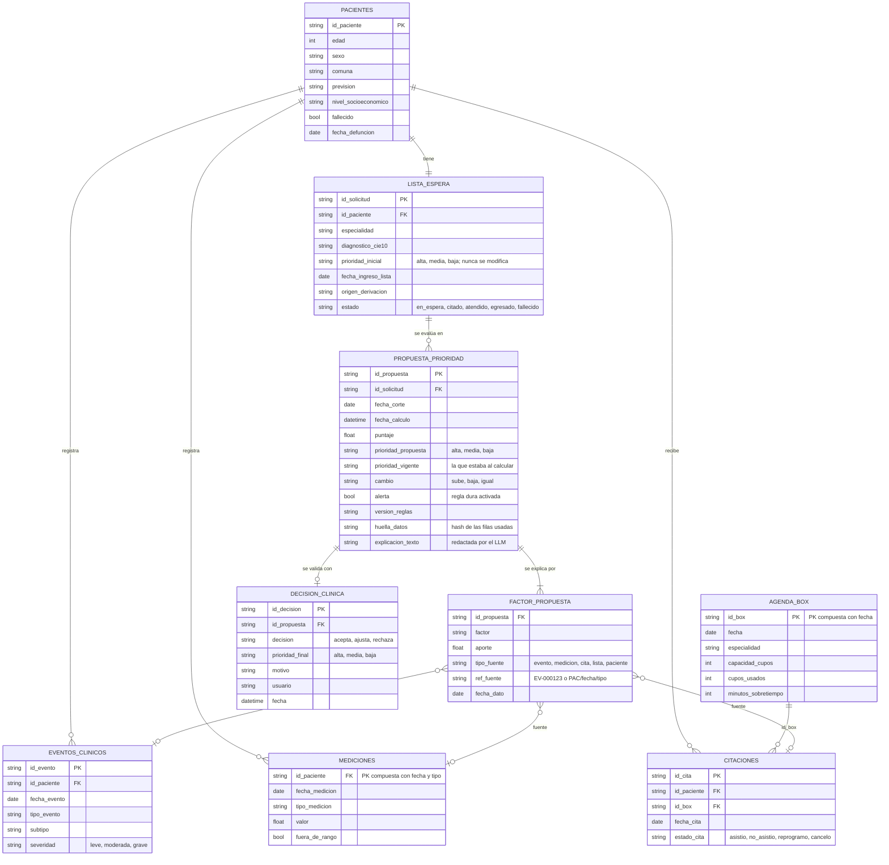
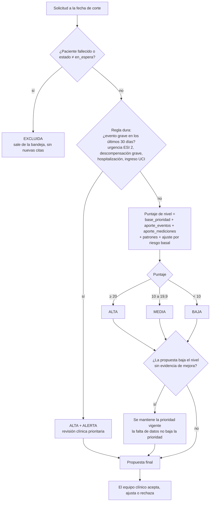
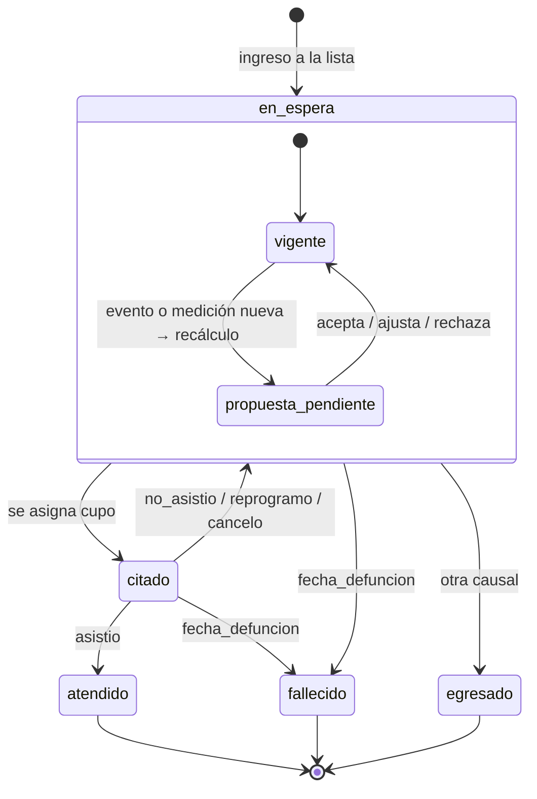
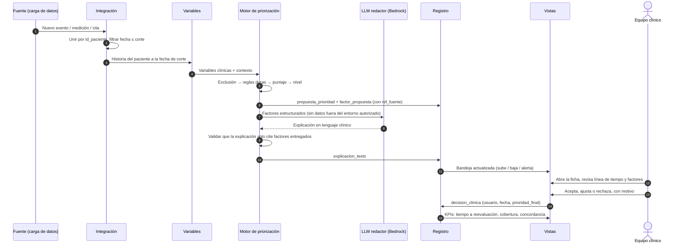
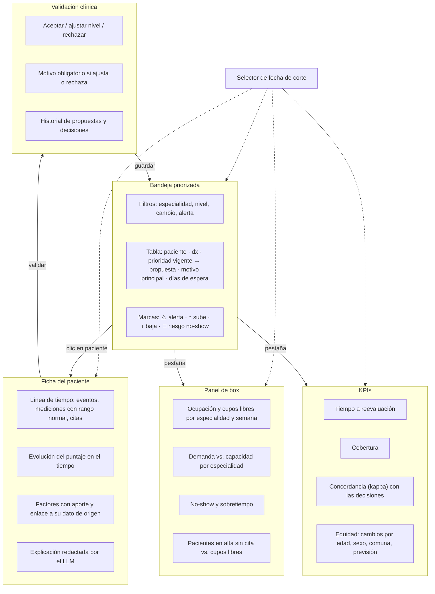

# Arquitectura: variables, trazabilidad, flujo y vistas

Diagramas del prototipo, construidos sobre el dataset del HLF (`docs/datos.md`) y el enfoque de `docs/enfoque.md`. Están en Mermaid: se ven en GitHub y en VS Code con la extensión *Markdown Preview Mermaid Support*.

Índice:
1. [Vista general](#1-vista-general)
2. [Generación de variables (linaje)](#2-generación-de-variables-linaje)
3. [Modelo de datos y trazabilidad](#3-modelo-de-datos-y-trazabilidad)
4. [Niveles de priorización](#4-niveles-de-priorización)
5. [Flujo de la aplicación](#5-flujo-de-la-aplicación)
6. [Vistas](#6-vistas)

---

## 1. Vista general

Las seis tablas fuente se combinan por `id_paciente` a una **fecha de corte**. De ellas salen las variables. El puntaje clínico es determinista y la IA generativa solo extrae información y redacta explicaciones. Todo queda registrado.

**Separaciones importantes:**
- Las variables de box (`V3`) **no entran** al puntaje clínico: alimentan el panel de box y las acciones sobre la cita.
- El LLM nunca calcula el puntaje. Entra como **extractor** (texto → eventos con fragmento citado) y como **redactor** (factores → explicación).

---

## 2. Generación de variables (linaje)

Cada variable sabe de qué tabla y de qué filas sale. Así cada factor de una propuesta puede apuntar a su dato de origen.

### Catálogo de variables

| Variable | Origen | Cálculo (siempre con fecha ≤ corte) | Uso |
|---|---|---|---|
| `base_prioridad` | `lista_espera.prioridad_inicial` | alta = 20, media = 10, baja = 0 | Puntaje |
| `dias_espera` | `lista_espera.fecha_ingreso_lista` | `corte − fecha_ingreso_lista` | Puntaje (peso bajo) |
| `factor_edad` | `pacientes.edad` | Escalonado: ≥ 75 años suma más | Puntaje (peso bajo) |
| `aporte_eventos` | `eventos_clinicos` | `Σ w(tipo, subtipo) · exp(−λ·Δt)`, con λ = ln 2 / 90 días | Puntaje |
| `n_graves_30d` | `eventos_clinicos` | Eventos con `severidad = grave` en los últimos 30 días | Regla dura |
| `n_mejora_90d` | `eventos_clinicos` | buena respuesta, estabilización, reducción dosis en 90 días | Puntaje (resta) |
| `desviacion_rango` | `mediciones` | `max(0, valor − max, min − valor) / (max − min)` del último valor | Puntaje |
| `pendiente_empeora` | `mediciones` | Pendiente por 30 días / ancho del rango; signo invertido en saturación y peak flow | Puntaje (la mejor señal según el EDA) |
| `pct_fuera_rango_90d` | `mediciones` | Proporción de mediciones fuera de rango en 90 días | Puntaje |
| `riesgo_no_show` | `citaciones` | `n_no_asistio / n_citas` con suavizado hacia la tasa global (23 %) | Panel de box |
| `presion_demanda` | `lista_espera` + `agenda_box` | `% pacientes en espera / % capacidad` por especialidad | Panel de box |
| `ocupacion`, `cupos_libres`, `sobretiempo_medio` | `agenda_box` | Por especialidad y semana | Panel de box |
| `excluido` | `pacientes`, `lista_espera` | `fallecido` o `estado ≠ en_espera` | Exclusión |

Las variables demográficas (`sexo`, `comuna`, `prevision`, `nivel_socioeconomico`) **no entran al puntaje clínico**. Se usan para auditar la equidad: comparar la distribución de los cambios de prioridad entre grupos.

---

## 3. Modelo de datos y trazabilidad

Tablas fuente (solo lectura) y tablas que genera el sistema. Cada `factor_propuesta` apunta a la fila exacta que lo originó.

**Reglas de trazabilidad:**
- `prioridad_inicial` **no se modifica nunca**. La propuesta y la decisión viven en tablas aparte.
- Cada propuesta guarda la `fecha_corte`, la `version_reglas` y una `huella_datos`. Con eso se puede reproducir exactamente el mismo cálculo.
- `ref_fuente` usa el ID de la fila cuando existe (`EV-…`, `CT-…`, `IC-…`). Las mediciones no tienen ID, así que se referencian por `id_paciente/fecha_medicion/tipo_medicion`.
- La explicación del LLM se guarda junto a los factores. Se valida que solo mencione factores presentes en `factor_propuesta`.

---

## 4. Niveles de priorización

### Escalas definidas en los datos

| Escala | Valores | Dónde |
|---|---|---|
| Prioridad | **alta · media · baja** | `lista_espera.prioridad_inicial` (y la propuesta usa la misma escala) |
| Severidad del evento | **grave · moderada · leve** | `eventos_clinicos.severidad` |
| Estado de la solicitud | en_espera · citado · atendido · egresado · fallecido | `lista_espera.estado` (en el dataset solo aparecen en_espera, atendido y fallecido) |
| Resultado de la cita | asistio · no_asistio · reprogramo · cancelo | `citaciones.estado_cita` |
| Medición | dentro / fuera de rango | `mediciones.fuera_de_rango` |

### Cómo se asigna el nivel propuesto

- **Umbrales iniciales:** alta ≥ 20, media 10–19,9, baja < 10, aplicados al **puntaje de nivel**. Con `base_prioridad` alta = 20 y media = 10, un paciente sin señales conserva su nivel. Los umbrales se versionan en `version_reglas` y se calibran con el equipo clínico.
- **Dos puntajes (implementado en el MVP, `reglas-v0.1`):** el *puntaje de nivel* decide el nivel y solo incluye la base y las señales clínicas. El *puntaje de orden* le suma el contexto (riesgo basal, edad, espera) y ordena dentro del nivel. Así el contexto nunca cambia el nivel por sí solo, pero desempata. Ver `docs/mvp.md`.
- **Bajar de nivel** exige evidencia de mejora (`n_mejora_90d > 0` o mediciones normales sostenidas). Un paciente sin registros nunca baja.
- **Prioridad vigente** = la última `prioridad_final` aceptada por el equipo clínico o, si no hay ninguna, `prioridad_inicial`. La propuesta se compara contra ella para marcar `cambio` (sube, baja, igual).
- **Riesgo basal por diagnóstico (abordado en el MVP, a validar con clínicos).** Dos pacientes con diagnósticos de riesgo muy distinto (por ejemplo I50 insuficiencia cardíaca y K21 reflujo) podían quedar en el mismo nivel y empatados. En `reglas-v0.1`, cada CIE-10 tiene una clase de riesgo basal (alto, medio o bajo) que (1) ajusta el peso de las señales clínicas (×1,25 alto, ×0,8 bajo) y (2) suma al puntaje de orden dentro del nivel. Ver `docs/enfoque.md`, sección "Pendiente: riesgo basal según el diagnóstico".
- **`riesgo_no_show` no cambia el nivel.** Se muestra como una marca aparte con una acción sugerida (confirmar la cita, ofrecer otro horario).

### Ejemplo con los casos de referencia

| Caso | Prioridad inicial | Señal principal | Nivel propuesto |
|---|---|---|---|
| PAC-HLF-00002 · deterioro agudo | baja | Urgencia ESI 2 (2026-07-20) | **alta + alerta** desde el corte 2026-07-20 |
| PAC-HLF-00001 · deterioro progresivo | alta | Pendiente del PHQ-9 de 4 a 19 | alta (se mantiene, con la tendencia destacada) |
| PAC-HLF-00028 · mejora | baja | Buena respuesta, PHQ-9 = 0 | baja (no puede bajar más) |
| PAC-HLF-00020 · inasistencia | media | 2 no-show, mediciones en rango | media + marca de riesgo de no-show |
| PAC-HLF-00032 · atendido | baja | Atendido 2026-06-30 | excluida desde 2026-06-30 |
| PAC-HLF-00009 · fallecido | baja | Urgencia con descompensación grave (2026-08-29) | alta + alerta; excluida desde 2026-09-08 |

### Ciclo de vida de una solicitud

---

## 5. Flujo de la aplicación

Desde que entra un dato nuevo hasta que queda registrada la decisión clínica.

En el prototipo, la "fuente" es el dataset completo. Se simula la llegada de datos avanzando la fecha de corte día a día.

---

## 6. Vistas

| Vista | Pregunta que responde | Datos que usa |
|---|---|---|
| Bandeja priorizada | ¿A quién reviso primero hoy? | `propuesta_prioridad` vigente, `lista_espera`, alertas |
| Ficha del paciente | ¿Por qué cambió su prioridad? | `eventos_clinicos`, `mediciones`, `citaciones`, `factor_propuesta` |
| Validación clínica | ¿Estoy de acuerdo con la propuesta? | `propuesta_prioridad` → `decision_clinica` |
| Panel de box | ¿Está bien usada la capacidad? | `agenda_box`, `citaciones`, demanda por especialidad |
| KPIs | ¿Funciona la herramienta? | Propuestas, decisiones y eventos (`docs/kpis.md`) |
