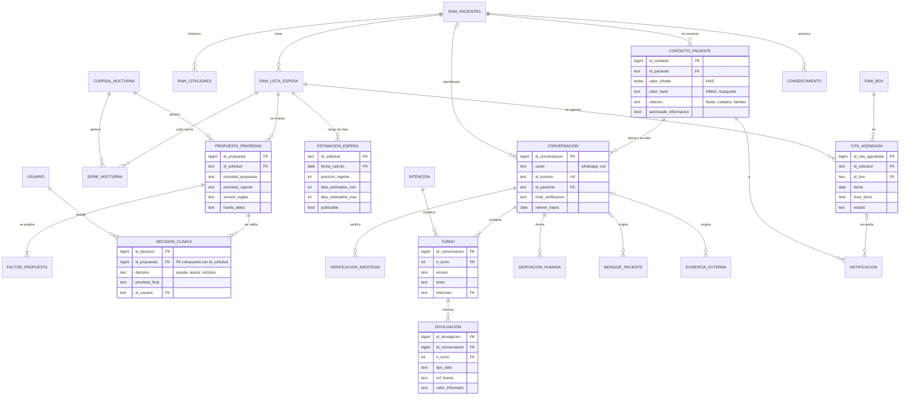

# Feature: Modelo de datos de la app y de los canales del paciente (WhatsApp y voz con IA)

Este documento define el modelo relacional completo del sistema sobre PostgreSQL (RDS). Agrega dos esquemas al esquema `raw` de [F0001](F0001-subida-datos-aws.md):

- **`priorizacion`**: lo que hoy guarda la app en SQLite (`priorizacion/registro.py`), ahora con llaves foráneas hacia `raw`. Suma la **agenda futura** y la **estimación de espera**, que el canal del paciente necesita para responder.
- **`canal`**: la comunicación con el paciente. **WhatsApp** y **teléfono con asistente de IA (voz)** comparten el mismo modelo. El paciente puede preguntar su prioridad y su posición en la lista, el tiempo estimado de atención, sus citas pasadas y próximas, y qué registros clínicos tiene el hospital.

DDL: `db/sql/priorizacion/` y `db/sql/canal/`, idempotentes. Se aplica con `python -m db esquema --esquema todos`.

## Principios que el modelo hace cumplir

| Principio | Cómo lo garantiza la base (no solo el código) |
|---|---|
| La herramienta propone, el equipo clínico decide | La propuesta (`propuesta_prioridad`) y la decisión (`decision_clinica`) viven en tablas separadas. `raw.lista_espera.prioridad_inicial` es de solo lectura para la app |
| Al paciente solo se le informa la prioridad **decidida** | Las vistas del asistente leen `v_prioridad_vigente` (última decisión clínica o, si no hay, la inicial), nunca la propuesta del motor |
| La posición en la lista no es una fecha garantizada | `estimacion_espera` guarda un **rango** (`dias_estimados_min`/`max`) con su nivel de confianza, y solo se informa si `publicable = true` |
| Trazabilidad | `decision_clinica`, `turno`, `divulgacion` y `consentimiento` son de **solo inserción** (un trigger rechaza `UPDATE`/`DELETE`) |
| Saber qué se le dijo a quién | Cada dato que informa el asistente queda en `canal.divulgacion`, con el turno y la fila fuente |
| Mínimo privilegio | El rol del asistente no puede leer `raw` ni `priorizacion`, ni ver los teléfonos. Solo lee vistas que filtran por el paciente verificado |
| No duplicar datos | No se copian `especialidad`, `prioridad_inicial` ni `id_paciente` cuando se pueden obtener de `raw.lista_espera` |

## Convención de llaves primarias

| Tipo de tabla | Llave | Ejemplos |
|---|---|---|
| Datos fuente del HLF | Llave natural del hospital (`text`) | `raw.pacientes.id_paciente`, `raw.lista_espera.id_solicitud` |
| Entidades del sistema | `bigint GENERATED ALWAYS AS IDENTITY` | `id_propuesta`, `id_conversacion`, `id_mensaje` |
| Series por fecha | Natural compuesta (entidad, fecha) | `serie_nocturna (id_solicitud, fecha)`, `estimacion_espera (id_solicitud, fecha_calculo)` |
| Detalle ordenado | Natural compuesta (padre, orden) | `factor_propuesta (id_propuesta, orden)`, `turno (id_conversacion, n_turno)` |
| Catálogos y usuarios | Código `text` estable | `usuario.id_usuario`, `intencion.codigo` |
| Identificadores externos | `UNIQUE`, no PK | `conversacion (canal, id_externo)`: el `ContactId` de Amazon Connect o el ID de WhatsApp |

**Cambio respecto de SQLite:** `registro.py` genera `EXT-00001` y `MSG-00001` con `COUNT(*) + 1`. Eso se repite si se borra una fila y choca con dos inserciones simultáneas. Aquí esos IDs pasan a ser `identity`.

**Integridad entre tablas:** `decision_clinica` referencia a `propuesta_prioridad` con una FK compuesta `(id_propuesta, id_solicitud)`, así que no se puede registrar una decisión de una solicitud apuntando a la propuesta de otra.

## Diagrama entidad-relación



## Esquema `priorizacion`

| Tabla | Grano (1 fila =) | Llave | Origen |
|---|---|---|---|
| usuario | una persona o proceso que decide o revisa | PK `id_usuario` | Nueva. Reemplaza `usuario`/`revisado_por` en texto libre |
| corrida_nocturna | una ejecución del proceso nocturno | PK `id_corrida` (identity) | `registro.py` |
| serie_nocturna | una solicitud en una noche | PK (`id_solicitud`, `fecha`), particionada por `fecha` | `registro.py`, sin `especialidad` ni `prioridad_inicial` (se obtienen de `raw`) |
| propuesta_prioridad | una propuesta del motor | PK `id_propuesta` (identity) | `registro.py`, sin `id_paciente` (se obtiene de `raw`) |
| factor_propuesta | un factor de una propuesta | PK (`id_propuesta`, `orden`) | `registro.py` |
| decision_clinica | una decisión del equipo clínico | PK `id_decision`, FK compuesta a la propuesta | `registro.py`. Solo inserciones |
| cita_agendada | una cita agendada desde la app | PK `id_cita_agendada` | **Nueva**. `raw.citaciones` es solo histórico, sin citas futuras |
| estimacion_espera | el rango de espera de una solicitud en un día | PK (`id_solicitud`, `fecha_calculo`) | **Nueva**. La calcula el proceso nocturno |
| v_prioridad_vigente (vista) | una solicitud | — | Última decisión clínica o, si no hay, la prioridad inicial |

`cita_agendada` tiene un índice único parcial: un box no puede tener dos citas activas a la misma hora.

## Esquema `canal`

| Tabla | Grano (1 fila =) | Llave | Notas |
|---|---|---|---|
| intencion | algo que puede pedir el paciente | PK `codigo` | Define la verificación mínima y si la IA lo resuelve o deriva a una persona |
| contacto_paciente | un teléfono o WhatsApp de un paciente | PK `id_contacto`, UNIQUE (`id_paciente`, `tipo`, `valor_hash`) | Número cifrado. **Un número puede ser de varios pacientes** (un cuidador) |
| consentimiento | otorgar o revocar, por canal y finalidad | PK `id_consentimiento` | Solo inserciones. La vista `v_consentimiento_vigente` da el estado actual |
| conversacion | un chat de WhatsApp o una llamada | PK `id_conversacion`, UNIQUE (`canal`, `id_externo`) | `id_paciente` queda NULL hasta identificar. Tiene fecha de retención |
| verificacion_identidad | un intento de verificar identidad | PK `id_verificacion` | Guarda el método y el resultado, **nunca el dato respondido** |
| turno | lo que dijo una de las partes | PK (`id_conversacion`, `n_turno`) | Texto o transcripción, intención y confianza del reconocimiento de voz (ASR) y de la clasificación de la intención (NLU) |
| divulgacion | un dato que el asistente informó | PK `id_divulgacion`, FK al turno | Solo inserciones. Incluye la fila fuente y el valor dicho |
| derivacion_humana | un caso que pasa a una persona | PK `id_derivacion` | Pregunta clínica, síntoma de alarma, verificación fallida… |
| mensaje_paciente | una confirmación o un síntoma informado | PK `id_mensaje` | Viene de `registro.py`. Ahora con `canal_origen` y `id_conversacion` |
| evidencia_externa | un examen hecho fuera del hospital | PK `id_evidencia` | Viene de `registro.py`. Archivo en S3 con su sha256 |
| notificacion | un mensaje o una llamada saliente | PK `id_notificacion` | Recordatorios, rescate de contacto, solicitud de exámenes |

### Lo que puede consultar el asistente (vistas `v_ia_*`)

| Pregunta del paciente | Vista | Verificación | Qué responde |
|---|---|---|---|
| "¿Qué prioridad tengo? ¿En qué lugar voy?" | `v_ia_estado_solicitud` | reforzada | Prioridad vigente, posición y total de la cola, días en espera |
| "¿Cuánto me falta?" | `v_ia_estado_solicitud` | reforzada | Rango de días estimado, solo si hay una estimación publicable |
| "¿Tengo hora? ¿Cuándo fue mi última cita?" | `v_ia_citas` | básica | Citas próximas (`cita_agendada`) y pasadas (`cita_agendada` y `raw.citaciones`) |
| "¿Qué exámenes o registros tienen de mí?" | `v_ia_registros` | reforzada | Eventos, mediciones y exámenes externos validados. Los marcados `sensible` (hospitalización, evento grave, PHQ-9) no se leen en voz alta: se ofrece derivar a una persona |

**Cómo se filtra por paciente:** después de verificar la identidad, el backend del asistente ejecuta `SET LOCAL canal.id_conversacion = '<id>'` en cada transacción. La función `canal.paciente_verificado(nivel)` devuelve el paciente solo si esa conversación está **en curso** y verificada al nivel que se pide. Sin eso, las vistas no devuelven filas. Un error de lógica del bot no puede mezclar datos de dos pacientes, y no se puede leer nada sin una verificación registrada.

> **Límite:** es una defensa contra errores, no contra credenciales robadas. El rol del asistente puede actualizar `conversacion.nivel_verificacion`. Para cerrar esa puerta, la verificación debe hacerla un servicio aparte con su propio rol, que sea el único autorizado a escribir esa columna.

### Niveles de verificación

| Nivel | Cómo se obtiene | Qué habilita |
|---|---|---|
| ninguna | — | Información general, derivar a una persona |
| basica | El número que llama está registrado (`contacto_paciente`) **y** coincide un dato simple | Citas, confirmar o cancelar asistencia, reportar síntomas, enviar exámenes |
| reforzada | Básica + código por SMS o dígitos del RUT | Prioridad, posición, tiempo estimado, registros clínicos |

Si el contacto es un cuidador (`relacion <> 'titular'`), solo recibe datos clínicos cuando `autorizado_informacion = true`.

> El dataset sintético no trae RUT, fecha de nacimiento ni teléfonos. `contacto_paciente` y la verificación reforzada quedan listas para cuando el HLF entregue esos datos (pregunta abierta en `docs/propuestas-solucion.md`).

## Flujo de una llamada con el asistente de voz

```mermaid
sequenceDiagram
    autonumber
    participant P as Paciente
    participant C as Amazon Connect + Lex/Transcribe
    participant L as Lambda del asistente (rol hlf_asistente_ia)
    participant DB as RDS (esquema canal)
    participant H as TENS o call center

    P->>C: Llama
    C->>L: ContactId + número (caller ID)
    L->>DB: INSERT conversacion (voz, entrante, ContactId)
    L->>DB: SELECT contacto_paciente WHERE valor_hash = HMAC(número)
    alt Varios pacientes con ese número
        L->>P: "¿Por quién consulta?"
    end
    L->>P: Pide el dato de verificación
    L->>DB: INSERT verificacion_identidad · UPDATE conversacion (id_paciente, nivel)
    P->>C: "¿Cuánto me falta para la hora?"
    C->>L: Transcripción + intención consultar_tiempo_espera
    L->>DB: INSERT turno (paciente)
    L->>DB: SET LOCAL canal.id_conversacion · SELECT v_ia_estado_solicitud
    L->>P: "Está en el lugar 3 de 120. Estimamos entre 14 y 35 días; no es una fecha garantizada."
    L->>DB: INSERT turno (asistente_ia) + INSERT divulgacion
    alt Pregunta clínica, síntoma de alarma o baja confianza
        L->>DB: INSERT derivacion_humana · mensaje_paciente (sintoma_alarma, pendiente)
        L->>H: Transfiere o deja en cola
    end
    L->>DB: UPDATE conversacion (fin, estado)
```

WhatsApp sigue el mismo flujo con `canal = 'whatsapp'`. El número de WhatsApp ya identifica al contacto, y la verificación reforzada se hace con un código.

## Retención y protección de datos

| Dato | Medida |
|---|---|
| Teléfonos | Cifrados en la app con KMS (`valor_cifrado`). Se buscan por HMAC con un secreto guardado en Secrets Manager (`valor_hash`). El asistente no tiene permiso sobre `valor_cifrado` |
| Transcripciones y grabaciones | `conversacion.retener_hasta` (por defecto, 1 año). Un proceso de retención borra los turnos vencidos: es el único `DELETE` permitido en `turno`. La grabación solo se guarda con consentimiento `grabacion_llamada` |
| Lo que se informó | `divulgacion` no se borra con la retención, porque es el registro de qué se entregó a quién. Guarda el valor informado, no la conversación |
| Datos de verificación | Nunca se guardan las respuestas, solo el método y el resultado |
| Consentimiento | Historial completo, solo inserciones (Ley 19.628 y Ley 21.719 de protección de datos personales) |
| Archivos de exámenes | S3 con SSE-KMS. La base guarda `uri_archivo` y `sha256_archivo` |

## Roles

| Rol | raw | priorizacion | canal |
|---|---|---|---|
| `hlf_lectura_raw` | SELECT | — | — |
| `hlf_app` (API de la bandeja) | (con `hlf_lectura_raw`) | SELECT, INSERT, UPDATE. DELETE solo en la serie y las propuestas nocturnas | SELECT, INSERT, UPDATE |
| `hlf_asistente_ia` (Lambda de WhatsApp y voz) | — | — | Vistas `v_ia_*`, columnas no sensibles de `contacto_paciente`, INSERT de conversación, turnos, divulgación, derivación, mensajes y evidencias |

Se crean con `python -m db permisos --esquema todos`.

## Mapeo a servicios AWS

| Pieza | Servicio |
|---|---|
| Telefonía y flujo de llamada | Amazon Connect |
| Voz a texto y texto a voz | Amazon Transcribe y Amazon Polly (voz es-US o es-MX). Ambos vienen integrados en Connect |
| Clasificación de la intención y diálogo | Amazon Lex V2, con Amazon Bedrock para redactar la respuesta a partir de las vistas `v_ia_*` |
| WhatsApp | AWS End User Messaging Social (WhatsApp Business) |
| Lógica del asistente | AWS Lambda (rol de base `hlf_asistente_ia`, en una VPC con el RDS) |
| Base | Amazon RDS for PostgreSQL (la misma instancia de F0001) |
| Grabaciones y exámenes | Amazon S3 con SSE-KMS |
| Secretos (credenciales, pepper del HMAC) | AWS Secrets Manager y AWS KMS |

## Comandos

```bash
python -m db esquema --esquema todos     # raw → priorizacion → canal (idempotente)
python -m db permisos --esquema todos    # roles hlf_lectura_raw, hlf_app, hlf_asistente_ia
```

## Probado

Contra PostgreSQL 16 local: carga de `raw`, aplicación de los tres esquemas dos veces seguidas (idempotencia) y 27 casos de comportamiento. Entre ellos:

- Se rechazan las decisiones incoherentes, las que apuntan a la propuesta de otra solicitud y las que no tienen un usuario registrado.
- Se rechazan las ediciones de tablas de auditoría, la doble agenda de un box y una alarma marcada como `registrado` sin revisión.
- Las vistas del asistente devuelven 0 filas sin verificación, solo citas con la verificación básica y todo con la reforzada.
- El rol del asistente no puede leer `raw` ni el teléfono cifrado.

## Pendientes / decisiones abiertas

- **`python -m db restaurar` deja de funcionar cuando hay datos en `priorizacion` o `canal`.** `carga.py` hace `TRUNCATE` de `raw` sin `CASCADE` a propósito, para no borrar datos de la app, y PostgreSQL rechaza vaciar tablas referenciadas por FKs. Hay que decidir entre una recarga incremental (`INSERT … ON CONFLICT`) o borrar y recrear todos los esquemas en orden.
- **Migrar `registro.py` a PostgreSQL** con estas tablas. Hoy sigue en SQLite: el modelo está listo, pero la app aún no lo usa.
- **Método de `estimacion_espera`**: propuesta inicial basada en las atenciones por especialidad en las últimas 8 semanas, con el rango del p25 al p75. `publicable` arranca en `false` hasta que gestión de lista lo apruebe.
- **Particiones de `serie_nocturna`**: hoy solo existe la partición `DEFAULT`. Crear particiones anuales o mensuales antes de cargar datos reales.
- **Teléfonos, RUT y fecha de nacimiento**: no vienen en el dataset; confirmar con el HLF qué datos de contacto existen.
