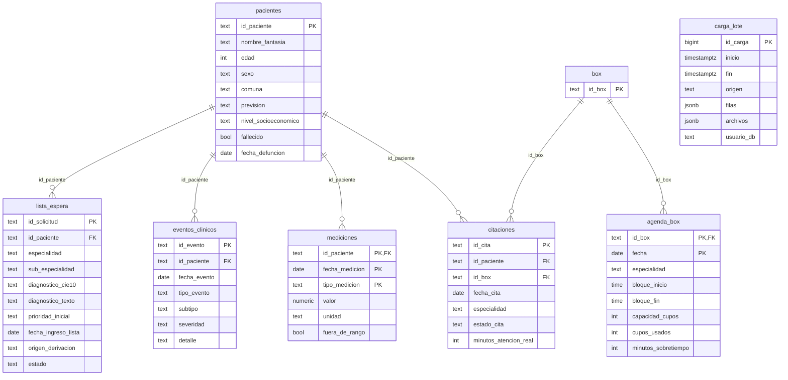
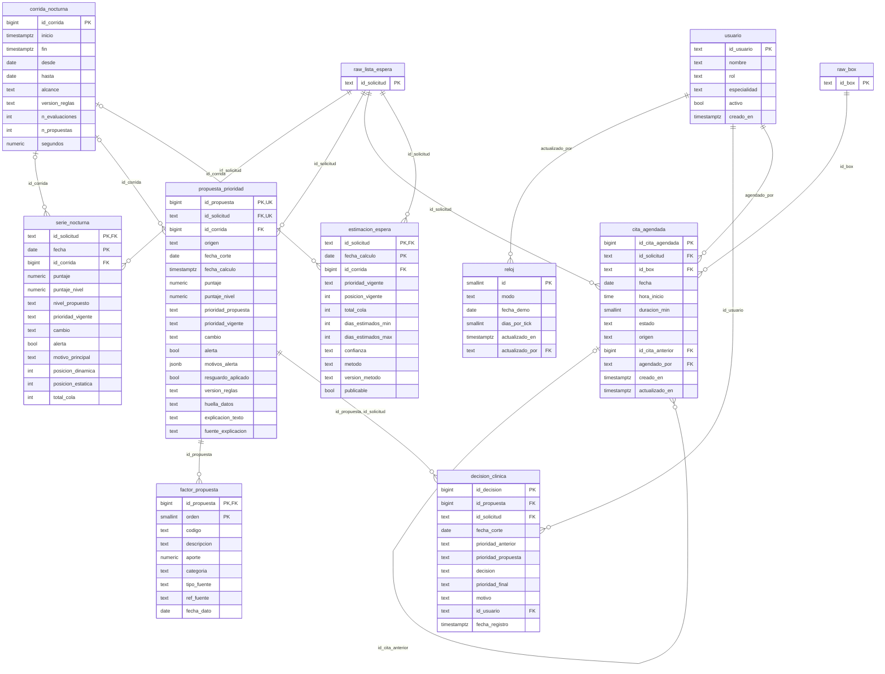
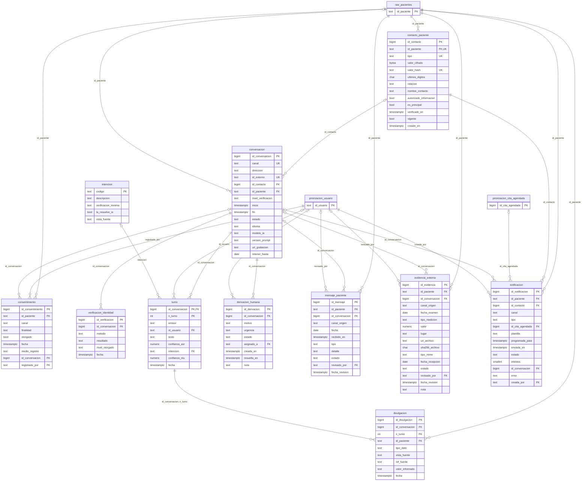
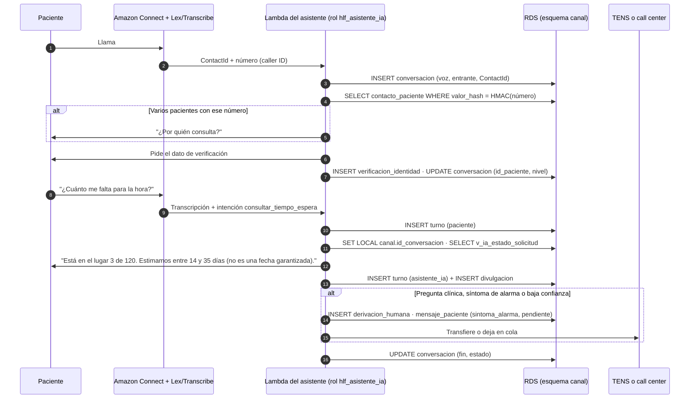

# Feature: Modelo de datos de la app y de los canales del paciente (WhatsApp y voz con IA)

Este documento define el modelo relacional completo del sistema sobre PostgreSQL (RDS). Agrega dos esquemas al esquema `raw` de [F0001](F0001-subida-datos-aws.md):

- **`priorizacion`**: lo que hoy guarda la app en SQLite (`priorizacion/registro.py`), ahora con llaves foráneas hacia `raw`. Suma la **agenda futura** y la **estimación de espera**, que el canal del paciente necesita para responder.
- **`canal`**: la comunicación con el paciente. **WhatsApp** y **teléfono con asistente de IA (voz)** comparten el mismo modelo. El paciente puede preguntar su prioridad y su posición en la lista, el tiempo estimado de atención, sus citas pasadas y próximas, y qué registros clínicos tiene el hospital.

DDL: `db/sql/priorizacion/` y `db/sql/canal/`, idempotentes. Se aplica con `python -m db esquema`.

El esquema `consulta` (preguntas del equipo clínico y documentos de la Knowledge Base), el reloj de la demo y la capa S3 + Athena se describen en [F0003](F0003-flujos-aws-datos.md), que ubica cada tabla en los flujos de [docs/diagramas/flujos-aws.pdf](../diagramas/flujos-aws.pdf).

## Principios que el modelo hace cumplir

| Principio | Cómo lo garantiza la base (no solo el código) |
|---|---|
| La herramienta propone, el equipo clínico decide | La propuesta (`propuesta_prioridad`) y la decisión (`decision_clinica`) viven en tablas separadas. `raw.lista_espera.prioridad_inicial` es de solo lectura para la app |
| Al paciente solo se le informa la prioridad **decidida** | Las vistas del asistente leen `v_prioridad_vigente` (última decisión clínica o, si no hay, la inicial), nunca la propuesta del motor |
| La posición en la lista no es una fecha garantizada | `estimacion_espera` guarda un **rango** (`dias_estimados_min`/`max`) con su nivel de confianza, y solo se informa si `publicable = true` |
| Trazabilidad | `decision_clinica`, `turno`, `divulgacion` y `consentimiento` son de **solo inserción** (un trigger rechaza `UPDATE`/`DELETE`) |
| Saber qué se le dijo a quién | Cada dato que informa el asistente queda en `canal.divulgacion`, con el turno y la fila fuente |
| Mínimo privilegio | El rol del asistente no puede leer `raw` ni `priorizacion`, ni ver los teléfonos. Solo lee vistas que filtran por el paciente verificado |
| No duplicar datos | No se copian `especialidad`, `prioridad_inicial` ni `id_paciente` cuando se pueden obtener de `raw.lista_espera` |

## Convención de llaves primarias

| Tipo de tabla | Llave | Ejemplos |
|---|---|---|
| Datos fuente del HLF | Llave natural del hospital (`text`) | `raw.pacientes.id_paciente`, `raw.lista_espera.id_solicitud` |
| Entidades del sistema | `bigint GENERATED ALWAYS AS IDENTITY` | `id_propuesta`, `id_conversacion`, `id_mensaje` |
| Series por fecha | Natural compuesta (entidad, fecha) | `serie_nocturna (id_solicitud, fecha)`, `estimacion_espera (id_solicitud, fecha_calculo)` |
| Detalle ordenado | Natural compuesta (padre, orden) | `factor_propuesta (id_propuesta, orden)`, `turno (id_conversacion, n_turno)` |
| Catálogos y usuarios | Código `text` estable | `usuario.id_usuario`, `intencion.codigo` |
| Identificadores externos | `UNIQUE`, no PK | `conversacion (canal, id_externo)`: el `ContactId` de Amazon Connect o el ID de WhatsApp |

**Cambio respecto de SQLite:** `registro.py` genera `EXT-00001` y `MSG-00001` con `COUNT(*) + 1`. Eso se repite si se borra una fila y choca con dos inserciones simultáneas. Aquí esos IDs pasan a ser `identity`.

**Integridad entre tablas:** `decision_clinica` referencia a `propuesta_prioridad` con una FK compuesta `(id_propuesta, id_solicitud)`, así que no se puede registrar una decisión de una solicitud apuntando a la propuesta de otra.

## Diagrama general

Relaciones entre las tablas de los cuatro esquemas de RDS. Cada entidad lleva el prefijo de su esquema y cada relación indica la columna de la llave foránea. `||` es obligatoria y `|o` opcional (la FK admite NULL). Las columnas de cada tabla están en el diagrama de su esquema: [raw](#esquema-raw), [priorizacion](#esquema-priorizacion), [canal](#esquema-canal) y [consulta](F0003-flujos-aws-datos.md#esquema-consulta).

```mermaid
erDiagram
    raw_pacientes ||--o{ raw_lista_espera : "id_paciente"
    raw_pacientes ||--o{ raw_eventos_clinicos : "id_paciente"
    raw_pacientes ||--o{ raw_mediciones : "id_paciente"
    raw_box ||--o{ raw_agenda_box : "id_box"
    raw_pacientes ||--o{ raw_citaciones : "id_paciente"
    raw_box ||--o{ raw_citaciones : "id_box"
    priorizacion_usuario ||--o{ priorizacion_reloj : "actualizado_por"
    raw_lista_espera ||--o{ priorizacion_serie_nocturna : "id_solicitud"
    priorizacion_corrida_nocturna |o--o{ priorizacion_serie_nocturna : "id_corrida"
    raw_lista_espera ||--o{ priorizacion_propuesta_prioridad : "id_solicitud"
    priorizacion_corrida_nocturna |o--o{ priorizacion_propuesta_prioridad : "id_corrida"
    priorizacion_propuesta_prioridad ||--o{ priorizacion_factor_propuesta : "id_propuesta"
    priorizacion_usuario ||--o{ priorizacion_decision_clinica : "id_usuario"
    priorizacion_propuesta_prioridad ||--o{ priorizacion_decision_clinica : "id_propuesta, id_solicitud"
    raw_lista_espera ||--o{ priorizacion_cita_agendada : "id_solicitud"
    raw_box ||--o{ priorizacion_cita_agendada : "id_box"
    priorizacion_cita_agendada |o--o{ priorizacion_cita_agendada : "id_cita_anterior"
    priorizacion_usuario ||--o{ priorizacion_cita_agendada : "agendado_por"
    raw_lista_espera ||--o{ priorizacion_estimacion_espera : "id_solicitud"
    priorizacion_corrida_nocturna |o--o{ priorizacion_estimacion_espera : "id_corrida"
    raw_pacientes ||--o{ canal_contacto_paciente : "id_paciente"
    raw_pacientes ||--o{ canal_consentimiento : "id_paciente"
    priorizacion_usuario ||--o{ canal_consentimiento : "registrado_por"
    canal_contacto_paciente |o--o{ canal_conversacion : "id_contacto"
    raw_pacientes |o--o{ canal_conversacion : "id_paciente"
    canal_conversacion |o--o{ canal_consentimiento : "id_conversacion"
    canal_conversacion ||--o{ canal_verificacion_identidad : "id_conversacion"
    canal_conversacion ||--o{ canal_turno : "id_conversacion"
    priorizacion_usuario |o--o{ canal_turno : "id_usuario"
    canal_intencion |o--o{ canal_turno : "intencion"
    raw_pacientes ||--o{ canal_divulgacion : "id_paciente"
    canal_turno ||--o{ canal_divulgacion : "id_conversacion, n_turno"
    canal_conversacion ||--o{ canal_derivacion_humana : "id_conversacion"
    priorizacion_usuario |o--o{ canal_derivacion_humana : "asignado_a"
    raw_pacientes ||--o{ canal_mensaje_paciente : "id_paciente"
    canal_conversacion |o--o{ canal_mensaje_paciente : "id_conversacion"
    priorizacion_usuario |o--o{ canal_mensaje_paciente : "revisado_por"
    raw_pacientes ||--o{ canal_evidencia_externa : "id_paciente"
    canal_conversacion |o--o{ canal_evidencia_externa : "id_conversacion"
    priorizacion_usuario |o--o{ canal_evidencia_externa : "revisado_por"
    raw_pacientes ||--o{ canal_notificacion : "id_paciente"
    canal_contacto_paciente ||--o{ canal_notificacion : "id_contacto"
    priorizacion_cita_agendada |o--o{ canal_notificacion : "id_cita_agendada"
    canal_conversacion |o--o{ canal_notificacion : "id_conversacion"
    priorizacion_usuario ||--o{ canal_notificacion : "creada_por"
    consulta_ingesta_kb ||--o{ consulta_documento_kb : "id_ingesta"
    raw_pacientes |o--o{ consulta_documento_kb : "id_paciente"
    priorizacion_usuario ||--o{ consulta_pregunta : "id_usuario"
    consulta_ingesta_kb |o--o{ consulta_pregunta : "id_ingesta"
    consulta_pregunta ||--o{ consulta_fuente_respuesta : "id_pregunta"
    consulta_documento_kb ||--o{ consulta_fuente_respuesta : "id_documento"
```



## Esquema `raw`

Datos crudos del HLF, de solo lectura para la app. Viene de [F0001](F0001-subida-datos-aws.md), que documenta la carga y la verificación. Se repite aquí para que el modelo completo quede en un solo lugar.

### Diagrama con columnas



### Columnas por tabla

Llave: **PK** primaria, **FK** foránea, **UK** única. Nulo = sí: la columna admite NULL. Los valores permitidos salen de los `CHECK` del DDL.

#### `raw.pacientes`

Tabla maestra: un paciente (pacientes.csv).

| Columna | Tipo | Nulo | Llave | Descripción |
|---|---|---|---|---|
| id_paciente | text | no | PK | Identificador del paciente (`PAC-HLF-00001`…) |
| nombre_fantasia | text | no |  | Nombre ficticio, no real |
| edad | integer | no |  | Edad en años. Regla: ≥ 0 |
| sexo | text | no |  | Sexo registrado. Valores: `F`, `M` |
| comuna | text | no |  | Comuna de residencia (Red Sur Oriente) |
| prevision | text | no |  | FONASA A/B/C/D o ISAPRE |
| nivel_socioeconomico | text | no |  | bajo / medio-bajo / medio |
| fallecido | boolean | no |  | Si el paciente falleció |
| fecha_defuncion | date | sí |  | Fecha de defunción; NULL si no falleció |

**Reglas:** `fallecido` = true si y solo si hay `fecha_defuncion`.

#### `raw.lista_espera`

Una solicitud en lista de espera (lista_espera.csv). prioridad_inicial nunca se modifica.

| Columna | Tipo | Nulo | Llave | Descripción |
|---|---|---|---|---|
| id_solicitud | text | no | PK | Identificador de la interconsulta (`IC-HLF-#####`) |
| id_paciente | text | no | FK | Paciente de la solicitud → `raw.pacientes` |
| especialidad | text | no |  | Especialidad de destino |
| sub_especialidad | text | no |  | Subespecialidad de destino |
| diagnostico_cie10 | text | no |  | Código CIE-10 del diagnóstico |
| diagnostico_texto | text | no |  | Descripción del diagnóstico |
| prioridad_inicial | text | no |  | Prioridad asignada al ingresar. **Nunca se modifica**. Valores: `alta`, `media`, `baja` |
| fecha_ingreso_lista | date | no |  | Ingreso a la lista: desde aquí se cuentan los días de espera |
| origen_derivacion | text | no |  | CESFAM/APS, Urgencia, Hospitalización, Otro hospital red |
| estado | text | no |  | Estado final de la solicitud. Valores: `en_espera`, `citado`, `atendido`, `egresado`, `fallecido` |

#### `raw.eventos_clinicos`

Un evento clínico fechado (eventos_clinicos.csv). detalle es una plantilla, no texto libre.

| Columna | Tipo | Nulo | Llave | Descripción |
|---|---|---|---|---|
| id_evento | text | no | PK | Identificador del evento (`EV-######`) |
| id_paciente | text | no | FK | Paciente → `raw.pacientes` |
| fecha_evento | date | no |  | Fecha del evento |
| tipo_evento | text | no |  | Tipo de evento. Valores: `cambio_farmaco`, `control_aps`, `examen_alterado`, `hospitalizacion`, `visita_urgencia` |
| subtipo | text | no |  | Detalle del tipo |
| severidad | text | no |  | Severidad. Valores: `leve`, `moderada`, `grave` |
| detalle | text | sí |  | Texto de plantilla, no texto libre |

#### `raw.mediciones`

Una medición fechada (mediciones.csv). Llave natural compuesta.

| Columna | Tipo | Nulo | Llave | Descripción |
|---|---|---|---|---|
| id_paciente | text | no | PK, FK | Paciente → `raw.pacientes` |
| fecha_medicion | date | no | PK | Fecha de la medición |
| tipo_medicion | text | no | PK | Qué se midió. Valores: `HbA1c`, `PHQ9`, `escala_dolor_eva`, `glicemia`, `peak_flow`, `presion_diastolica`, `presion_sistolica`, `saturacion_o2` |
| valor | numeric | no |  | Valor medido |
| unidad | text | no |  | Unidad del valor |
| fuera_de_rango | boolean | no |  | Si el valor está fuera del rango normal |

#### `raw.box`

Dimensión derivada: un box del hospital (id_box distintos de agenda_box.csv).

| Columna | Tipo | Nulo | Llave | Descripción |
|---|---|---|---|---|
| id_box | text | no | PK | Identificador del box (`BOX-01`…). Dimensión derivada de agenda_box |

#### `raw.agenda_box`

El bloque de un box en un día hábil (agenda_box.csv).

| Columna | Tipo | Nulo | Llave | Descripción |
|---|---|---|---|---|
| id_box | text | no | PK, FK | Box → `raw.box` |
| fecha | date | no | PK | Día del bloque |
| especialidad | text | no |  | Especialidad que usa el box ese día |
| bloque_inicio | time without time zone | no |  | Hora de inicio del bloque |
| bloque_fin | time without time zone | no |  | Hora de término del bloque |
| capacidad_cupos | integer | no |  | Cupos ofrecidos. Regla: > 0 |
| cupos_usados | integer | no |  | Cupos efectivamente usados |
| minutos_sobretiempo | integer | no |  | Minutos sobre el horario del bloque. Regla: ≥ 0 |

**Reglas:** `bloque_fin` > `bloque_inicio`; `cupos_usados` entre 0 y `capacidad_cupos`.

#### `raw.citaciones`

Una cita ofrecida a un paciente (citaciones.csv).

| Columna | Tipo | Nulo | Llave | Descripción |
|---|---|---|---|---|
| id_cita | text | no | PK | Identificador de la cita (`CT-######`) |
| id_paciente | text | no | FK | Paciente citado → `raw.pacientes` |
| id_box | text | no | FK | Box de la cita → `raw.box` |
| fecha_cita | date | no |  | Fecha de la cita |
| especialidad | text | no |  | Especialidad |
| estado_cita | text | no |  | Resultado de la cita. Valores: `asistio`, `no_asistio`, `reprogramo`, `cancelo` |
| minutos_atencion_real | integer | sí |  | Duración real; solo si asistió. Regla: > 0 |

**Reglas:** `minutos_atencion_real` tiene valor si y solo si `estado_cita` = `asistio`; Sin FK a `agenda_box`: 118 de 257 citas no tienen bloque ese día.

#### `raw.carga_lote`

Una carga del esquema raw: filas por tabla y sha256 de cada CSV.

| Columna | Tipo | Nulo | Llave | Descripción |
|---|---|---|---|---|
| id_carga | bigint | no | PK | Identificador de la carga. Autogenerado (identity) |
| inicio | timestamp with time zone | no |  | Inicio de la carga |
| fin | timestamp with time zone | no |  | Término de la carga. Por defecto: `now()` |
| origen | text | no |  | Carpeta o bucket de origen |
| filas | jsonb | no |  | Filas cargadas por tabla |
| archivos | jsonb | no |  | sha256 de cada CSV |
| usuario_db | text | no |  | Usuario de base que hizo la carga. Por defecto: `CURRENT_USER` |

## Esquema `priorizacion`

| Tabla | Grano (1 fila =) | Llave | Origen |
|---|---|---|---|
| usuario | una persona o proceso que decide o revisa | PK `id_usuario` | Nueva. Reemplaza `usuario`/`revisado_por` en texto libre |
| reloj | la fecha de corte vigente (una sola fila) | PK `id` (siempre 1) | **Nueva**. Modo real o demo; ver [F0003](F0003-flujos-aws-datos.md#reloj-de-la-demo-flujo-d) |
| corrida_nocturna | una ejecución del proceso nocturno | PK `id_corrida` (identity) | `registro.py` |
| serie_nocturna | una solicitud en una noche | PK (`id_solicitud`, `fecha`), particionada por `fecha` | `registro.py`, sin `especialidad` ni `prioridad_inicial` (se obtienen de `raw`) |
| propuesta_prioridad | una propuesta del motor | PK `id_propuesta` (identity) | `registro.py`, sin `id_paciente` (se obtiene de `raw`) |
| factor_propuesta | un factor de una propuesta | PK (`id_propuesta`, `orden`) | `registro.py` |
| decision_clinica | una decisión del equipo clínico | PK `id_decision`, FK compuesta a la propuesta | `registro.py`. Solo inserciones |
| cita_agendada | una cita agendada desde la app | PK `id_cita_agendada` | **Nueva**. `raw.citaciones` es solo histórico, sin citas futuras |
| estimacion_espera | el rango de espera de una solicitud en un día | PK (`id_solicitud`, `fecha_calculo`) | **Nueva**. La calcula el proceso nocturno |
| v_prioridad_vigente (vista) | una solicitud | — | Última decisión clínica hasta la fecha de corte o, si no hay, la prioridad inicial |

`cita_agendada` tiene un índice único parcial: un box no puede tener dos citas activas a la misma hora.

### Diagrama con columnas



Las entidades con prefijo (`raw_…`, `priorizacion_…`) son de otro esquema y se muestran solo con su llave.

### Columnas por tabla

Llave: **PK** primaria, **FK** foránea, **UK** única. Nulo = sí: la columna admite NULL. Los valores permitidos salen de los `CHECK` del DDL.

#### `priorizacion.usuario`

Quién decide o revisa. Las columnas *_por de todo el modelo apuntan aquí.

| Columna | Tipo | Nulo | Llave | Descripción |
|---|---|---|---|---|
| id_usuario | text | no | PK | Login institucional, o `sistema` / `asistente_ia` |
| nombre | text | no |  | Nombre visible |
| rol | text | no |  | Rol en el proceso. Valores: `medico`, `enfermeria`, `tens`, `gestor_lista`, `administrativo`, `sistema` |
| especialidad | text | sí |  | Especialidad a la que pertenece; NULL = todas |
| activo | boolean | no |  | false = ya no puede decidir ni revisar. Por defecto: `true` |
| creado_en | timestamp with time zone | no |  | Alta del usuario. Por defecto: `now()` |

#### `priorizacion.reloj`

Fecha de corte vigente (real o simulada para la demo). Una sola fila.

| Columna | Tipo | Nulo | Llave | Descripción |
|---|---|---|---|---|
| id | smallint | no | PK | Siempre 1: la tabla tiene una sola fila. Por defecto: `1` |
| modo | text | no |  | `real` = hoy; `demo` = fecha simulada. Valores: `real`, `demo` |
| fecha_demo | date | sí |  | Fecha simulada; obligatoria en modo demo |
| dias_por_tick | smallint | no |  | Días que avanza cada tick de la demo. Regla: > 0. Por defecto: `1` |
| actualizado_en | timestamp with time zone | no |  | Último cambio. Por defecto: `now()` |
| actualizado_por | text | no | FK | Quién lo cambió (`sistema` si fue la Lambda) → `priorizacion.usuario` |

**Reglas:** Una sola fila (`id` = 1); Modo `demo` exige `fecha_demo`; Se lee con `priorizacion.fecha_corte()` y se avanza con `priorizacion.avanzar_reloj(dias)`.

#### `priorizacion.corrida_nocturna`

Bitácora: una ejecución del proceso nocturno.

| Columna | Tipo | Nulo | Llave | Descripción |
|---|---|---|---|---|
| id_corrida | bigint | no | PK | Identificador de la corrida. Autogenerado (identity) |
| inicio | timestamp with time zone | no |  | Inicio de la ejecución |
| fin | timestamp with time zone | sí |  | Término; NULL si sigue corriendo |
| desde | date | no |  | Primera fecha de corte evaluada |
| hasta | date | no |  | Última fecha de corte evaluada |
| alcance | text | no |  | `completa` o una especialidad |
| version_reglas | text | no |  | `VERSION_REGLAS` usada |
| n_evaluaciones | integer | sí |  | Evaluaciones calculadas. Regla: ≥ 0 |
| n_propuestas | integer | sí |  | Propuestas guardadas. Regla: ≥ 0 |
| segundos | numeric(10,2) | sí |  | Duración |

**Reglas:** `hasta` ≥ `desde`; `fin` ≥ `inicio`.

#### `priorizacion.serie_nocturna`

Puntaje y posición de cada solicitud activa en cada noche. Particionar por año o mes.

| Columna | Tipo | Nulo | Llave | Descripción |
|---|---|---|---|---|
| id_solicitud | text | no | PK, FK | Solicitud evaluada → `raw.lista_espera` |
| fecha | date | no | PK | Noche evaluada (fecha de corte) |
| id_corrida | bigint | sí | FK | Corrida que la generó → `priorizacion.corrida_nocturna` |
| puntaje | numeric(8,3) | no |  | Puntaje total |
| puntaje_nivel | numeric(8,3) | no |  | Puntaje que define el nivel |
| nivel_propuesto | text | no |  | Nivel que propone el motor. Valores: `alta`, `media`, `baja` |
| prioridad_vigente | text | no |  | Prioridad decidida que regía esa noche. Valores: `alta`, `media`, `baja` |
| cambio | text | no |  | Propuesto frente a vigente. Valores: `sube`, `baja`, `igual` |
| alerta | boolean | no |  | Se activó una regla dura |
| motivo_principal | text | sí |  | Factor que más aportó |
| posicion_dinamica | integer | no |  | Posición en la cola según el puntaje. Regla: > 0 |
| posicion_estatica | integer | no |  | Posición según prioridad inicial y antigüedad. Regla: > 0 |
| total_cola | integer | no |  | Solicitudes activas en la cola de esa especialidad. Regla: > 0 |

**Reglas:** Particionada por rango de `fecha` (hoy solo la partición `serie_nocturna_default`); Ambas posiciones ≤ `total_cola`.

#### `priorizacion.propuesta_prioridad`

Prioridad propuesta por el motor con su explicación. Nunca modifica raw.lista_espera.prioridad_inicial.

| Columna | Tipo | Nulo | Llave | Descripción |
|---|---|---|---|---|
| id_propuesta | bigint | no | PK, UK | Identificador de la propuesta. Autogenerado (identity) |
| id_solicitud | text | no | FK, UK | Solicitud evaluada → `raw.lista_espera` |
| id_corrida | bigint | sí | FK | Corrida nocturna que la generó; NULL si se calculó al validar → `priorizacion.corrida_nocturna` |
| origen | text | no |  | Quién la generó. Valores: `nocturno`, `validacion` |
| fecha_corte | date | no |  | Fecha hasta la que se usaron datos |
| fecha_calculo | timestamp with time zone | no |  | Momento del cálculo. Por defecto: `now()` |
| puntaje | numeric(8,3) | no |  | Puntaje total |
| puntaje_nivel | numeric(8,3) | no |  | Puntaje que define el nivel |
| prioridad_propuesta | text | no |  | Nivel propuesto. Valores: `alta`, `media`, `baja` |
| prioridad_vigente | text | no |  | Prioridad que regía al calcular. Valores: `alta`, `media`, `baja` |
| cambio | text | no |  | Propuesta frente a vigente. Valores: `sube`, `baja`, `igual` |
| alerta | boolean | no |  | Se activó una regla dura |
| motivos_alerta | jsonb | no |  | Lista JSON de reglas duras activadas. Por defecto: `'[]'` |
| resguardo_aplicado | boolean | no |  | Se aplicó el resguardo que impide bajar por falta de datos. Por defecto: `false` |
| version_reglas | text | no |  | `VERSION_REGLAS` usada |
| huella_datos | text | no |  | Hash de las filas fuente usadas: permite reproducir el cálculo |
| explicacion_texto | text | no |  | Explicación legible |
| fuente_explicacion | text | no |  | Quién redactó la explicación. Valores: `plantilla`, `llm` |

**Reglas:** UNIQUE (`id_propuesta`, `id_solicitud`): destino de la FK compuesta de `decision_clinica`; `motivos_alerta` debe ser un arreglo JSON.

#### `priorizacion.factor_propuesta`

Un factor que explica una propuesta, con la fila fuente exacta.

| Columna | Tipo | Nulo | Llave | Descripción |
|---|---|---|---|---|
| id_propuesta | bigint | no | PK, FK | Propuesta que explica → `priorizacion.propuesta_prioridad` |
| orden | smallint | no | PK | Orden de presentación. Regla: ≥ 0 |
| codigo | text | no |  | Código del factor |
| descripcion | text | no |  | Texto del factor |
| aporte | numeric(8,3) | no |  | Puntos que aporta (puede ser negativo) |
| categoria | text | no |  | base, contexto, ajuste, regla_dura, tendencia… |
| tipo_fuente | text | no |  | Tabla de la que sale el dato. Valores: `lista`, `paciente`, `evento`, `medicion`, `cita`, `externa`, `mensaje` |
| ref_fuente | text | sí |  | ID de la fila fuente (`EV-…`, `CT-…`, `IC-…`, o `paciente/fecha/tipo` para mediciones) |
| fecha_dato | date | sí |  | Fecha del dato fuente |

**Reglas:** Se borra junto con su propuesta (`ON DELETE CASCADE`).

#### `priorizacion.decision_clinica`

Lo que decidió el equipo clínico. Solo inserciones; la vigente es la última por fecha.

| Columna | Tipo | Nulo | Llave | Descripción |
|---|---|---|---|---|
| id_decision | bigint | no | PK | Identificador de la decisión. Autogenerado (identity) |
| id_propuesta | bigint | no | FK | Propuesta que se revisó → `priorizacion.propuesta_prioridad` |
| id_solicitud | text | no | FK | Solicitud (FK compuesta con id_propuesta) → `priorizacion.propuesta_prioridad` |
| fecha_corte | date | no |  | Fecha desde la que rige |
| prioridad_anterior | text | no |  | Prioridad vigente antes de decidir. Valores: `alta`, `media`, `baja` |
| prioridad_propuesta | text | no |  | Lo que proponía el motor. Valores: `alta`, `media`, `baja` |
| decision | text | no |  | Qué hizo el equipo clínico. Valores: `acepta`, `ajusta`, `rechaza` |
| prioridad_final | text | no |  | Prioridad que queda vigente. Valores: `alta`, `media`, `baja` |
| motivo | text | no |  | Justificación (obligatoria) |
| id_usuario | text | no | FK | Quién decidió → `priorizacion.usuario` |
| fecha_registro | timestamp with time zone | no |  | Momento del registro. Por defecto: `now()` |

**Reglas:** FK compuesta (`id_propuesta`, `id_solicitud`) → `propuesta_prioridad`; `acepta` ⇒ `prioridad_final` = `prioridad_propuesta`; `rechaza` ⇒ `prioridad_final` = `prioridad_anterior`; `motivo` no puede ir vacío; Solo inserciones (trigger).

#### `priorizacion.cita_agendada`

Cita futura o reciente agendada desde la app (raw.citaciones es solo histórico).

| Columna | Tipo | Nulo | Llave | Descripción |
|---|---|---|---|---|
| id_cita_agendada | bigint | no | PK | Identificador de la cita. Autogenerado (identity) |
| id_solicitud | text | no | FK | Solicitud que se atiende → `raw.lista_espera` |
| id_box | text | no | FK | Box asignado → `raw.box` |
| fecha | date | no |  | Día de la cita |
| hora_inicio | time without time zone | sí |  | Hora; NULL si aún no se asigna |
| duracion_min | smallint | sí |  | Duración planificada. Regla: > 0 |
| estado | text | no |  | Estado de la cita. Valores: `programada`, `confirmada`, `reprogramada`, `cancelada`, `asistio`, `no_asistio`. Por defecto: `'programada'` |
| origen | text | no |  | Cómo se agendó. Valores: `agenda_propuesta`, `manual`, `reemplazo_cupo` |
| id_cita_anterior | bigint | sí | FK | Cita que reemplaza, si es reprogramación → `priorizacion.cita_agendada` |
| agendado_por | text | no | FK | Quién agendó → `priorizacion.usuario` |
| creado_en | timestamp with time zone | no |  | Alta del registro. Por defecto: `now()` |
| actualizado_en | timestamp with time zone | no |  | Último cambio de estado. Por defecto: `now()` |

**Reglas:** Índice único parcial: un box no tiene dos citas `programada`/`confirmada` el mismo día y hora; `id_cita_anterior` ≠ `id_cita_agendada`.

#### `priorizacion.estimacion_espera`

Rango de días estimado para ser atendido, por solicitud y día. Solo las publicables llegan al paciente.

| Columna | Tipo | Nulo | Llave | Descripción |
|---|---|---|---|---|
| id_solicitud | text | no | PK, FK | Solicitud → `raw.lista_espera` |
| fecha_calculo | date | no | PK | Día del cálculo |
| id_corrida | bigint | sí | FK | Corrida que la calculó → `priorizacion.corrida_nocturna` |
| prioridad_vigente | text | no |  | Prioridad decidida usada para ordenar. Valores: `alta`, `media`, `baja` |
| posicion_vigente | integer | no |  | Lugar en la cola según la prioridad vigente. Regla: > 0 |
| total_cola | integer | no |  | Largo de la cola. Regla: > 0 |
| dias_estimados_min | integer | no |  | Límite inferior del rango de días. Regla: ≥ 0 |
| dias_estimados_max | integer | no |  | Límite superior del rango de días |
| confianza | text | no |  | Confianza del rango. Valores: `alta`, `media`, `baja` |
| metodo | text | no |  | Método de estimación (p. ej. `throughput_8_semanas`) |
| version_metodo | text | no |  | Versión del método |
| publicable | boolean | no |  | true = el asistente puede informarla. Por defecto: `false` |

**Reglas:** `posicion_vigente` ≤ `total_cola`; `dias_estimados_max` ≥ `dias_estimados_min`.

#### `priorizacion.v_prioridad_vigente` (vista)

Prioridad que rige a la fecha de corte: última decisión clínica hasta esa fecha o, si no hay, la inicial.

| Columna | Tipo |
|---|---|
| id_solicitud | text |
| id_paciente | text |
| especialidad | text |
| prioridad_inicial | text |
| prioridad_vigente | text |
| fecha_ultima_decision | date |
| fecha_ingreso_lista | date |
| estado | text |

## Esquema `canal`

| Tabla | Grano (1 fila =) | Llave | Notas |
|---|---|---|---|
| intencion | algo que puede pedir el paciente | PK `codigo` | Define la verificación mínima y si la IA lo resuelve o deriva a una persona |
| contacto_paciente | un teléfono o WhatsApp de un paciente | PK `id_contacto`, UNIQUE (`id_paciente`, `tipo`, `valor_hash`) | Número cifrado. **Un número puede ser de varios pacientes** (un cuidador) |
| consentimiento | otorgar o revocar, por canal y finalidad | PK `id_consentimiento` | Solo inserciones. La vista `v_consentimiento_vigente` da el estado actual |
| conversacion | un chat de WhatsApp o una llamada | PK `id_conversacion`, UNIQUE (`canal`, `id_externo`) | `id_paciente` queda NULL hasta identificar. Tiene fecha de retención |
| verificacion_identidad | un intento de verificar identidad | PK `id_verificacion` | Guarda el método y el resultado, **nunca el dato respondido** |
| turno | lo que dijo una de las partes | PK (`id_conversacion`, `n_turno`) | Texto o transcripción, intención y confianza del reconocimiento de voz (ASR) y de la clasificación de la intención (NLU) |
| divulgacion | un dato que el asistente informó | PK `id_divulgacion`, FK al turno | Solo inserciones. Incluye la fila fuente y el valor dicho |
| derivacion_humana | un caso que pasa a una persona | PK `id_derivacion` | Pregunta clínica, síntoma de alarma, verificación fallida… |
| mensaje_paciente | una confirmación o un síntoma informado | PK `id_mensaje` | Viene de `registro.py`. Ahora con `canal_origen` y `id_conversacion` |
| evidencia_externa | un examen hecho fuera del hospital | PK `id_evidencia` | Viene de `registro.py`. Archivo en S3 con su sha256 |
| notificacion | un mensaje o una llamada saliente | PK `id_notificacion` | Recordatorios, rescate de contacto, solicitud de exámenes |

### Diagrama con columnas



Las entidades con prefijo (`raw_…`, `priorizacion_…`) son de otro esquema y se muestran solo con su llave.

### Columnas por tabla

Llave: **PK** primaria, **FK** foránea, **UK** única. Nulo = sí: la columna admite NULL. Los valores permitidos salen de los `CHECK` del DDL.

#### `canal.intencion`

Qué puede pedir el paciente y qué nivel de identidad exige cada cosa.

| Columna | Tipo | Nulo | Llave | Descripción |
|---|---|---|---|---|
| codigo | text | no | PK | Código de la intención |
| descripcion | text | no |  | Qué pide el paciente |
| verificacion_minima | text | no |  | Identidad mínima para responder. Valores: `ninguna`, `basica`, `reforzada` |
| la_resuelve_ia | boolean | no |  | false = siempre deriva a una persona |
| vista_fuente | text | sí |  | Vista `v_ia_*` de la que sale la respuesta |

#### `canal.contacto_paciente`

Un medio de contacto de un paciente. El número va cifrado; se busca por HMAC.

| Columna | Tipo | Nulo | Llave | Descripción |
|---|---|---|---|---|
| id_contacto | bigint | no | PK | Identificador del contacto. Autogenerado (identity) |
| id_paciente | text | no | FK, UK | Paciente al que pertenece → `raw.pacientes` |
| tipo | text | no | UK | Medio. Valores: `movil`, `fijo`, `whatsapp` |
| valor_cifrado | bytea | no |  | Número E.164 cifrado con KMS |
| valor_hash | text | no | UK | HMAC-SHA256 del número: se busca por esto |
| ultimos_digitos | character(4) | no |  | Últimos 4 dígitos, para mostrar |
| relacion | text | no |  | Relación con el paciente. Valores: `titular`, `cuidador`, `familiar`. Por defecto: `'titular'` |
| nombre_contacto | text | sí |  | Nombre del tercero; obligatorio si no es el titular |
| autorizado_informacion | boolean | no |  | Un tercero recibe datos clínicos solo si es true. Por defecto: `false` |
| es_principal | boolean | no |  | Contacto preferido de ese tipo. Por defecto: `false` |
| verificado_en | timestamp with time zone | sí |  | Cuándo se confirmó el número |
| vigente | boolean | no |  | false = dado de baja. Por defecto: `true` |
| creado_en | timestamp with time zone | no |  | Alta del contacto. Por defecto: `now()` |

**Reglas:** UNIQUE (`id_paciente`, `tipo`, `valor_hash`): el mismo número puede repetirse entre pacientes; Un solo contacto `es_principal` vigente por paciente y tipo (índice único parcial); Si `relacion` ≠ `titular`, `nombre_contacto` es obligatorio.

#### `canal.consentimiento`

Historial de consentimientos por canal y finalidad (Ley 19.628 / 21.719).

| Columna | Tipo | Nulo | Llave | Descripción |
|---|---|---|---|---|
| id_consentimiento | bigint | no | PK | Identificador. Autogenerado (identity) |
| id_paciente | text | no | FK | Paciente → `raw.pacientes` |
| canal | text | no |  | Canal al que aplica. Valores: `whatsapp`, `voz`, `sms` |
| finalidad | text | no |  | Para qué. Valores: `recordatorios`, `consulta_estado`, `envio_examenes`, `grabacion_llamada`, `asistente_ia` |
| otorgado | boolean | no |  | true = otorga, false = revoca |
| fecha | timestamp with time zone | no |  | Momento. Por defecto: `now()` |
| medio_registro | text | no |  | Por dónde lo dio. Valores: `presencial`, `whatsapp`, `voz`, `web` |
| id_conversacion | bigint | sí | FK | Conversación en que se dio, si fue por el canal → `canal.conversacion` |
| registrado_por | text | no | FK | Quién lo registró → `priorizacion.usuario` |

**Reglas:** Solo inserciones (trigger). Rige la fila más reciente por paciente, canal y finalidad.

#### `canal.conversacion`

Una conversación por WhatsApp o una llamada telefónica con el asistente.

| Columna | Tipo | Nulo | Llave | Descripción |
|---|---|---|---|---|
| id_conversacion | bigint | no | PK | Identificador. Autogenerado (identity) |
| canal | text | no | UK | WhatsApp o llamada. Valores: `whatsapp`, `voz` |
| direccion | text | no |  | Quién inició. Valores: `entrante`, `saliente` |
| id_externo | text | no | UK | ContactId de Amazon Connect o ID de conversación de WhatsApp |
| id_contacto | bigint | sí | FK | Contacto que llamó o escribió → `canal.contacto_paciente` |
| id_paciente | text | sí | FK | Paciente identificado; NULL hasta identificar → `raw.pacientes` |
| nivel_verificacion | text | no |  | Identidad verificada alcanzada. Valores: `ninguna`, `basica`, `reforzada`. Por defecto: `'ninguna'` |
| inicio | timestamp with time zone | no |  | Inicio. Por defecto: `now()` |
| fin | timestamp with time zone | sí |  | Término; NULL si sigue en curso |
| estado | text | no |  | Estado. Valores: `en_curso`, `finalizada`, `abandonada`, `derivada`. Por defecto: `'en_curso'` |
| idioma | text | no |  | Idioma de la conversación. Por defecto: `'es-CL'` |
| modelo_ia | text | sí |  | Modelo usado (ID de Bedrock) |
| version_prompt | text | sí |  | Versión del prompt |
| uri_grabacion | text | sí |  | Grabación en S3; solo voz y con consentimiento |
| retener_hasta | date | no |  | Fecha de borrado de turnos y grabación. Por defecto: `(CURRENT_DATE + 365)` |

**Reglas:** UNIQUE (`canal`, `id_externo`); `estado` = `en_curso` si y solo si `fin` es NULL; `nivel_verificacion` ≠ `ninguna` exige `id_paciente`; `uri_grabacion` solo si `canal` = `voz`.

#### `canal.verificacion_identidad`

Cada intento de verificar identidad. Nunca guarda el dato respondido.

| Columna | Tipo | Nulo | Llave | Descripción |
|---|---|---|---|---|
| id_verificacion | bigint | no | PK | Identificador. Autogenerado (identity) |
| id_conversacion | bigint | no | FK | Conversación → `canal.conversacion` |
| metodo | text | no |  | Cómo se verificó. Valores: `numero_registrado`, `fecha_nacimiento`, `digitos_rut`, `codigo_sms`, `agente_humano` |
| resultado | text | no |  | Resultado del intento. Valores: `exitosa`, `fallida`, `bloqueada` |
| nivel_otorgado | text | no |  | Nivel que otorga si fue exitoso. Valores: `ninguna`, `basica`, `reforzada` |
| fecha | timestamp with time zone | no |  | Momento. Por defecto: `now()` |

**Reglas:** Un intento no exitoso otorga nivel `ninguna`; Nunca guarda el dato que respondió el paciente.

#### `canal.turno`

Un mensaje o una intervención hablada dentro de una conversación.

| Columna | Tipo | Nulo | Llave | Descripción |
|---|---|---|---|---|
| id_conversacion | bigint | no | PK, FK | Conversación → `canal.conversacion` |
| n_turno | integer | no | PK | Número correlativo del turno. Regla: > 0 |
| emisor | text | no |  | Quién habla. Valores: `paciente`, `asistente_ia`, `funcionario` |
| id_usuario | text | sí | FK | Funcionario, si emisor = funcionario → `priorizacion.usuario` |
| texto | text | no |  | Mensaje o transcripción |
| confianza_asr | numeric(4,3) | sí |  | Confianza del reconocimiento de voz (solo voz) |
| intencion | text | sí | FK | Intención detectada → `canal.intencion` |
| confianza_nlu | numeric(4,3) | sí |  | Confianza de la intención |
| fecha | timestamp with time zone | no |  | Momento. Por defecto: `now()` |

**Reglas:** `id_usuario` obligatorio si y solo si `emisor` = `funcionario`; No se edita (trigger). Solo el proceso de retención puede borrar.

#### `canal.divulgacion`

Qué dato se informó a quién, en qué turno y desde qué fila fuente.

| Columna | Tipo | Nulo | Llave | Descripción |
|---|---|---|---|---|
| id_divulgacion | bigint | no | PK | Identificador. Autogenerado (identity) |
| id_conversacion | bigint | no | FK | Conversación → `canal.turno` |
| n_turno | integer | no | FK | Turno en que se informó → `canal.turno` |
| id_paciente | text | no | FK | Paciente sobre el que se informó → `raw.pacientes` |
| tipo_dato | text | no |  | Qué se informó. Valores: `prioridad`, `posicion`, `tiempo_estimado`, `cita_proxima`, `cita_pasada`, `registro_clinico`, `estado_solicitud`, `examen_pendiente` |
| vista_fuente | text | no |  | Vista consultada |
| ref_fuente | text | no |  | Fila fuente (`id_solicitud/fecha`, `CT-…`, `EV-…`) |
| valor_informado | text | no |  | Lo que se dijo |
| fecha | timestamp with time zone | no |  | Momento. Por defecto: `now()` |

**Reglas:** FK compuesta (`id_conversacion`, `n_turno`) → `turno`; Solo inserciones (trigger).

#### `canal.derivacion_humana`

Caso que el asistente pasa a una persona (TENS, enfermería, call center).

| Columna | Tipo | Nulo | Llave | Descripción |
|---|---|---|---|---|
| id_derivacion | bigint | no | PK | Identificador. Autogenerado (identity) |
| id_conversacion | bigint | no | FK | Conversación que se deriva → `canal.conversacion` |
| motivo | text | no |  | Por qué se deriva. Valores: `pregunta_clinica`, `sintoma_alarma`, `verificacion_fallida`, `pide_persona`, `baja_confianza`, `dato_sensible`, `reclamo` |
| urgencia | text | no |  | Plazo de atención. Valores: `inmediata`, `mismo_dia`, `normal` |
| estado | text | no |  | Estado de la gestión. Valores: `pendiente`, `en_gestion`, `resuelta`, `sin_contacto`. Por defecto: `'pendiente'` |
| asignado_a | text | sí | FK | Quién la gestiona → `priorizacion.usuario` |
| creada_en | timestamp with time zone | no |  | Momento de la derivación. Por defecto: `now()` |
| resuelta_en | timestamp with time zone | sí |  | Cierre |
| nota | text | sí |  | Nota de gestión |

**Reglas:** `resuelta_en` tiene valor si y solo si `estado` es `resuelta` o `sin_contacto`.

#### `canal.mensaje_paciente`

Confirmaciones y síntomas que informa el paciente. Las alarmas requieren revisión.

| Columna | Tipo | Nulo | Llave | Descripción |
|---|---|---|---|---|
| id_mensaje | bigint | no | PK | Identificador. Autogenerado (identity) |
| id_paciente | text | no | FK | Paciente → `raw.pacientes` |
| id_conversacion | bigint | sí | FK | Conversación; NULL si vino por la web → `canal.conversacion` |
| canal_origen | text | no |  | Por dónde llegó. Valores: `whatsapp`, `voz`, `web`, `presencial` |
| fecha | date | no |  | Fecha a la que se refiere |
| recibido_en | timestamp with time zone | no |  | Momento de recepción. Por defecto: `now()` |
| tipo | text | no |  | Qué informa. Valores: `confirma_asistencia`, `no_puede_asistir`, `sintoma_alarma`, `sintoma_sin_alarma`, `sin_respuesta` |
| detalle | text | no |  | Texto del paciente. Por defecto: `''` |
| estado | text | no |  | Las alarmas parten en `pendiente`. Valores: `pendiente`, `registrado`, `validada`, `rechazada` |
| revisado_por | text | sí | FK | Quién revisó → `priorizacion.usuario` |
| fecha_revision | timestamp with time zone | sí |  | Momento de la revisión |

**Reglas:** Un `sintoma_alarma` no puede quedar `registrado`: requiere revisión; `validada`/`rechazada` exigen `revisado_por` y `fecha_revision`.

#### `canal.evidencia_externa`

Examen hecho fuera del hospital. Solo la validada entra al puntaje.

| Columna | Tipo | Nulo | Llave | Descripción |
|---|---|---|---|---|
| id_evidencia | bigint | no | PK | Identificador. Autogenerado (identity) |
| id_paciente | text | no | FK | Paciente → `raw.pacientes` |
| id_conversacion | bigint | sí | FK | Conversación en que llegó → `canal.conversacion` |
| canal_origen | text | no |  | Por dónde llegó. Valores: `whatsapp`, `web`, `presencial` |
| fecha_examen | date | no |  | Fecha en que se tomó el examen |
| tipo_medicion | text | no |  | Qué se midió. Valores: `HbA1c`, `PHQ9`, `escala_dolor_eva`, `glicemia`, `peak_flow`, `presion_diastolica`, `presion_sistolica`, `saturacion_o2` |
| valor | numeric | no |  | Valor informado |
| lugar | text | no |  | Centro donde se hizo. Por defecto: `''` |
| uri_archivo | text | sí |  | Archivo en S3 (SSE-KMS) |
| sha256_archivo | character(64) | sí |  | Hash del archivo |
| tipo_mime | text | sí |  | Formato del archivo. Valores: `application/pdf`, `image/jpeg`, `image/png` |
| fecha_recepcion | date | no |  | Fecha de recepción |
| estado | text | no |  | Solo la `validada` entra al puntaje. Valores: `pendiente`, `validada`, `rechazada`. Por defecto: `'pendiente'` |
| revisado_por | text | sí | FK | Quién revisó → `priorizacion.usuario` |
| fecha_revision | timestamp with time zone | sí |  | Momento de la revisión |
| nota | text | sí |  | Nota de la revisión |

**Reglas:** `fecha_examen` ≤ `fecha_recepcion`; `uri_archivo` y `sha256_archivo` van juntos; Un estado distinto de `pendiente` exige `revisado_por` y `fecha_revision`.

#### `canal.notificacion`

Mensaje o llamada saliente. Solo se programa si hay consentimiento vigente.

| Columna | Tipo | Nulo | Llave | Descripción |
|---|---|---|---|---|
| id_notificacion | bigint | no | PK | Identificador. Autogenerado (identity) |
| id_paciente | text | no | FK | Paciente → `raw.pacientes` |
| id_contacto | bigint | no | FK | Contacto al que se envía → `canal.contacto_paciente` |
| canal | text | no |  | Medio de envío. Valores: `whatsapp`, `voz`, `sms` |
| tipo | text | no |  | Motivo. Valores: `recordatorio_cita`, `confirmacion_asistencia`, `solicitud_examen`, `rescate_contacto`, `cambio_cita` |
| id_cita_agendada | bigint | sí | FK | Cita a la que se refiere → `priorizacion.cita_agendada` |
| plantilla | text | no |  | Plantilla aprobada (WhatsApp exige plantillas) |
| programada_para | timestamp with time zone | no |  | Cuándo enviar |
| enviada_en | timestamp with time zone | sí |  | Cuándo se envió |
| estado | text | no |  | Estado del envío. Valores: `programada`, `enviada`, `entregada`, `leida`, `respondida`, `fallida`, `cancelada`. Por defecto: `'programada'` |
| intentos | smallint | no |  | Intentos realizados. Regla: ≥ 0. Por defecto: `0` |
| id_conversacion | bigint | sí | FK | Conversación si el paciente respondió → `canal.conversacion` |
| error | text | sí |  | Último error |
| creada_por | text | no | FK | Quién la programó → `priorizacion.usuario` |

**Reglas:** Recordatorio, confirmación o cambio de cita exigen `id_cita_agendada`; Los estados enviada, entregada, leída o respondida exigen `enviada_en`.

#### `canal.v_consentimiento_vigente` (vista)

Estado actual de cada consentimiento (última fila por paciente, canal y finalidad).

| Columna | Tipo |
|---|---|
| id_paciente | text |
| canal | text |
| finalidad | text |
| otorgado | bool |
| fecha | timestamptz |

#### `canal.v_ia_estado_solicitud` (vista)

Asistente, verificación reforzada: prioridad vigente, posición y rango estimado, a la fecha de corte.

| Columna | Tipo |
|---|---|
| id_solicitud | text |
| id_paciente | text |
| especialidad | text |
| sub_especialidad | text |
| estado | text |
| prioridad_vigente | text |
| fecha_ingreso_lista | date |
| dias_en_espera | int |
| posicion_vigente | int |
| total_cola | int |
| dias_estimados_min | int |
| dias_estimados_max | int |
| confianza_estimacion | text |
| fecha_estimacion | date |
| fecha_corte | date |

#### `canal.v_ia_citas` (vista)

Asistente, verificación básica: citas próximas y pasadas, a la fecha de corte.

| Columna | Tipo |
|---|---|
| origen | text |
| ref_fuente | text |
| id_paciente | text |
| especialidad | text |
| id_box | text |
| fecha | date |
| hora_inicio | time |
| estado | text |
| temporalidad | text |

#### `canal.v_ia_registros` (vista)

Asistente, verificación reforzada: eventos, mediciones y exámenes externos validados hasta la fecha de corte.

| Columna | Tipo |
|---|---|
| tipo_registro | text |
| ref_fuente | text |
| id_paciente | text |
| fecha | date |
| categoria | text |
| descripcion | text |
| valor | numeric |
| unidad | text |
| sensible | bool |

### Lo que puede consultar el asistente (vistas `v_ia_*`)

| Pregunta del paciente | Vista | Verificación | Qué responde |
|---|---|---|---|
| "¿Qué prioridad tengo? ¿En qué lugar voy?" | `v_ia_estado_solicitud` | reforzada | Prioridad vigente, posición y total de la cola, días en espera |
| "¿Cuánto me falta?" | `v_ia_estado_solicitud` | reforzada | Rango de días estimado, solo si hay una estimación publicable |
| "¿Tengo hora? ¿Cuándo fue mi última cita?" | `v_ia_citas` | básica | Citas próximas (`cita_agendada`) y pasadas (`cita_agendada` y `raw.citaciones`) |
| "¿Qué exámenes o registros tienen de mí?" | `v_ia_registros` | reforzada | Eventos, mediciones y exámenes externos validados. Los marcados `sensible` (hospitalización, evento grave, PHQ-9) no se leen en voz alta: se ofrece derivar a una persona |

**Fecha de corte:** las tres vistas usan `priorizacion.fecha_corte()`. Con el reloj en modo demo no informan nada posterior a esa fecha. Una cita histórica posterior al corte aparece como próxima y `programada`, porque a esa fecha su resultado aún no se conoce.

**Cómo se filtra por paciente:** después de verificar la identidad, el backend del asistente ejecuta `SET LOCAL canal.id_conversacion = '<id>'` en cada transacción. La función `canal.paciente_verificado(nivel)` devuelve el paciente solo si esa conversación está **en curso** y verificada al nivel que se pide. Sin eso, las vistas no devuelven filas. Un error de lógica del bot no puede mezclar datos de dos pacientes, y no se puede leer nada sin una verificación registrada.

> **Límite:** es una defensa contra errores, no contra credenciales robadas. El rol del asistente puede actualizar `conversacion.nivel_verificacion`. Para cerrar esa puerta, la verificación debe hacerla un servicio aparte con su propio rol, que sea el único autorizado a escribir esa columna.

### Niveles de verificación

| Nivel | Cómo se obtiene | Qué habilita |
|---|---|---|
| ninguna | — | Información general, derivar a una persona |
| basica | El número que llama está registrado (`contacto_paciente`) **y** coincide un dato simple | Citas, confirmar o cancelar asistencia, reportar síntomas, enviar exámenes |
| reforzada | Básica + código por SMS o dígitos del RUT | Prioridad, posición, tiempo estimado, registros clínicos |

Si el contacto es un cuidador (`relacion <> 'titular'`), solo recibe datos clínicos cuando `autorizado_informacion = true`.

> El dataset sintético no trae RUT, fecha de nacimiento ni teléfonos. `contacto_paciente` y la verificación reforzada quedan listas para cuando el HLF entregue esos datos (pregunta abierta en `docs/propuestas-solucion.md`).

## Flujo de una llamada con el asistente de voz



WhatsApp sigue el mismo flujo con `canal = 'whatsapp'`. El número de WhatsApp ya identifica al contacto, y la verificación reforzada se hace con un código.

## Retención y protección de datos

| Dato | Medida |
|---|---|
| Teléfonos | Cifrados en la app con KMS (`valor_cifrado`). Se buscan por HMAC con un secreto guardado en Secrets Manager (`valor_hash`). El asistente no tiene permiso sobre `valor_cifrado` |
| Transcripciones y grabaciones | `conversacion.retener_hasta` (por defecto, 1 año). Un proceso de retención borra los turnos vencidos: es el único `DELETE` permitido en `turno`. La grabación solo se guarda con consentimiento `grabacion_llamada` |
| Lo que se informó | `divulgacion` no se borra con la retención, porque es el registro de qué se entregó a quién. Guarda el valor informado, no la conversación |
| Datos de verificación | Nunca se guardan las respuestas, solo el método y el resultado |
| Consentimiento | Historial completo, solo inserciones (Ley 19.628 y Ley 21.719 de protección de datos personales) |
| Archivos de exámenes | S3 con SSE-KMS. La base guarda `uri_archivo` y `sha256_archivo` |

## Roles

| Rol | raw | priorizacion | canal |
|---|---|---|---|
| `hlf_lectura_raw` | SELECT | — | — |
| `hlf_app` (API de la bandeja) | (con `hlf_lectura_raw`) | SELECT, INSERT, UPDATE. DELETE solo en la serie y las propuestas nocturnas | SELECT, INSERT, UPDATE |
| `hlf_asistente_ia` (Lambda de WhatsApp y voz) | — | — | Vistas `v_ia_*`, columnas no sensibles de `contacto_paciente`, INSERT de conversación, turnos, divulgación, derivación, mensajes y evidencias |

Se crean con `python -m db permisos --esquema todos`.

## Mapeo a servicios AWS

| Pieza | Servicio |
|---|---|
| Telefonía y flujo de llamada | Amazon Connect |
| Voz a texto y texto a voz | Amazon Transcribe y Amazon Polly (voz es-US o es-MX). Ambos vienen integrados en Connect |
| Clasificación de la intención y diálogo | Amazon Lex V2, con Amazon Bedrock para redactar la respuesta a partir de las vistas `v_ia_*` |
| WhatsApp | AWS End User Messaging Social (WhatsApp Business) |
| Lógica del asistente | AWS Lambda (rol de base `hlf_asistente_ia`, en una VPC con el RDS) |
| Base | Amazon RDS for PostgreSQL (la misma instancia de F0001) |
| Grabaciones y exámenes | Amazon S3 con SSE-KMS |
| Secretos (credenciales, pepper del HMAC) | AWS Secrets Manager y AWS KMS |

## Comandos

```bash
python -m db restaurar                       # raw → priorizacion → canal y consulta, carga o sincroniza raw y verifica todo
python -m db esquema                         # solo crea los esquemas que falten (idempotente)
python -m db permisos                        # roles hlf_lectura_raw, hlf_app, hlf_asistente_ia
python -m db verificar                       # incluye tablas, vistas, FKs, triggers y catálogos de priorizacion, canal y consulta
python -m db borrar --esquema canal --confirmar   # borra un esquema; raw se niega mientras existan los otros
```

`--esquema` acepta `raw`, `priorizacion`, `canal`, `consulta` o `todos` (el valor por defecto en `esquema` y `permisos`).

**Recarga de `raw` con datos de la app:** `restaurar` no usa `TRUNCATE`, porque PostgreSQL lo rechaza en tablas referenciadas. En su lugar, sincroniza `raw` con los CSV por llave primaria. Si una fila que la app referencia desaparece del CSV, la carga falla sin cambiar nada (detalle en [F0001](F0001-subida-datos-aws.md#garantías-de-la-carga)).

## Probado

`tests/test_db.py`, contra PostgreSQL 16 local: los tres esquemas aplicados dos veces (idempotencia), la recarga con datos de la app, el borrado seguro, la verificación que detecta una FK perdida y las reglas del modelo. Antes, un script de prueba revisó 27 casos de comportamiento. Entre ellos:

- Se rechazan las decisiones incoherentes, las que apuntan a la propuesta de otra solicitud y las que no tienen un usuario registrado.
- Se rechazan las ediciones de tablas de auditoría, la doble agenda de un box y una alarma marcada como `registrado` sin revisión.
- Las vistas del asistente devuelven 0 filas sin verificación, solo citas con la verificación básica y todo con la reforzada.
- El rol del asistente no puede leer `raw` ni el teléfono cifrado.

## Pendientes / decisiones abiertas

- ~~`python -m db restaurar` deja de funcionar cuando hay datos en `priorizacion` o `canal`~~: **resuelto** con la recarga sincronizada por llave primaria (`INSERT … ON CONFLICT` + borrado de ausentes).
- **Migrar `registro.py` a PostgreSQL** con estas tablas. Hoy sigue en SQLite: el modelo está listo, pero la app aún no lo usa.
- **Método de `estimacion_espera`**: propuesta inicial basada en las atenciones por especialidad en las últimas 8 semanas, con el rango del p25 al p75. `publicable` arranca en `false` hasta que gestión de lista lo apruebe.
- **Particiones de `serie_nocturna`**: hoy solo existe la partición `DEFAULT`. Crear particiones anuales o mensuales antes de cargar datos reales.
- **Teléfonos, RUT y fecha de nacimiento**: no vienen en el dataset; confirmar con el HLF qué datos de contacto existen.
