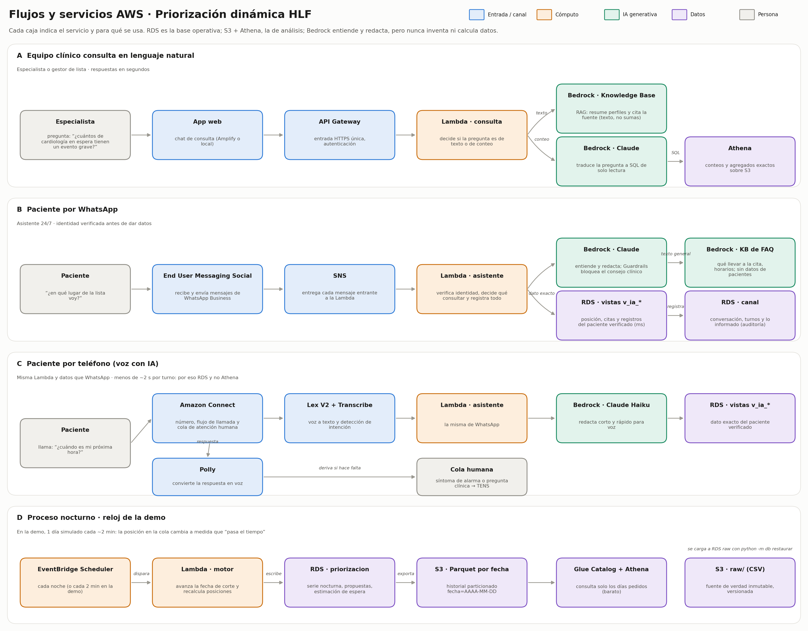
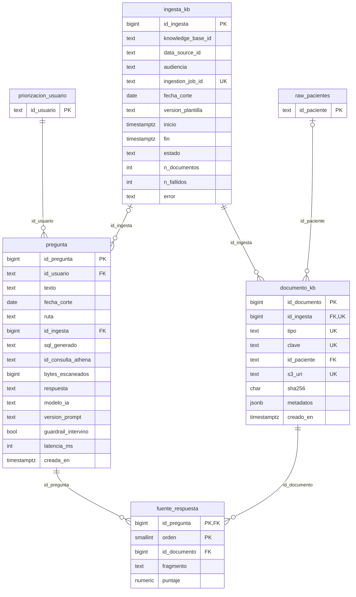

# Feature: Estructura de datos para los flujos de servicios AWS

Este documento conecta el modelo de datos con los cuatro flujos de [docs/diagramas/flujos-aws.pdf](../diagramas/flujos-aws.pdf): consulta del equipo clínico, WhatsApp, teléfono con IA y proceso nocturno o reloj de la demo. Para cada flujo indica qué tablas, vistas y archivos de S3 lee o escribe.

Agrega tres piezas a lo definido en [F0001](F0001-subida-datos-aws.md) (`raw`) y [F0002](F0002-modelo-datos-canales.md) (`priorizacion` y `canal`):

- **Reloj de la demo** (`priorizacion.reloj`): una fecha de corte única para toda la base, real o simulada.
- **Esquema `consulta`**: los documentos de las Knowledge Bases de Bedrock y la trazabilidad de cada pregunta del equipo clínico.
- **Capa S3 + Athena** (`db/athena.py`): `raw` como Parquet tipado y el historial nocturno particionado por fecha, para conteos y agregados exactos.



## Dónde vive cada dato

| Dónde | Qué | Por qué ahí |
|---|---|---|
| **RDS PostgreSQL** | `raw`, `priorizacion`, `canal`, `consulta` | Transacciones, llaves foráneas, triggers de auditoría y respuestas en milisegundos (bandeja clínica, WhatsApp, voz) |
| **S3 + Athena** | `hlf_raw` (copia de `raw` en Parquet) y `hlf_historial` (serie nocturna y estimación de espera, por fecha) | Conteos y agregados exactos sobre todo el historial, sin depender de que RDS esté encendida; se paga por consulta |
| **S3 `kb/` + Bedrock Knowledge Base** | Perfiles de paciente, resúmenes, diccionario y FAQ, como documentos | Búsqueda semántica de texto (RAG). Nunca para contar ni para el dato de un paciente en el canal |
| **S3 (archivos)** | CSV originales, exámenes externos y grabaciones | Copia inmutable y archivos binarios. RDS guarda solo la URI y el sha256 |

## Mapa: flujo → estructura

| Flujo | Lee | Escribe |
|---|---|---|
| **A · Equipo clínico consulta** | `consulta.v_kb_vigente`, Knowledge Base del equipo, `hlf_raw.*` y `hlf_historial.*` en Athena | `consulta.pregunta`, `consulta.fuente_respuesta` |
| **A · Lambda de preparación** | `raw.*` (hasta la fecha de corte) | S3 `kb/`, `consulta.ingesta_kb`, `consulta.documento_kb` |
| **B · WhatsApp** | `canal.v_ia_*` (paciente verificado, a la fecha de corte), Knowledge Base del paciente (solo FAQ) | `canal.conversacion`, `verificacion_identidad`, `turno`, `divulgacion`, `mensaje_paciente`, `evidencia_externa`, `derivacion_humana` |
| **C · Teléfono** | Igual que WhatsApp | Igual que WhatsApp, más `conversacion.uri_grabacion` si hay consentimiento |
| **D · Reloj o proceso nocturno** | `priorizacion.reloj`, `raw.*` | `priorizacion.serie_nocturna`, `propuesta_prioridad`, `estimacion_espera`; S3 `historial/…/fecha=…/` |

## Reloj de la demo (flujo D)

`priorizacion.reloj` tiene una sola fila. En modo `real`, la fecha de corte es hoy. En modo `demo`, es una fecha simulada que avanza en cada *tick*.

- `priorizacion.fecha_corte()` devuelve la fecha vigente. Es `SECURITY DEFINER`, así que el rol del asistente la usa sin poder leer `priorizacion`.
- `priorizacion.avanzar_reloj(dias)` la adelanta y devuelve la nueva fecha. En modo real no hace nada y devuelve NULL.
- **Respetan la fecha de corte:** `v_prioridad_vigente` (solo decisiones hasta esa fecha), las tres vistas `v_ia_*` (nada posterior; una cita histórica posterior aparece como próxima y `programada`), `consulta.pregunta.fecha_corte` y `consulta.ingesta_kb.fecha_corte`.

Tick de la demo (EventBridge Scheduler → Lambda, cada ~2 minutos):

```sql
SELECT priorizacion.avanzar_reloj();          -- 1. el día siguiente (dias_por_tick)
-- 2. el motor evalúa las solicitudes a priorizacion.fecha_corte() y escribe serie_nocturna y estimacion_espera
-- 3. python -m db athena exportar --desde <fecha> --hasta <fecha>   (partición de esa noche en S3)
```

Desde la línea de comandos:

```bash
python -m db reloj --demo 2026-06-01 --dias-por-tick 1   # entra en modo demo
python -m db reloj --avanzar                              # un tick
python -m db reloj                                        # muestra modo y fecha de corte
python -m db reloj --real                                 # vuelve a la fecha real
```

> **Límite del dataset:** `raw.lista_espera.estado` es el estado **final** (atendido, fallecido…) y no trae fecha de egreso. Con el reloj en el pasado, una solicitud ya atendida sigue mostrándose con ese estado. El motor calcula la cola con sus propias reglas a la fecha de corte; el asistente informa la posición desde `estimacion_espera`, no desde ese campo.

## Esquema `consulta`

Trazabilidad del flujo A. Cumple el principio rector del proyecto: si se usa un LLM, debe citar la fuente de lo que dice.

| Tabla | Grano (1 fila =) | Llave | Notas |
|---|---|---|---|
| ingesta_kb | una generación y sincronización de una Knowledge Base | PK `id_ingesta`, UNIQUE `ingestion_job_id` | Guarda la `fecha_corte` de los datos usados. Una sola ingesta en curso por KB |
| documento_kb | un documento subido a S3 `kb/` | PK `id_documento`, UNIQUE (`id_ingesta`, `tipo`, `clave`) | Un trigger impide que un perfil de paciente entre a la KB del paciente |
| pregunta | una pregunta del equipo clínico y su respuesta | PK `id_pregunta` | Ruta `texto` (RAG, exige KB) o `conteo` (exige el SQL y el ID de la consulta en Athena). Solo inserciones |
| fuente_respuesta | un fragmento citado en una respuesta | PK (`id_pregunta`, `orden`) | FK al documento exacto. Solo inserciones |
| v_kb_vigente (vista) | una Knowledge Base | — | Última ingesta completa: la que usa la Lambda de consulta |

**Dos Knowledge Bases separadas.** La del equipo clínico tiene los perfiles de los 500 pacientes, resúmenes y el diccionario. La del paciente tiene solo textos generales (`faq_paciente`). Así una búsqueda en WhatsApp o en una llamada no puede devolver el perfil de otro paciente.

### Diagrama con columnas



Las entidades con prefijo (`raw_…`, `priorizacion_…`) son de otro esquema y se muestran solo con su llave.

### Columnas por tabla

Llave: **PK** primaria, **FK** foránea, **UK** única. Nulo = sí: la columna admite NULL. Los valores permitidos salen de los `CHECK` del DDL.

#### `consulta.ingesta_kb`

Una generación de documentos y su sincronización con una Knowledge Base de Bedrock.

| Columna | Tipo | Nulo | Llave | Descripción |
|---|---|---|---|---|
| id_ingesta | bigint | no | PK | Identificador. Autogenerado (identity) |
| knowledge_base_id | text | no |  | ID de la Knowledge Base en Bedrock |
| data_source_id | text | no |  | Fuente de datos S3 de esa KB |
| audiencia | text | no |  | Para quién es la KB. Valores: `equipo_clinico`, `paciente` |
| ingestion_job_id | text | sí | UK | ID de StartIngestionJob; NULL mientras se preparan los documentos |
| fecha_corte | date | no |  | Datos usados hasta esta fecha: en la demo no se indexa el futuro |
| version_plantilla | text | no |  | Versión del generador de perfiles y resúmenes |
| inicio | timestamp with time zone | no |  | Inicio. Por defecto: `now()` |
| fin | timestamp with time zone | sí |  | Término |
| estado | text | no |  | Estado. Valores: `preparando`, `sincronizando`, `completa`, `fallida`. Por defecto: `'preparando'` |
| n_documentos | integer | sí |  | Documentos sincronizados. Regla: ≥ 0 |
| n_fallidos | integer | sí |  | Documentos que fallaron. Regla: ≥ 0 |
| error | text | sí |  | Último error |

**Reglas:** Una sola ingesta en curso por KB (índice único parcial); `completa`/`fallida` si y solo si hay `fin`; `sincronizando`/`completa` exigen `ingestion_job_id`.

#### `consulta.documento_kb`

Un documento de la Knowledge Base: qué es, dónde está en S3 y con qué metadatos.

| Columna | Tipo | Nulo | Llave | Descripción |
|---|---|---|---|---|
| id_documento | bigint | no | PK | Identificador. Autogenerado (identity) |
| id_ingesta | bigint | no | FK, UK | Ingesta en que se generó → `consulta.ingesta_kb` |
| tipo | text | no | UK | Qué documento es. Valores: `perfil_paciente`, `resumen_especialidad`, `resumen_box_mes`, `diccionario`, `faq_paciente` |
| clave | text | no | UK | id_paciente, especialidad, `BOX-01/2026-06`, etc. |
| id_paciente | text | sí | FK | Paciente, solo en perfiles → `raw.pacientes` |
| s3_uri | text | no | UK | Ubicación en S3 kb/ |
| sha256 | character(64) | no |  | Hash del contenido |
| metadatos | jsonb | no |  | metadataAttributes de Bedrock para filtrar (especialidad, estado, comuna…). Por defecto: `'{}'` |
| creado_en | timestamp with time zone | no |  | Alta. Por defecto: `now()` |

**Reglas:** UNIQUE (`id_ingesta`, `tipo`, `clave`) y (`id_ingesta`, `s3_uri`); `id_paciente` obligatorio si y solo si es `perfil_paciente`; Trigger: la KB del paciente solo admite `faq_paciente`; un perfil nunca llega al paciente.

#### `consulta.pregunta`

Una pregunta del equipo clínico, su ruta (RAG o Athena) y la respuesta entregada.

| Columna | Tipo | Nulo | Llave | Descripción |
|---|---|---|---|---|
| id_pregunta | bigint | no | PK | Identificador. Autogenerado (identity) |
| id_usuario | text | no | FK | Quién preguntó → `priorizacion.usuario` |
| texto | text | no |  | La pregunta |
| fecha_corte | date | no |  | Fecha de corte vigente al preguntar. Por defecto: `priorizacion.fecha_corte()` |
| ruta | text | no |  | Cómo se respondió. Valores: `texto`, `conteo`, `rechazada` |
| id_ingesta | bigint | sí | FK | KB usada (ruta texto) → `consulta.ingesta_kb` |
| sql_generado | text | sí |  | SQL de solo lectura que generó Claude (ruta conteo) |
| id_consulta_athena | text | sí |  | QueryExecutionId de Athena |
| bytes_escaneados | bigint | sí |  | Datos leídos por Athena (costo). Regla: ≥ 0 |
| respuesta | text | no |  | Respuesta entregada |
| modelo_ia | text | no |  | Modelo usado |
| version_prompt | text | no |  | Versión del prompt |
| guardrail_intervino | boolean | no |  | Guardrails bloqueó o modificó la respuesta. Por defecto: `false` |
| latencia_ms | integer | sí |  | Tiempo total de respuesta. Regla: ≥ 0 |
| creada_en | timestamp with time zone | no |  | Momento. Por defecto: `now()` |

**Reglas:** Ruta `texto` exige `id_ingesta`; Ruta `conteo` si y solo si hay `sql_generado` e `id_consulta_athena`; Solo inserciones (trigger).

#### `consulta.fuente_respuesta`

Fragmento de un documento de la KB citado en una respuesta.

| Columna | Tipo | Nulo | Llave | Descripción |
|---|---|---|---|---|
| id_pregunta | bigint | no | PK, FK | Pregunta → `consulta.pregunta` |
| orden | smallint | no | PK | Orden de la cita. Regla: ≥ 0 |
| id_documento | bigint | no | FK | Documento citado → `consulta.documento_kb` |
| fragmento | text | no |  | Texto recuperado que respalda la respuesta |
| puntaje | numeric(6,5) | sí |  | Relevancia del fragmento (0 a 1) |

**Reglas:** Solo inserciones (trigger).

#### `consulta.v_kb_vigente` (vista)

Última sincronización completa de cada Knowledge Base.

| Columna | Tipo |
|---|---|
| knowledge_base_id | text |
| audiencia | text |
| id_ingesta | bigint |
| fecha_corte | date |
| sincronizada_en | timestamptz |
| n_documentos | int |

## Capa S3 + Athena

`python -m db athena publicar` convierte `raw` a Parquet con los mismos conversores y validaciones que la carga a RDS. Los tipos quedan exactos: fechas como `date` y `mediciones.valor` como `decimal(12,3)`, nunca `float`. Luego sube los archivos a S3, crea las tablas en Athena y verifica. Si un archivo no cambió (mismo sha256), no lo vuelve a subir.

### Organización del bucket

```
s3://<HLF_S3_BUCKET>/
├── hlf/csv/<archivo>.csv                                   CSV originales (versionado del bucket)
├── hlf/parquet/<tabla>/<tabla>.parquet                     raw en Parquet: LOCATION de hlf_raw.<tabla>
├── hlf/parquet/_manifiesto.json                            filas por tabla y sha256 de cada CSV y Parquet
├── hlf/historial/<tabla>/fecha=AAAA-MM-DD/<tabla>.parquet  una partición por noche (serie_nocturna, estimacion_espera)
├── hlf/kb/equipo/…  y  hlf/kb/paciente/…                   documentos de cada Knowledge Base + <doc>.metadata.json
└── athena-resultados/                                      resultados de Athena (se borran a los 7 días)
```

Los exámenes externos y las grabaciones van en otro prefijo o bucket, con acceso más restringido. Se registran en `canal.evidencia_externa.uri_archivo` y `canal.conversacion.uri_grabacion`.

### Tablas en Athena (Glue Data Catalog)

| Base | Tablas | Origen | Partición |
|---|---|---|---|
| `hlf_raw` | las 7 de `raw` | `python -m db athena publicar` | — |
| `hlf_historial` | `serie_nocturna`, `estimacion_espera` | `python -m db athena exportar` (desde RDS) | `fecha`, con *partition projection*: Athena encuentra cada noche nueva sin `MSCK REPAIR` ni crawlers |

El historial incluye `especialidad` y `prioridad_inicial` copiadas de `raw.lista_espera`. Es una capa de análisis, así que se evita un join en cada consulta. En RDS esas columnas no se duplican.

### Consultas exactas

- **Parametrizadas:** `?` en el SQL y valores en `ExecutionParameters`, convertidos a literales con su tipo (`'texto'` escapado, `DATE '2026-06-01'`). Nunca se arma SQL concatenando lo que escribe el usuario.
- **Resultados tipados:** `Athena.ejecutar()` devuelve `int`, `Decimal`, `date` o `bool` según el tipo de cada columna, no texto.
- **Solo lectura:** `consultar` rechaza todo lo que no sea `SELECT`, `WITH`, `SHOW`, `DESCRIBE` o `EXPLAIN`. Esto también debe exigirlo el rol IAM de la Lambda de consulta.
- **Costo acotado:** el workgroup impone su configuración, cifra los resultados y corta toda consulta que escanee más de 1 GB.

```bash
python -m db athena consultar "SELECT especialidad, count(*) AS n FROM hlf_raw.lista_espera
  WHERE estado = ? GROUP BY 1 ORDER BY 2 DESC" -p en_espera

python -m db athena consultar "SELECT fecha, posicion_dinamica, total_cola FROM hlf_historial.serie_nocturna
  WHERE id_solicitud = ? AND fecha BETWEEN ? AND ? ORDER BY fecha" -p IC-HLF-00001 -p 2026-06-01 -p 2026-06-30
```

Desde la línea de comandos, `-p` pasa texto. Desde Python, `Athena.ejecutar(sql, [date(...), 3])` respeta el tipo de cada valor.

## Roles

| Rol | Para qué | Permisos |
|---|---|---|
| `hlf_preparacion_kb` | Lambda de preparación de documentos | Lee `raw`. Registra ingestas y documentos |
| `hlf_consulta_ia` | Lambda de consulta del equipo clínico | Lee `v_kb_vigente` y `documento_kb`. Registra preguntas y fuentes |
| `hlf_app`, `hlf_asistente_ia`, `hlf_lectura_raw` | Ver [F0002](F0002-modelo-datos-canales.md#roles) | Sin cambios. `hlf_app` además lee `consulta` |

En AWS cada Lambda tiene además un rol IAM: S3 solo en sus prefijos, Athena solo en el workgroup `hlf-priorizacion` y Bedrock solo en su Knowledge Base y su modelo.

## Comandos

```bash
bash db/infra/crear_s3_athena.sh          # bucket privado, versionado y cifrado + workgroup con límite de costo
python -m db restaurar                    # RDS: raw → priorizacion → canal → consulta, carga y verificación
python -m db permisos                     # roles de la base, incluidos los del flujo A
python -m db athena publicar              # raw a S3 + tablas en Athena + verificación
python -m db athena exportar              # historial nocturno de RDS a S3 hasta la fecha de corte
python -m db athena verificar             # conteos y huérfanos en Athena contra el manifiesto
python -m db reloj --demo 2026-06-01      # reloj de la demo
```

Variables: `HLF_S3_BUCKET` (obligatoria), `HLF_S3_PREFIJO` (por defecto `hlf`), `HLF_ATHENA_WORKGROUP` (`hlf-priorizacion`), `HLF_ATHENA_DB` (`hlf`, de donde salen `hlf_raw` y `hlf_historial`) y `AWS_REGION`. Requiere `boto3` y `pyarrow`.

## Probado

- **PostgreSQL 16 local** (`tests/test_db.py`, 16 pruebas de integración):
  - el reloj en modo real y demo;
  - las vistas del asistente no muestran eventos posteriores a la fecha de corte, y la posición cambia al avanzar el reloj;
  - el rol del asistente usa la fecha de corte sin poder leer `priorizacion`;
  - la KB del paciente rechaza perfiles;
  - una pregunta de conteo sin SQL, o de texto sin KB, se rechaza;
  - no se puede editar una pregunta.
- **Capa Athena con S3 y Athena simulados** (`tests/test_athena.py`, 16 pruebas): Parquet con tipos exactos, subida idempotente, DDL con partition projection, parámetros, resultados tipados y paginados, rechazo de SQL de escritura y exportación del historial desde PostgreSQL.
- **DuckDB sobre los Parquet generados:** el mismo SQL de `verificar` da conteos correctos y 0 huérfanos, `valor` se lee como `DECIMAL(12,3)` y el historial particionado se filtra por fecha.

**No probado contra AWS real:** esta máquina no tiene credenciales. `crear_s3_athena.sh` solo se revisó en sintaxis. Falta correr `publicar` y `verificar` en la cuenta del hackatón.

## Pendientes

- **Lambdas:** preparación de documentos de la KB, consulta del equipo clínico, asistente (WhatsApp y voz) y tick del reloj. La base y la capa de datos ya están; falta el código de cada handler.
- **Motor en RDS:** el tick del reloj necesita que `priorizacion/registro.py` y `nocturno.py` escriban en PostgreSQL (hoy usan SQLite). Recién entonces `athena exportar` tendrá historial real.
- **Método de `estimacion_espera`** (ver F0002).
- **Re-sincronizar la KB en la demo:** sincronizar los perfiles en cada tick tarda minutos. Para la demo conviene generar la KB una vez a la fecha inicial del reloj y responder lo que dependa de la fecha (posición, citas) siempre desde RDS o Athena.
- **Lake Formation:** con datos reales del HLF, usar permisos por columna y por fila en `hlf_raw` en vez de acceso a tablas completas.
