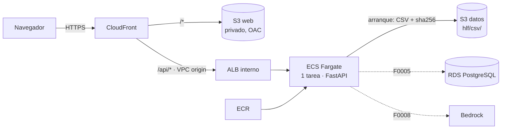

# F0004 · Despliegue del frontend y el backend en AWS

**Estado:** Hecha (desplegada en `demo`) · **Depende de:** F0003 · **Tamaño:** L

## Objetivo

Publicar la app (frontend React y API FastAPI) en AWS bajo una sola URL HTTPS, con infraestructura como código reproducible y un despliegue de un comando, sin exponer el backend a internet y sin poner datos del hospital en imágenes ni en el repositorio.

## Qué existe hoy

- `api/main.py`: FastAPI. Al arrancar carga los CSV en memoria (`Repositorio.desde_csv()`), abre el registro SQLite y, si no hay serie nocturna, la calcula completa (puede tardar minutos). Si existe `web/dist`, también sirve el frontend.
- `web/`: React + Vite. Llama a la API con rutas relativas `/api/...`; en desarrollo Vite redirige `/api` al puerto 8000 (`web/vite.config.ts`).
- `db/`: carga de RDS (F0001) y capa S3 + Athena (F0003). `db/infra/crear_rds.sh` y `db/infra/crear_s3_athena.sh` crean RDS, el bucket y el workgroup con AWS CLI.
- No hay Dockerfile, IaC ni CI/CD. `requirements.txt` mezcla ejecución, tests y notebooks.

**Restricción de diseño:** hasta F0005 la API guarda estado en memoria y en SQLite. Por eso corre como **una sola tarea**, y su SQLite se pierde al reiniciar. Es aceptable para la demo con datos sintéticos; F0005 lo elimina.

## Alcance

**Entra:** imagen Docker del backend, infraestructura CDK (red, datos, backend, frontend), descarga de los CSV desde S3 al arrancar, pipeline de CI y despliegue manual desde GitHub Actions, y documentación de operación.

**No entra:** dominio propio y certificado (se usa el dominio de CloudFront), autenticación (F0007), persistencia en RDS (F0005), alarmas y WAF (F0013).

## Diseño



| Decisión | Elección | Por qué |
|---|---|---|
| Cómputo del backend | **ECS Fargate** (1 tarea, 1 vCPU, 3 GB) | La API carga el dataset en memoria y recalcula al arrancar: Lambda tendría arranques en frío de minutos. Fargate con un ALB interno permite dejar el backend privado detrás de CloudFront, y escala por tareas cuando F0005 quite el estado local |
| Exposición | **ALB interno + CloudFront VPC origin** | El backend no tiene IP pública ni balanceador público: solo CloudFront llega a él. El security group del ALB solo acepta la *prefix list* administrada `com.amazonaws.global.cloudfront.origin-facing` |
| Frontend | **S3 privado + CloudFront con OAC** | Archivos estáticos con caché global. El bucket no es público: solo CloudFront lo lee |
| Mismo dominio para web y API | `/api/*` → ALB, el resto → S3 | Igual que el proxy de Vite: no hace falta CORS ni cambiar el frontend |
| Rutas de la SPA | CloudFront Function en el comportamiento por defecto (`/bandeja` → `/index.html`) | Las páginas de error a nivel de distribución también reescribirían los 404 de la API |
| IaC | **AWS CDK en Python** | El equipo ya trabaja en Python. Los stacks se prueban con `aws_cdk.assertions`. Reemplaza a los scripts `crear_*.sh`, que quedan como alternativa manual |
| NAT Gateway | **0 en la demo** (tareas en subred pública con IP pública, SG cerrado a todo salvo el ALB) | Ahorra ~US$ 32 al mes. El entorno con datos reales usa `nat_gateways: 1` y tareas en subred privada |
| Datos en el contenedor | El `entrypoint` descarga los CSV de S3 y verifica el sha256 contra el manifiesto | La imagen no lleva datos del hospital. Se reutiliza lo publicado con `python -m db athena publicar` |
| Despliegues | `min_healthy_percent=0`, circuit breaker con rollback | Con una sola tarea con estado no puede haber dos versiones escribiendo a la vez. F0005 lo cambia a despliegue sin corte |

**Timeouts:** CloudFront espera hasta 60 s por respuesta del origen y el ALB 120 s. `POST /api/nocturno/ejecutar` puede tardar más: desde F0006 responde de inmediato (202) y corre en segundo plano.

## Cambios por carpeta

```
docker/backend/Dockerfile          python:3.11-slim, usuario sin privilegios, solo requirements/base.txt
docker/backend/entrypoint.sh       descarga y verifica los CSV si falta el dataset; si no hay datos, no arranca
.dockerignore                      excluye data/, *.csv, web/, infra/, docs/, notebooks/, tests/
.gitattributes                     *.sh y Dockerfile siempre con LF (core.autocrlf=true en Windows)
requirements/base.txt, dev.txt, notebooks.txt   requirements.txt queda como "-r" de dev + notebooks
db/athena.py, db/__main__.py       función y comando `athena descargar`
infra/
  app.py, cdk.json, requirements.txt, README.md
  config/entornos.py               dev y demo: región, cpu/memoria, nat_gateways, crear_rds, borrar al destruir
  stacks/red.py                    VPC 2 AZ (pública, aislada [, privada]), endpoint S3, SG del ALB, backend y RDS
  stacks/datos.py                  bucket de datos (privado, versionado, cifrado, ciclo de vida), workgroup de
                                   Athena con límite de 1 GB, RDS PostgreSQL 16 opcional (subred aislada)
  stacks/backend.py                cluster ECS, imagen desde docker/backend, tarea, servicio, ALB interno, logs
  stacks/frontend.py               bucket web, CloudFront (S3 con OAC + VPC origin), función SPA, cabeceras de
                                   seguridad, regla de SG desde la prefix list de CloudFront, despliegue de web/dist
  tests/test_stacks.py             ALB interno, bucket sin acceso público, /api/* sin caché, RDS cifrada, etc.
.github/workflows/ci.yml           pytest (sin base), tsc + vite build, cdk synth y pruebas de infra
.github/workflows/deploy.yml       manual: OIDC → build web → cdk deploy --all → muestra la URL
```

## Tareas

1. Separar `requirements/` (base, dev, notebooks) y verificar que `pip install -r requirements.txt` sigue funcionando.
2. Agregar `python -m db athena descargar` con verificación de sha256, y su prueba con S3 simulado.
3. Escribir el Dockerfile, el `entrypoint.sh`, `.dockerignore` y `.gitattributes`. Construir la imagen y correrla en local con el dataset montado como volumen.
4. Crear `infra/` con `config/` y el stack de red. `cdk synth` sin errores.
5. Stack de datos: bucket, workgroup y RDS opcional. Exportar el nombre del bucket, el workgroup y el endpoint.
6. Stack de backend: imagen, tarea (variables `HLF_S3_BUCKET`, `HLF_ATHENA_WORKGROUP`, `HLF_DB_SECRET_ID`, `HLF_DB_HOST`, `LLM_PROVEEDOR`), servicio y ALB interno con health check en `/api/meta` y gracia de 6 minutos.
7. Stack de frontend: bucket web, OAC, VPC origin, función SPA, comportamiento `/api/*` sin caché y despliegue de `web/dist`.
8. Pruebas de infraestructura (`infra/tests/`).
9. Workflows de CI y despliegue. El despliegue usa un rol IAM asumido por OIDC, sin llaves de acceso guardadas en GitHub.
10. Primer despliegue en la cuenta del hackatón: `python -m db athena publicar`, luego `cdk deploy --all`, y prueba de las seis vistas desde la URL de CloudFront.
11. Documentar la operación en `infra/README.md`: desplegar, ver logs, reiniciar y destruir.

## Criterios de aceptación

- `cdk deploy --all -c entorno=demo` crea todo desde una cuenta vacía y entrega una URL `https://xxxx.cloudfront.net`.
- Las seis vistas (bandeja, ficha, agenda, canal, KPIs, nocturno) cargan desde esa URL.
- El ALB no tiene IP pública. Una petición directa al ALB desde internet no responde.
- El bucket web y el de datos rechazan el acceso público. `aws s3 ls` sin credenciales falla.
- La imagen no contiene datos del proyecto (`docker run --rm --entrypoint sh imagen -c 'find /app -name "*.csv"'` no devuelve nada).
- `cdk destroy --all -c entorno=dev` deja la cuenta sin recursos del proyecto. En `demo`, los buckets y RDS se conservan: tienen `RETAIN` o snapshot.
- CI corre en cada PR y falla si fallan los tests, el build del frontend o `cdk synth`.

## Pruebas

- **Automáticas:** `tests/test_athena.py` (descarga con S3 simulado), `infra/tests/` (templates sintetizados) y CI.
- **Manuales:** `docker build` y `docker run` en local; después del despliegue, recorrer las vistas, registrar una decisión clínica y ver los logs en CloudWatch.

## Despliegue realizado

Desplegado el 2026-10-15 en la cuenta del hackatón (`us-east-1`, entorno `demo`): **https://d27qviveikaea2.cloudfront.net**

| Paso | Resultado |
|---|---|
| `cdk bootstrap` | Cuenta preparada (stack `CDKToolkit`) |
| `HlfDemo-Red`, `HlfDemo-Datos` | VPC, bucket, workgroup y RDS PostgreSQL 16 creados (~8 min, la mayor parte RDS) |
| `python -m db athena publicar` | 6 CSV + 7 Parquet en S3, tablas en Athena, verificación en verde contra Athena real |
| `HlfDemo-Backend` | Imagen construida y subida a ECR. La tarea descargó y verificó los CSV desde S3 y arrancó en ~11 s (4 min 19 s de despliegue) |
| `HlfDemo-Frontend` | CloudFront con VPC origin (12 min 20 s; el VPC origin es lo más lento) |
| Carga de RDS por tarea ECS (`python -m db restaurar` y `permisos`) | 4 esquemas, 6.738 filas, verificación en verde dentro de la VPC |

## Probado

- **Criterios de aceptación verificados en AWS:**
  - Las 8 rutas de la SPA (incluidas `/ficha/IC-HLF-00001` y la raíz) devuelven la app; las 7 rutas de la API responden 200 por CloudFront, y una ruta inexistente de la API devuelve el 404 en JSON (no `index.html`).
  - El ALB es `internal`: una petición directa a su DNS desde internet no responde.
  - Los buckets web y de datos responden 403 sin credenciales.
  - HTTP redirige a HTTPS; los archivos de Vite salen con `max-age=31536000, immutable`, HSTS y `nosniff`.
  - Una decisión clínica registrada por CloudFront (`POST /api/solicitudes/{id}/decisiones`) cambia la prioridad vigente y recalcula la cola.
  - La imagen no contiene datos del proyecto (`find /app -name "*.csv"` vacío). Los únicos `.csv` de la imagen son datos de prueba de numpy y scikit-learn en `site-packages`.
- **Local:** la API arranca con solo `requirements/base.txt` (23 s, primer arranque con el cálculo completo); el contenedor arranca con el dataset montado (16 s) y sin datos falla con un mensaje claro.
- **Automáticas:** `infra/tests/test_stacks.py` (22 pruebas sobre los templates de `dev` y `demo`) y `tests/test_athena.py` (descarga verificada: completa, archivo alterado, manifiesto incompleto).

**Pendiente de F0004:**

- **Despliegue desde GitHub Actions:** `deploy.yml` necesita un rol IAM con confianza OIDC en GitHub (`secrets.AWS_DEPLOY_ROLE_ARN`). Falta comprobar si el rol del hackatón (`WSParticipantRole`) permite crearlo. Mientras tanto, se despliega desde una máquina con Docker siguiendo `infra/README.md`.
- **CI sin dataset:** el dataset no se versiona, así que en CI las pruebas que lo necesitan se saltan. Para cubrirlas hace falta un dataset sintético reducido en `data/synthetic/`.

## Riesgos y decisiones abiertas

- ~~**Cuenta del hackatón**~~: CloudFront VPC origins, Fargate y RDS funcionaron en `us-east-1` con el rol `WSParticipantRole`.
- ~~**SG del ALB con VPC origin**~~: la regla desde la prefix list `com.amazonaws.global.cloudfront.origin-facing` bastó.
- **Primer arranque:** en Fargate tardó ~11 s, muy por debajo de la gracia de 6 minutos. Crecerá con datos reales; F0006 lo resuelve precalculando la serie.
- **Estado local** (SQLite y memoria): se pierde al reiniciar la tarea hasta F0005.
