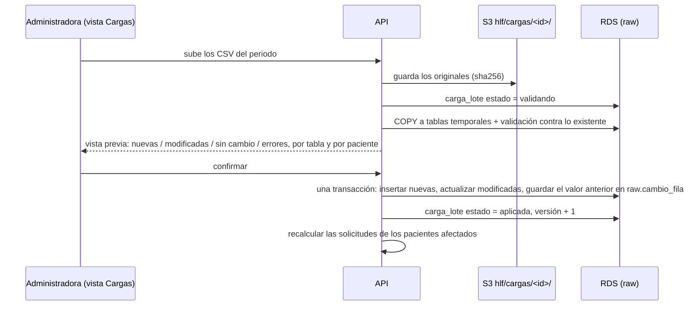

# F0005 · La app usa RDS, con cargas de datos incrementales y versionadas

**Estado:** Hecha (desplegada en `demo`) · **Depende de:** F0004 · **Tamaño:** XL (dos fases: A, persistencia; B, cargas)

## Objetivo

1. **Persistencia (fase A):** conectar la app a las tablas que ya existen en RDS (F0002 y F0003). El motor lee `raw` desde PostgreSQL, y propuestas, decisiones, mensajes y evidencias se guardan en `priorizacion` y `canal`. Con eso, lo que decide la Administradora sobrevive a un reinicio, queda auditado por la base y el backend puede correr en más de una tarea.
2. **Cargas (fase B):** una vista donde la Administradora sube los CSV exportados de cada **nuevo periodo**. La app los valida, muestra qué cambia y, al confirmar, **los suma a lo que ya existe**: un paciente con datos previos recibe la información nueva sobre su historia, no empieza de cero. Cada carga queda versionada, con sus archivos originales y el detalle de lo que agregó o modificó.

## Contexto de uso (definido por el HLF)

- **Una sola usuaria: la Administradora.** Revisa las prioridades propuestas a partir de los nuevos antecedentes, acepta, ajusta o rechaza, valida lo que llega por el canal del paciente y sube las cargas de datos. **Ni médicos ni otro personal usan la plataforma.**
- **Los datos llegan por periodos.** Cada actualización es una exportación de los CSV crudos (los mismos 6 archivos) de un periodo de tiempo nuevo, no la historia completa. Un paciente puede aparecer en varias exportaciones.

## Qué existe hoy

- **Lectura:** `priorizacion/datos.py` → `leer_csv()` arma 6 DataFrames (`pacientes`, `lista`, `eventos`, `mediciones`, `agenda`, `citas`) y `Repositorio` construye las historias en memoria.
- **Escritura:** `priorizacion/registro.py` → clase `Registro` sobre SQLite, con 7 tablas y unos 20 métodos. La API usa sobre todo `decisiones`, `mensajes`, `evidencias`, `guardar_propuesta`, `registrar_decision`, `reemplazar_serie` y `version`.
- **RDS en AWS (desplegada en F0004, cargada y verificada):** `raw` con las 6.738 filas, y `priorizacion`, `canal` y `consulta` vacíos, con sus llaves foráneas, `CHECK`, triggers de auditoría y roles.
- **Carga de datos** (`db/carga.py`): la primera carga usa `COPY`; las siguientes **sincronizan**: dejan `raw` idéntico a los CSV, por lo que **borran las filas que no vienen en los archivos nuevos**. Sirve para reconstruir la base desde la historia completa, **no** para exportaciones por periodo: con ellas se perdería la historia anterior. `raw.carga_lote` registra cada carga (filas y sha256), pero no su periodo, quién la hizo ni qué cambió.
- **Usuarios:** la API recibe el autor en texto libre (`usuario = "equipo_clinico"` en decisiones; `revisado_por = "tens"` en las revisiones del canal). `priorizacion.usuario.rol` solo admite `medico`, `enfermeria`, `tens`, `gestor_lista`, `administrativo` y `sistema`.
- **Archivos de evidencia:** se guardan en el disco local del contenedor (`config.EVIDENCIA_DIR`).
- **Contenedor en AWS:** descarga los CSV de S3 al arrancar y lee desde ahí (`Repositorio.desde_csv()`).
- `api/main.py` tiene 528 líneas con todas las rutas, y usa un `threading.Lock` y un caché en memoria cuya llave es `registro.version()`.

## Alcance

**Entra:**
- Origen de datos PostgreSQL para el motor y registro en PostgreSQL con la misma interfaz que el de SQLite.
- Usuaria única con el rol `administracion`, que es la autora de toda decisión, validación y carga.
- Archivos de evidencia en S3.
- Separar `api/main.py` en routers y permitir varias tareas.
- Cargas incrementales: subida, validación, vista previa de cambios, confirmación, versiones, historial de cambios por fila y recálculo de las solicitudes afectadas.

**No entra:**
- Autenticación (F0007). Mientras tanto, la API registra todo a nombre de la usuaria `administradora` y no hay inicio de sesión.
- Deshacer una carga confirmada. Las versiones y el historial de cambios permiten auditar y corregir con una carga nueva, pero no hay un botón "revertir".
- Borrar datos de `raw` desde la vista.
- Cambios al motor ni a las reglas.

## Diseño

### Fase A · Persistencia

**Dos implementaciones con la misma interfaz**, elegidas por configuración:

| Pieza | Local (se mantiene como respaldo de la demo) | AWS |
|---|---|---|
| Datos fuente | `Repositorio.desde_csv()` | `Repositorio.desde_postgres(conn)`: los mismos 6 DataFrames, leídos de `raw` |
| Registro | `RegistroSQLite` (el actual) | `RegistroPostgres`: esquemas `priorizacion` y `canal` |
| Archivos de evidencia | Disco local | S3 `hlf/canal/evidencias/<id_paciente>/<id>.<ext>`, con sha256 en `canal.evidencia_externa` |
| Arranque del contenedor | Descarga los CSV de S3 | No descarga nada: lee `raw` de RDS |

Se elige con `HLF_DATABASE_URL` o `HLF_DB_SECRET_ID` (las mismas variables de `db/conexion.py`). Sin ellas, la app funciona como hoy.

**Usuaria única:** una migración agrega el rol `administracion` a `priorizacion.usuario` y crea la usuaria `administradora`. La API deja de recibir el autor en el cuerpo de la petición: hasta F0007 toda escritura se registra a nombre de `administradora`, y desde F0007, a nombre de la sesión. En la interfaz desaparecen los campos "usuario" y "revisado por".

**Diferencias que el adaptador debe resolver** (el modelo de F0002 es más estricto que el de SQLite):

| En SQLite | En RDS | Qué hace el adaptador |
|---|---|---|
| `id_evidencia` = `EXT-00001` (COUNT+1) | `bigint identity` | La API devuelve el ID numérico. El frontend no asume prefijos (revisado) |
| Autor en texto libre | `id_usuario` / `revisado_por` FK a `priorizacion.usuario` | Siempre `administradora` hasta F0007 |
| `serie_nocturna` con `especialidad` y `prioridad_inicial` | Se obtienen de `raw.lista_espera` | `serie()` y `serie_resumen()` hacen el join |
| `decision_clinica` admite cualquier combinación | `CHECK decision_coherente` | Validar en la API antes de insertar y devolver 422 con un mensaje claro |
| `version()` = conteos de filas | Varias tareas | Un contador en una tabla de estado que sube con cada escritura **y con cada carga confirmada**. Cada tarea refresca su caché y su repositorio en memoria cuando cambia |

**Varias tareas:** el repositorio en memoria sale de `raw`. Lo que cambia con el uso (evidencias validadas, mensajes y cargas nuevas) se vuelve a aplicar cuando sube la versión. Las transacciones de PostgreSQL reemplazan al `threading.Lock`.

**Routers:** `api/main.py` se separa en `api/rutas/{meta,bandeja,solicitudes,agenda,canal,kpis,nocturno,cargas}.py`, más `api/dependencias.py` (repositorio, registro, caché y usuaria actual) y `api/serializacion.py` (`a_json`). El comportamiento existente no cambia; las pruebas de `tests/test_api.py` lo garantizan.

### Fase B · Cargas incrementales y versionadas



**Regla de combinación** (por llave primaria de cada tabla, la misma que ya usa `db/carga.py`):

| Caso | Qué pasa |
|---|---|
| Fila nueva (llave que no existe) | Se inserta. Ejemplo: los eventos del nuevo periodo de un paciente existente se **suman** a su historia |
| Misma llave, mismos valores | Sin cambio (las exportaciones con solapamiento de fechas no duplican nada) |
| Misma llave, valores distintos | Se actualiza con el valor nuevo y el anterior queda en `raw.cambio_fila`. Ejemplo esperado: `lista_espera.estado` pasa de `en_espera` a `atendido`, o `pacientes.fallecido` a `true` |
| Fila que no viene en la exportación nueva | **Se conserva.** Una exportación por periodo no trae la historia anterior |
| Paciente nuevo | Se crea con todos sus datos |

**Validación antes de confirmar** (nada se escribe en `raw` hasta que la Administradora confirma):

- Cabeceras, tipos y valores permitidos: los mismos conversores y `CHECK` de la carga actual.
- Llaves duplicadas dentro del mismo archivo.
- Integridad contra **lo existente más lo nuevo**: un evento puede referirse a un paciente que vino en una carga anterior.
- Advertencias que no bloquean, pero se muestran: mediciones ya cargadas con otro valor (posible corrección), eventos posteriores a la fecha de defunción, filas fuera del periodo declarado, y cambios en datos maestros del paciente (sexo, comuna, previsión).

**Versiones:** cada carga confirmada es una versión numerada. Guarda:
- el periodo declarado;
- quién la subió y cuándo;
- los archivos originales en S3 (`hlf/cargas/<id_carga>/`, con versionado del bucket);
- el sha256 de cada archivo;
- el resumen por tabla (nuevas, modificadas, sin cambio);
- el detalle fila a fila en `raw.cambio_fila`.

Subir dos veces los mismos archivos se detecta por sha256 y no genera una versión nueva.

**Después de confirmar:**
1. Sube el contador de versión: cada tarea recarga su repositorio en memoria.
2. Se recalculan solo las solicitudes de los pacientes afectados (`nocturno.recalcular_solicitud`), no la historia completa.
3. Las nuevas señales (por ejemplo, una hospitalización del nuevo periodo) aparecen en la bandeja como propuestas para revisar.

### Cambios al modelo de datos (migraciones idempotentes)

| Archivo | Cambio |
|---|---|
| `db/sql/raw/002_cargas_incrementales.sql` | `carga_lote` agrega `version`, `modo` (`inicial`, `incremental`, `reconstruccion`), `periodo_desde`, `periodo_hasta`, `cargado_por`, `estado` (`validando`, `lista`, `aplicada`, `descartada`, `fallida`), `uri_s3`, `resumen` (jsonb) y `advertencias` (jsonb). Las 7 tablas de `raw` agregan `id_carga_alta` e `id_carga_modificacion` (FK a `carga_lote`), para saber qué carga trajo o cambió cada fila. Nueva tabla `raw.cambio_fila` (`id_carga`, `tabla`, `llave` jsonb, `antes` jsonb, `despues` jsonb), solo inserciones |
| `db/sql/priorizacion/002_usuaria_unica.sql` | El `CHECK` de `usuario.rol` admite `administracion`; se crea la usuaria `administradora` |
| `db/sql/priorizacion/002_…` (estado) | Tabla `priorizacion.estado_app` (una fila) con el contador de versión que leen las tareas |

`raw` sigue siendo de solo lectura para la app (rol `hlf_app`). Las cargas usan un rol propio, `hlf_cargas`, con `INSERT` y `UPDATE` sobre `raw`, pero sin `DELETE`.

**`db/carga.py` y la línea de comandos:** el modo incremental pasa a ser la forma normal de agregar datos. `python -m db cargar --incremental --periodo 2026-10-01:2026-12-31 --datos <carpeta>` hace lo mismo que la vista, sin la interfaz. La sincronización actual (`restaurar` y `--reemplazar`) queda solo para **reconstruir** la base desde la historia completa. Su ayuda y el documento F0001 advierten que borra lo que no venga en los archivos.

## Cambios por carpeta

```
db/sql/raw/002_cargas_incrementales.sql      versiones, procedencia por fila, historial de cambios, rol hlf_cargas
db/sql/priorizacion/002_usuaria_unica.sql    rol administracion, usuaria administradora, estado_app
db/carga.py                                   modo incremental (validar → vista previa → aplicar), sin borrar
db/__main__.py                                cargar --incremental --periodo; restaurar advierte que reconstruye
priorizacion/datos.py                         Repositorio.desde_postgres(conn)
priorizacion/registro.py                      protocolo Registro + RegistroSQLite (código actual) + fábrica según config
priorizacion/registro_postgres.py             RegistroPostgres (priorizacion + canal)
priorizacion/archivos.py                      evidencias y cargas: disco local o S3
priorizacion/config.py                        conexión a RDS, bucket, usuaria por defecto
api/main.py                                   solo crea la app e incluye los routers
api/rutas/*.py                                incluye cargas.py: subir, vista previa, confirmar, descartar, historial
api/dependencias.py, api/serializacion.py
web/src/paginas/Cargas.tsx                    subir archivos, vista previa, confirmar, historial de versiones
web/src/paginas/*.tsx                         sin campos "usuario" ni "revisado por"
docker/backend/entrypoint.sh                  con RDS configurada no descarga CSV
infra/stacks/backend.py                       desired_count 2 en demo, despliegue sin corte (min 100 %)
tests/test_registro_postgres.py               la misma batería para las dos implementaciones (parametrizada)
tests/test_carga_incremental.py               combinación por periodos, validación, versiones, historial
```

## Tareas

**Fase A · Persistencia**

1. Definir el protocolo `Registro` a partir de los métodos que usan la API y el motor.
2. Mover el código actual a `RegistroSQLite` sin cambiar su comportamiento. Toda la suite debe seguir pasando.
3. Migración de la usuaria única. La API registra a `administradora` y deja de leer el autor del cuerpo de la petición; se quitan esos campos de la interfaz.
4. Pruebas del protocolo parametrizadas por implementación (SQLite siempre; PostgreSQL si hay `HLF_TEST_DATABASE_URL`).
5. Implementar `RegistroPostgres` hasta que pase la misma batería.
6. `Repositorio.desde_postgres()`, con una prueba de que produce los mismos DataFrames que `desde_csv()` (mismos conteos y tipos).
7. Evidencias en S3 detrás de `priorizacion/archivos.py`.
8. Separar `api/main.py` en routers. `tests/test_api.py` sin cambios debe pasar.
9. Contador de versión compartido y refresco del caché por tarea.
10. Infraestructura: el contenedor deja de descargar CSV con RDS configurada; dos tareas; despliegue sin corte.

**Fase B · Cargas**

11. Migración de cargas incrementales, con verificación de la estructura nueva en `db/verificacion.py`.
12. Modo incremental en `db/carga.py`: validar contra lo existente, vista previa y aplicar sin borrar, con historial de cambios. Pruebas con exportaciones simuladas por periodo (ver Pruebas).
13. Comando `python -m db cargar --incremental`, y advertencia explícita en `restaurar` y `--reemplazar`.
14. API de cargas: subir (archivos a S3 y validación), vista previa, confirmar, descartar e historial de versiones.
15. Vista `Cargas` en el frontend.
16. Recálculo de las solicitudes afectadas al confirmar, y aviso en la bandeja de cuántas propuestas nuevas generó la carga.
17. Migración de la demo en AWS: la RDS ya cargada pasa a ser la versión 1 (modo `inicial`); se despliega y se verifica que la bandeja muestra lo mismo que en local.

## Criterios de aceptación

**Fase A**
- Con RDS configurada, la app no lee CSV ni escribe SQLite. Sin RDS, funciona igual que hoy.
- Una decisión registrada desde la bandeja aparece en `priorizacion.decision_clinica` a nombre de `administradora`, y sigue ahí después de reiniciar o redesplegar el servicio.
- Con dos tareas detrás del ALB, una decisión hecha en una se refleja en la otra en la siguiente petición.
- La bandeja al 2026-10-13 tiene las mismas posiciones y niveles en modo CSV + SQLite que en modo RDS.

**Fase B**
- Al dividir el dataset en dos exportaciones por periodo y cargarlas en orden, `raw` queda **idéntico** a cargar el dataset completo de una vez. Esto prueba que la segunda carga suma y no reemplaza.
- Un paciente con eventos en ambos periodos queda con **todos** sus eventos, y su ficha muestra los del periodo nuevo después de confirmar.
- Una fila que cambia de valor entre exportaciones (por ejemplo, `estado` de `en_espera` a `atendido`) queda con el valor nuevo, y el anterior aparece en `raw.cambio_fila` con la versión que lo cambió.
- La vista previa muestra los conteos exactos de filas nuevas, modificadas y sin cambio antes de confirmar, y descartar no deja ninguna huella en `raw`.
- Volver a subir los mismos archivos no crea una versión nueva.
- Un archivo con un error (tipo inválido, llave duplicada, evento de un paciente inexistente) bloquea la confirmación con el archivo y la línea exactos.
- El historial lista cada versión con su periodo, autora, fecha, conteos y los archivos originales descargables.

## Pruebas

- Batería del protocolo `Registro` sobre ambas implementaciones.
- `tests/test_api.py` contra las dos configuraciones.
- **Cargas por periodo, con el dataset sintético partido por fecha:** dos o tres exportaciones con solapamiento, cambios de estado entre una y otra, paciente nuevo en la segunda y una corrección de medición. Se comparan contra la carga completa.
- Concurrencia: dos procesos registran decisiones a la vez y no se pierde ninguna; dos cargas confirmadas a la vez se serializan (`pg_advisory_lock`).

## Implementado

Desplegado el 2026-10-15 en el entorno `demo` (https://<distribucion>.cloudfront.net).

**Diferencias con el plan:**

| Plan | Implementado | Por qué |
|---|---|---|
| Código de rol `administracion` | Igual. La usuaria es `administradora` (`HLF_USUARIA` permite cambiarla) | — |
| La subida de archivos | JSON con base64 (máx. 20 MB), no `multipart` | Evita una dependencia nueva (`python-multipart`) y sigue el patrón de las evidencias del canal |
| Migración de la demo (tarea 17) | La API **aplica las migraciones al arrancar** (idempotentes, bajo `pg_advisory_lock`) | Una versión nueva nunca corre sobre un esquema viejo, y no hace falta una tarea manual previa al despliegue |
| `carga_lote.filas` | En una versión aplicada guarda los **totales de `raw`** tras aplicarla; las filas de cada archivo quedan en `resumen` | `python -m db verificar` compara contra totales, no contra el tamaño de una exportación parcial |
| Fecha de referencia | Con RDS, "hoy" es la última fecha con datos (`fecha_max_datos`) en vez del 2026-10-13 fijo | Si no, una carga de un periodo posterior no se vería en la bandeja. F0006 la reemplaza por el reloj |
| Aviso en la bandeja de las propuestas nuevas (tarea 16) | El aviso está en la vista Cargas al confirmar ("N solicitudes recalculadas y M propuestas para revisar", con enlace a la bandeja) | La bandeja ya muestra las propuestas nuevas ordenadas por alerta y nivel |

**Archivos principales:** `priorizacion/registro.py` (protocolo + SQLite), `priorizacion/registro_postgres.py`, `priorizacion/datos.py` (`leer_postgres`, `Repositorio.desde_postgres`, `Repositorio.crear`), `priorizacion/archivos.py`, `priorizacion/nocturno.py` (`recalcular_solicitudes`), `api/estado.py`, `api/rutas/*.py` (8 routers, incluido `cargas.py`), `db/carga.py` (modo incremental), `db/sql/raw/002_cargas_incrementales.sql`, `db/sql/priorizacion/002_usuaria_unica.sql`, `web/src/paginas/Cargas.tsx`, `docker/backend/entrypoint.sh`, `infra/stacks/backend.py`.

## Probado

- **Automáticas** (`python -m pytest` con PostgreSQL 16): 77 pruebas en verde.
  - `tests/test_carga_incremental.py` (11):
    - dos exportaciones por periodo, con solapamiento de 30 días, cambios de estado y pacientes nuevos, dejan `raw` **idéntico** a la carga completa;
    - la historia previa se conserva;
    - los cambios quedan en `raw.cambio_fila` con su procedencia;
    - la vista previa es exacta y descartar no deja huella;
    - los mismos archivos no crean otra versión;
    - los errores indican archivo y línea;
    - hay advertencias de corrección y de filas fuera de periodo;
    - el rol `hlf_cargas` no puede borrar;
    - la verificación queda en verde después de sumar un periodo.
  - `tests/test_persistencia_rds.py` (5):
    - mismas columnas y tipos que SQLite;
    - una decisión persiste y otra instancia la ve;
    - la bandeja es idéntica en modo local y en RDS;
    - 20 decisiones concurrentes desde dos procesos, sin pérdidas;
    - la base rechaza una decisión sin motivo.
  - `tests/test_api.py` pasa **sin cambios** en modo local y en modo RDS.
- **De punta a punta, local:** API en modo RDS (no crea SQLite).
  - Una carga con una paciente nueva, un evento grave nuevo y un cambio de estado se aplicó como versión 2: IC-HLF-00028 pasó de baja a alta por la hospitalización nueva, y la paciente nueva entró a la bandeja en alta con alerta.
  - Dos instancias de la API sobre la misma base: una decisión hecha en una aparece en la otra en la siguiente petición.
- **Actualización sobre una base en el estado previo** (solo las migraciones `001`, como estaba la RDS de AWS): la API migró sola, la carga existente quedó como versión 1 (`inicial`) y la verificación salió en verde.
- **En AWS (`demo`):**
  - 2 tareas en RDS. La primera migró y calculó la serie; la segunda arrancó en 3 s.
  - Una decisión registrada por CloudFront **sobrevivió a un redespliegue forzado** y la ven las dos tareas nuevas.
  - Vista previa de una carga con los originales guardados en S3 (`hlf/cargas/<id>/`) y descarte sin huella en `raw`.

**Datos que quedaron en la demo de AWS:** una decisión de prueba (`IC-HLF-00417`, motivo "Prueba de persistencia F0005") y la carga 2 descartada. Se pueden dejar como ejemplo o limpiar con una reconstrucción.

## Pendiente

- **Usuario de base con mínimo privilegio:** la API se conecta con el usuario maestro de RDS (el secreto que crea CDK). Los roles `hlf_app` y `hlf_cargas` existen, pero falta un usuario de login con esos roles y su propio secreto. Queda para F0013.
- **`athena publicar` desde RDS:** hoy publica los CSV locales. Con cargas incrementales debe publicar desde `raw` (F0006).
- **Confirmar con el HLF** que los identificadores no cambian entre exportaciones (ver Riesgos).

## Impacto en otros planes

- **F0007 (autenticación):** con una sola usuaria, la matriz de roles se reduce a un rol (`administracion`) y sin registro abierto. El plan se simplifica cuando se implemente.
- **F0006 (proceso nocturno):** el recálculo después de una carga reutiliza `recalcular_solicitud`. El proceso nocturno sigue siendo el responsable del recálculo completo y del historial en Athena.
- **F0003 (Athena):** `athena publicar` hoy lee los CSV locales. Con cargas incrementales debe poder publicar desde `raw` en RDS. Queda como tarea de F0006, junto con `athena exportar`.

## Riesgos y decisiones abiertas

- **Identificadores estables entre exportaciones:** la combinación supone que `id_paciente`, `id_solicitud`, `id_evento` e `id_cita` son los mismos en cada exportación del HLF. **Confirmar con el HLF.** Si cambian, hace falta una llave de cruce (por ejemplo, RUT cifrado), que el dataset sintético no trae.
- **Estados que retroceden:** si una exportación nueva trae una solicitud `en_espera` que antes estaba `atendido`, ¿es una corrección o un error? Propuesta: aplicarlo y marcarlo como advertencia destacada en la vista previa.
- **Responsabilidad clínica:** el principio del proyecto es que el equipo clínico decide. Con la Administradora como única revisora, conviene dejar por escrito con el HLF qué criterios clínicos aplica y quién responde por ellos.
- **Rendimiento:** la serie nocturna completa tiene unas 150 mil filas; escribirla con `COPY`, no fila por fila. Una carga recalcula solo a los pacientes afectados.
- **Tamaño de los archivos:** el periodo de prueba pesa menos de 1 MB. Si una exportación real supera unos 10 MB, la subida pasa a URLs prefirmadas de S3 en vez de ir por la API.
