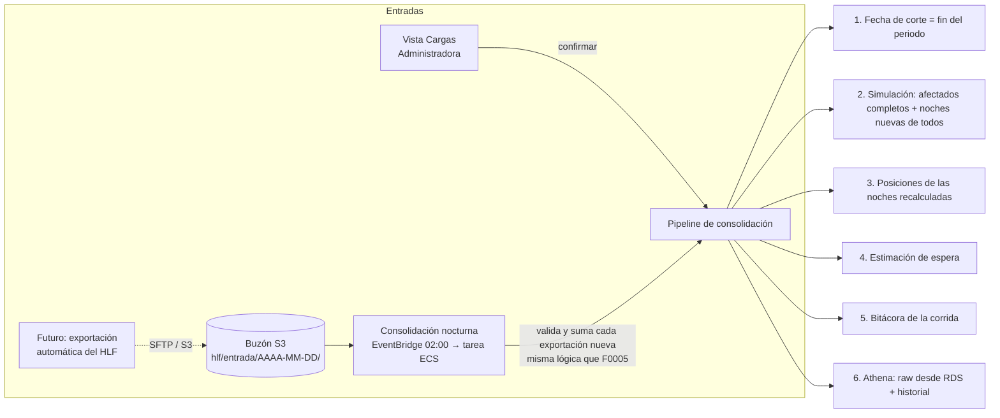

# F0006 · Consolidación nocturna, recálculo por carga e histórico

**Estado:** Implementado y desplegado en `demo` · **Depende de:** F0005 · **Tamaño:** L

## Objetivo

Un solo **pipeline de consolidación** con dos puertas de entrada:

1. **Manual (hoy):** la Administradora sube la exportación de un periodo en la vista Cargas (F0005). Al confirmarla, el pipeline corre en segundo plano.
2. **Automática (consolidación nocturna):** un proceso programado revisa cada noche un **buzón de exportaciones**. Toma las que llegaron ese día, las valida y las suma con las mismas reglas de F0005, y después corre el mismo pipeline. Si un día no llegó nada, lo registra y no cambia nada.

Cuando el HLF pueda dejar sus CSV directamente en el buzón (SFTP con AWS Transfer Family, un script programado, o un sistema que escriba en S3), la carga manual deja de ser necesaria y no hay que cambiar nada del sistema. Así queda preparado para escalar a esa integración.

El pipeline genera el **histórico con los cambios**:
- la simulación noche a noche (`serie_nocturna`): cómo evolucionó el puntaje y la posición de cada solicitud con los datos disponibles hasta cada noche;
- las versiones de los datos y el valor anterior de cada fila modificada (F0005);
- la estimación de espera a la fecha de corte;
- la bitácora de cada corrida;
- el historial en Athena.

## Principios

- **La fecha de corte es la de los datos.** "Hoy" para la app es el fin del periodo de la última carga aplicada, y se muestra como "datos al DD-MM-AAAA". Evaluar al día real con datos de un mes atrás haría crecer la espera y vencer ventanas de eventos sin saber qué pasó.
- **La bandeja no depende de la serie.** Se calcula al momento a la fecha de corte. La serie noche a noche es la simulación histórica: alimenta la evolución de la ficha, los KPIs y Athena.
- **Mismo pipeline, mismo resultado.** Da igual si una exportación entró por la vista Cargas o por el buzón: misma validación, misma versión y mismo recálculo.

## Punto de partida (antes de F0006)

- **Cargas (F0005):** vista previa, confirmar, versiones, `raw.cambio_fila`. Al confirmar se recalculan solo los pacientes afectados (`recalcular_solicitudes`), de forma síncrona.
- **Serie nocturna:** se calcula completa en el primer arranque (`nocturno.ejecutar`) y por solicitud con decisiones, validaciones y cargas. Cuando una carga adelanta la fecha de corte, **solo los pacientes afectados** reciben las noches nuevas: los demás quedan cortados en la fecha anterior y las posiciones de las noches nuevas se calculan solo entre los afectados.
- **Fecha de corte:** con RDS es la última fecha con datos (`Repositorio.fecha_max_datos`, provisorio). `priorizacion.reloj` tiene los modos `real` y `demo` de F0003, con `avanzar_reloj()`. La app no lo usa; las vistas del asistente sí.
- **`estimacion_espera`:** existe, pero nada la llena.
- **`POST /api/nocturno/ejecutar`:** recalcula la historia completa de forma síncrona y puede superar los 60 s de CloudFront.
- **Athena:** `publicar` lee CSV locales (pendiente T2). `exportar` sube el historial.
- **Serie:** solo tiene la partición `DEFAULT` (pendiente T5).
- **Infraestructura:** no hay ningún proceso programado.

## Diseño



### Pipeline de consolidación (`priorizacion/consolidacion.py`)

Lo llaman la vista Cargas (en segundo plano) y la consolidación nocturna. Corre con un candado en PostgreSQL (`pg_advisory_lock`, `hlf_consolidacion`): nunca hay dos a la vez. Los recálculos puntuales (una decisión o una evidencia validada) toman el mismo candado, y mientras hay un recálculo en curso la API responde 409 a esas escrituras para que la Administradora reintente en un minuto.

| Paso | Qué hace |
|---|---|
| 1. Fecha de corte | `priorizacion.fecha_corte()` la toma de la última versión aplicada: el fin de su periodo o, si no lo declaró, la última fecha con datos |
| 2. Simulación | Pacientes afectados por la carga: simulación completa, porque su historia cambió. Demás solicitudes activas: **solo las noches nuevas**, continuando desde su última noche guardada (sin rehacer la historia) |
| 3. Posiciones | Se recalculan solo las noches tocadas (las nuevas y las de los afectados) y se reemplazan esas noches en la serie |
| 4. Estimación | `throughput_8_semanas` a la fecha de corte (ver abajo) |
| 5. Bitácora | `corrida_nocturna` con `origen` (`carga`, `nocturno`, `completo`), `id_carga`, `estado` (`en_curso`, `completa`, `fallida`) y el detalle |
| 6. Athena | Si hay bucket: publica `raw` desde RDS y exporta solo las noches que cambiaron |

**Prueba clave:** cargar el periodo 1, sumar el periodo 2 y correr el pipeline deja la serie **idéntica** al recálculo completo con el dataset entero.

### Consolidación nocturna (`servicios/nocturno/`)

| Decisión | Elección | Por qué |
|---|---|---|
| Disparador | **EventBridge Scheduler**, `cron(0 2 * * ? *)` en `America/Santiago` | Una vez al día, con zona horaria |
| Dónde corre | Tarea ECS Fargate con la misma imagen del backend y el comando `python -m servicios.nocturno` | Sin el límite de 15 minutos de Lambda y reutilizando el motor |
| Buzón | `s3://<bucket>/hlf/entrada/<carpeta>/*.csv`: una carpeta por exportación, procesadas en orden alfabético (fecha ISO). Opcional: `periodo.json` con `{"desde": …, "hasta": …}`. En local, una carpeta (`HLF_BUZON`) | Formato simple que cualquier integración futura puede escribir |
| Qué ya se procesó | La base: una carpeta que ya figura en `raw.carga_lote.origen` **con los mismos archivos** (sha256), sea aplicada, fallida, lista o descartada, no se vuelve a tomar. Si el HLF corrige los CSV en la misma carpeta, las huellas cambian y se procesa de nuevo | La base es la fuente de verdad; no hace falta mover archivos |
| Confirmación | **Automática si no hay errores** (`HLF_AUTOCONFIRMAR=1`, el valor por defecto). Con errores queda `fallida` y la Administradora la ve en Cargas. Las advertencias quedan registradas en la versión | Es la condición para dejar de cargar a mano. Con `HLF_AUTOCONFIRMAR=0` quedan `lista` para revisión manual |
| Con errores | La exportación queda `fallida` y **las siguientes esperan**: un periodo puede referirse a pacientes que llegan en el anterior | Aplicar el periodo 3 sin el 2 dejaría huecos en la historia |
| Sin datos nuevos | Corre igual y queda en la bitácora con `sin_exportaciones_nuevas`; la simulación no cambia (0 evaluaciones) | Se ve que la noche corrió |

### Fecha de corte y reloj

`priorizacion.reloj` pasa de los modos `real`/`demo` (F0003) a:

| Modo | Fecha de corte | Uso |
|---|---|---|
| `datos` (por defecto) | La mayor fecha de corte entre las versiones aplicadas (`raw.carga_lote.fecha_corte`) | Normal |
| `manual` | Una fecha fija (`python -m db reloj --fijar AAAA-MM-DD`) | Ensayos y pruebas |

`avanzar_reloj()` y el avance automático se eliminan. La API usa `fecha_corte()` como "hoy" con RDS; en modo local, la última fecha con datos. El selector de fecha de la app sigue permitiendo mirar cualquier noche anterior.

### Estimación de espera (`priorizacion/estimacion.py`)

`throughput_8_semanas`:
1. Ordena la cola de cada especialidad por prioridad vigente, fecha de ingreso e ID; esa es la posición vigente.
2. Cuenta las atenciones (citas con asistencia) por semana en las 8 semanas previas al corte.
3. El rango de días es `posición ÷ (atenciones por día)`, usando las semanas p75 (cota optimista) y p25 (cota pesimista).
4. Sin atenciones en la ventana, **no hay estimación**: no se inventa.

`confianza` depende de cuántas semanas tuvieron atenciones. `publicable = false` hasta que el HLF apruebe informarla (pregunta H5 de pendientes.md).

### Ejecución asíncrona

- **Confirmar una carga:** aplica la versión (rápido) y responde. El pipeline sigue en un hilo de la tarea que atendió la petición. La vista Cargas consulta `GET /api/nocturno/estado` hasta que termina.
- **Recalcular la historia completa:** solo cuando cambia `VERSION_REGLAS`. Desde la vista Nocturno, también en segundo plano.

### Demo

`scripts/exportaciones_demo.py` parte el dataset en N exportaciones por periodo (por ejemplo, hasta junio, de julio a septiembre y octubre) en carpetas listas para:
- **subirlas a mano** en la vista Cargas; o
- **dejarlas en el buzón** y correr la consolidación nocturna (`python -m servicios.nocturno`, o esperar a las 02:00): las toma todas en orden.

## Cambios por carpeta

```
db/sql/raw/003_fecha_de_corte.sql              carga_lote.fecha_corte (fin del periodo o última fecha con datos)
db/sql/priorizacion/003_consolidacion.sql      reloj datos/manual; fecha_corte() desde raw.carga_lote; corrida_nocturna
                                               con origen, estado, id_carga y detalle; particiones anuales de la serie
db/carga.py                                    calcula y guarda la fecha de corte de cada versión
db/__main__.py                                 reloj --fijar / --datos; athena publicar --desde-rds
db/athena.py                                   publicar desde RDS
priorizacion/nocturno.py                       simulación incremental por solicitud (continúa desde la última noche)
priorizacion/estimacion.py                     throughput_8_semanas (puro)
priorizacion/consolidacion.py                  pipeline: simulación, posiciones, estimación, bitácora, Athena
priorizacion/registro*.py                      fecha_corte(), reemplazar_noches(), guardar_estimaciones(),
                                               estimaciones(), corrida con estado
servicios/nocturno/__main__.py, buzon.py       consolidación nocturna: buzón (S3 o carpeta) → cargas → pipeline
api/estado.py, api/rutas/cargas.py, api/rutas/nocturno.py
                                               "hoy" = fecha de corte; pipeline en segundo plano; estado de la corrida
web/src/App.tsx, paginas/Cargas.tsx, paginas/Nocturno.tsx, paginas/Ficha.tsx
                                               "datos al …"; progreso del recálculo; corridas con su origen; estimación
docker/backend/Dockerfile                      copia servicios/
infra/stacks/nocturno.py                       construct: EventBridge Scheduler → tarea ECS; permisos del scheduler
infra/stacks/backend.py                        crea el construct si hay RDS (mismo cluster, imagen y red)
docker/backend/entrypoint.sh                   la tarea nocturna con RDS no descarga CSV
scripts/exportaciones_demo.py                  exportaciones por periodo para la demo
tests/test_estimacion.py, tests/test_consolidacion.py, tests/test_nocturno_buzon.py, tests/test_api.py,
tests/test_db.py (reloj), infra/tests
```

## Tareas

1. Migraciones `003`: fecha de corte por versión, modos del reloj, `fecha_corte()` desde las versiones, bitácora ampliada y particiones anuales (moviendo los datos de `DEFAULT`).
2. Simulación incremental: cada solicitud continúa desde su última noche guardada. Escritura solo de las noches tocadas.
3. Estimación de espera, con sus pruebas.
4. Pipeline de consolidación y su prueba clave (periodo 1 + periodo 2 = dataset completo).
5. Cargas: el pipeline corre en segundo plano al confirmar, con su estado visible.
6. Consolidación nocturna con buzón en S3 y en carpeta local: toma las exportaciones nuevas en orden, ignora las ya procesadas, confirma solas las que no tienen errores y deja las fallidas para la Administradora.
7. Athena: publicar `raw` desde RDS.
8. La API usa `fecha_corte()`, muestra "datos al …" y la estimación en la ficha. La vista Nocturno lista las corridas con su origen y recalcula la historia completa en segundo plano.
9. Infraestructura: Scheduler a las 02:00 de Chile → tarea ECS (solo en entornos con RDS) y permisos de Athena y Glue.
10. `scripts/exportaciones_demo.py`. Ensayo: tres exportaciones en el buzón, una corrida nocturna, y la cola cambiando en cada versión.
11. Documentación: F0003 (reloj), `docs/kpis.md`, `docs/mvp.md`, `docs/propuestas-solucion.md` (tiempo a reevaluación) y `infra/README.md` (buzón y horario).

## Criterios de aceptación

- **Simulación idéntica a la referencia:** sumar un periodo y correr el pipeline deja la serie idéntica al recálculo completo. Ninguna solicitud queda con la simulación cortada.
- **Buzón:** con tres exportaciones en el buzón, una corrida nocturna las aplica como versiones sucesivas, en orden. Una segunda corrida no hace nada ("sin exportaciones nuevas"). Una exportación con errores queda `fallida` y visible en Cargas; las posteriores esperan a que se corrija (ver la tabla de decisiones).
- **Fecha de corte:** después de una carga cuyo periodo termina el 31-12, la app, la bandeja y las vistas del asistente usan el 31-12 y muestran "datos al 31-12-…".
- **Sin esperas:** confirmar una carga responde en menos de 2 s y la vista Cargas muestra el progreso del recálculo.
- **Una a la vez:** una carga manual y la corrida nocturna nunca recalculan a la vez.
- **Estimación:** existe para cada solicitud activa con atenciones recientes en su especialidad, y nunca es negativa ni inventada.
- **Programado solo donde hay base:** en AWS, el Scheduler existe en `demo` (con RDS), a las 02:00 de `America/Santiago`; en `dev` no.
- **Athena:** `hlf_raw` se publica desde RDS e `hlf_historial.serie_nocturna` muestra la evolución a través de las versiones.

## Riesgos y decisiones abiertas

- **Frecuencia de las exportaciones.** El desafío pide reevaluar en menos de 72 h. Ese plazo depende de cada cuánto llegue una exportación: con el buzón conectado, diario. Con carga manual, recomendar al menos cada 3 días.
- **Confirmación automática.** Una exportación sin errores pero con advertencias (por ejemplo, un estado que retrocede) se aplica sola. Si el HLF prefiere revisar esos casos, se apaga con `HLF_AUTOCONFIRMAR=0`.
- **Integración futura del buzón:** acordar con el HLF el mecanismo (SFTP con AWS Transfer Family, S3 directo con un rol, u otro) y el formato de carpeta. El sistema solo exige que cada exportación quede en su propia carpeta.
- **Escala:** la simulación incremental evita recalcular la historia cada noche. A escala del HLF (~26 mil solicitudes), las noches tocadas por pacientes afectados pueden ser muchas; si el pipeline supera unos minutos, pasarlo de hilo a tarea ECS.
- **Aprobación de la estimación** antes de informarla al paciente (pregunta H5 de pendientes.md).

## Resultado

Implementado y probado en local (PostgreSQL 16 en Docker y el dataset) y desplegado en `demo` el 15-10-2026: la API responde "datos al 2026-10-13" en modo `datos` y entrega la estimación en la ficha, y una ejecución manual de la tarea nocturna (la misma que lanza el Scheduler) terminó con código 0. Leyó el buzón de S3 vacío, registró la corrida y publicó en S3 el Parquet de `raw` y la estimación del corte.

| Criterio | Cómo se comprobó | Resultado |
|---|---|---|
| Simulación idéntica a la referencia | `tests/test_consolidacion.py`: periodo 1 → consolidar → sumar periodo 2 → consolidar solo lo afectado, contra el dataset entero consolidado una vez | Serie nocturna y propuestas idénticas. Solo se recalcularon las solicitudes afectadas |
| Buzón | `tests/test_nocturno_buzon.py` y un ensayo con la CLI sobre una base vacía | Tres exportaciones → versiones 1, 2 y 3, en orden; serie completa al 13-10-2026 en 35 s. La segunda noche: 0 evaluaciones en 3 s, registrada como "sin exportaciones nuevas" |
| Errores | Prueba con un evento de un paciente inexistente | La entrega queda `fallida` con archivo y línea, la siguiente espera y la fecha de corte no avanza. La noche siguiente no repite la misma entrega fallida |
| Fecha de corte | `python -m db reloj` tras el ensayo; `/api/meta` | "Fecha de corte 2026-10-13 · modo datos"; la app muestra "Datos al …" |
| Sin esperas | `tests/test_api.py` | Confirmar una carga y `POST /api/nocturno/ejecutar` responden de inmediato (202); `GET /api/nocturno/estado` informa el avance |
| Una a la vez | `tests/test_consolidacion.py` y `tests/test_api.py` | Una segunda corrida espera el candado; un segundo recálculo responde 409; las decisiones esperan |
| Estimación | `tests/test_estimacion.py` y la consolidación | 409 solicitudes con estimación al 13-10-2026; nunca negativa; sin atenciones recientes no hay estimación. Se guarda una por fecha de corte (histórico) |
| Programado solo donde hay base | `infra/tests` | `AWS::Scheduler::Schedule` a las 02:00 de `America/Santiago` solo en `demo` |
| Athena | `tests/test_nocturno_buzon.py` con S3 simulado | Parquet de `raw` desde RDS (idempotente) y solo las particiones de las noches tocadas |

Suite: 97 pruebas con PostgreSQL y dataset, más las nuevas de API y buzón; en modo CI (sin dataset ni base) 28 pasan y el resto se salta. Infraestructura: 26 pruebas.

**Diferencias con el plan:**
- La tarea nocturna es un construct dentro de `BackendStack`, no un stack aparte: comparte cluster, imagen y red sin referencias entre stacks.
- No hacen falta permisos de Athena ni Glue: la publicación solo escribe Parquet en S3 (`parquet/` e `historial/`), y el historial usa *partition projection*. Las tablas se crean una vez con `python -m db athena publicar`.
- Una entrega fallida detiene las siguientes (ver la tabla de decisiones).
- Al arrancar, la API pone al día la serie y la estimación si la base viene de antes de F0006 o se cargaron datos por la línea de comandos.

