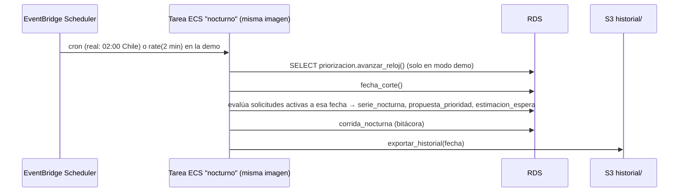

# F0006 · Proceso nocturno y reloj de la demo en AWS

**Estado:** Plan · **Depende de:** F0005 · **Tamaño:** M

## Objetivo

Que el recálculo de prioridades corra solo, fuera de la API: cada noche en operación real o cada pocos minutos en la demo (reloj). Cada ejecución deja la serie, las propuestas y la estimación de espera en RDS, y el historial en S3 para Athena. Así la posición en la cola cambia "a medida que pasa el tiempo", en la app y en los canales del paciente.

## Qué existe hoy

- `priorizacion/nocturno.py`: `ejecutar(repo, registro)` recalcula la historia completa y `recalcular_solicitud()` recalcula una sola. Se puede correr con `python -m priorizacion.nocturno`.
- La API lo ejecuta al arrancar si no hay serie, y por `POST /api/nocturno/ejecutar` de forma síncrona (puede tardar minutos).
- RDS (F0003): `priorizacion.reloj`, `fecha_corte()` y `avanzar_reloj()`; `estimacion_espera` existe pero nada la llena.
- `python -m db athena exportar` sube el historial por fecha a S3.
- `config.FECHA_REFERENCIA` está fija en el código (2026-10-13) y es el "hoy" de la API.

## Alcance

**Entra:** tarea programada en ECS, tick del reloj, cálculo de `estimacion_espera`, exportación a S3, ejecución manual asíncrona desde la vista Nocturno, y que la API use `fecha_corte()` como fecha de referencia.

**No entra:** procesamiento por evento en tiempo real, como recalcular al llegar una urgencia (queda como mejora).

## Diseño



| Decisión | Elección | Por qué |
|---|---|---|
| Dónde corre | **Tarea ECS Fargate programada**, misma imagen que el backend con otro comando (`python -m servicios.nocturno`) | Reutiliza el motor sin empaquetarlo aparte. Sin el límite de 15 minutos de Lambda para el recálculo completo |
| Disparador | EventBridge Scheduler con zona horaria `America/Santiago` | Cron con zona horaria. En la demo, `rate(2 minutes)`, que se activa y desactiva con un parámetro |
| Incremental | Cada ejecución evalúa **solo la fecha de corte** (las ~400 solicitudes activas) | El recálculo completo queda para la primera carga y para cuando cambia `VERSION_REGLAS` |
| Concurrencia | Un candado en PostgreSQL (`pg_try_advisory_lock`) | Si un tick tarda más que el intervalo, el siguiente sale sin hacer nada |
| Estimación de espera | `throughput_8_semanas`: atenciones por especialidad en las últimas 8 semanas → rango p25–p75 de días según la posición | Simple y explicable. `publicable=false` hasta que gestión de lista lo apruebe (decisión abierta de F0002) |
| Ejecución manual | `POST /api/nocturno/ejecutar` lanza la tarea (`ecs:RunTask`) y responde 202 con el ID. La vista Nocturno consulta el estado en `corrida_nocturna` | Saca de la API el trabajo de minutos que hoy excede el timeout de CloudFront |

**Fecha de referencia de la API:** `config.FECHA_REFERENCIA` se reemplaza por `priorizacion.fecha_corte()` cuando hay RDS. Así la bandeja, la ficha y los canales muestran el mismo "hoy".

## Cambios por carpeta

```
servicios/nocturno/__main__.py       entrada de la tarea: candado → tick → evaluar → estimar → exportar
servicios/nocturno/estimacion.py     método throughput_8_semanas (puro, probado sin base)
servicios/comun/conexion.py          conexión a RDS para servicios (reusa db/conexion.py)
priorizacion/nocturno.py             ejecutar_fecha(repo, registro, fecha): evaluación de una sola noche
api/rutas/nocturno.py                POST asíncrono (RunTask) y GET del estado de la corrida
infra/stacks/nocturno.py             definición de tarea, Scheduler (real y demo), rol IAM (RDS, S3 historial)
web/src/paginas/Nocturno.tsx         botón "Avanzar un día" y "Ejecutar ahora" con estado en curso
tests/test_nocturno_fecha.py, servicios/nocturno/tests/
```

## Tareas

1. `ejecutar_fecha()`: evaluar solo las solicitudes activas a una fecha. Prueba: la fila de cada solicitud coincide con la del recálculo completo para esa misma noche.
2. Método de estimación y sus pruebas: el rango crece con la posición y nunca es negativo.
3. `servicios/nocturno` con candado, tick del reloj, evaluación, estimación, bitácora y exportación.
4. La API usa `fecha_corte()`. La vista Nocturno muestra el modo del reloj y permite avanzar.
5. Endpoint asíncrono y estado de la corrida.
6. Stack `nocturno`: tarea, dos schedules (real y demo, este desactivado por defecto) y permisos mínimos.
7. Ensayo de la demo: `python -m db reloj --demo 2026-06-01`, activar el schedule demo y comprobar que la posición del paciente de referencia cambia en la app y en `canal.v_ia_estado_solicitud`.

## Criterios de aceptación

- Con el schedule demo activo, cada 2 minutos avanza un día, aparece una nueva `corrida_nocturna` y una partición nueva en `s3://…/historial/serie_nocturna/fecha=…/`.
- Dos ejecuciones superpuestas no duplican filas: la segunda sale por el candado.
- `POST /api/nocturno/ejecutar` responde en menos de 1 segundo.
- `python -m db athena consultar` sobre `hlf_historial.serie_nocturna` muestra la evolución de la posición de una solicitud.
- En modo real, el schedule corre una vez al día a las 02:00 hora de Chile.

## Riesgos y decisiones abiertas

- **Estado final de `raw.lista_espera`:** con el reloj en el pasado, `estado` refleja el resultado final (ver F0003). El cálculo de la cola debe basarse en las fechas de citas y eventos hasta el corte, no en ese campo.
- **Validar el método de estimación con gestión de lista** antes de marcar estimaciones como publicables.
- **Costo en la demo:** un `rate(2 minutes)` encendido toda la noche son unas 700 tareas. Apagarlo al terminar (lo cubre F0013 con un presupuesto).
