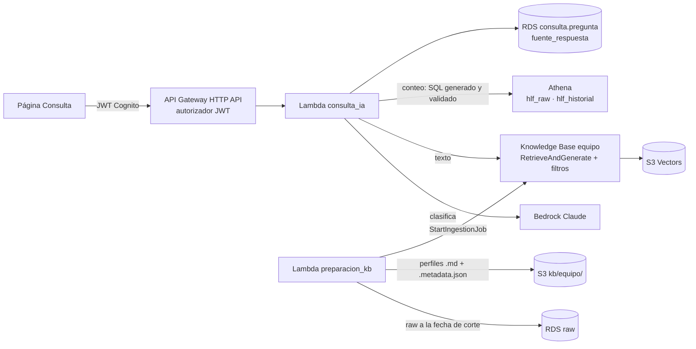

# F0009 · Consulta en lenguaje natural del equipo clínico

**Estado:** Plan · **Depende de:** F0005, F0007, F0008 · **Tamaño:** L

## Objetivo

Que un especialista o gestor de lista pregunte en lenguaje natural y reciba una respuesta trazable:

- **"¿Cuántos pacientes de cardiología en espera tienen un evento grave?"** → conteo exacto con Athena, mostrando el SQL ejecutado.
- **"Resume la evolución de la paciente 00028"** → resumen con RAG sobre los perfiles, citando los fragmentos de origen.

Es el flujo A de `docs/diagramas/flujos-aws.pdf`.

## Qué existe hoy

- **RDS, esquema `consulta` (F0003):**
  - `ingesta_kb` y `documento_kb` registran qué se indexó, con su fecha de corte.
  - `pregunta` y `fuente_respuesta` guardan cada respuesta con su SQL o sus fuentes.
  - Restricciones: la Knowledge Base del paciente no admite perfiles; una pregunta de conteo exige SQL y una de texto exige KB.
- **Roles:** `hlf_preparacion_kb` y `hlf_consulta_ia`.
- **Capa Athena** (`db/athena.py`): `hlf_raw` y `hlf_historial`; `Athena.ejecutar()` con parámetros y resultados tipados; `es_solo_lectura()`; workgroup con límite de 1 GB por consulta.
- Explicaciones con Bedrock (F0008): política IAM y guardrail reutilizables.
- No existe la generación de documentos, ni la Knowledge Base, ni las Lambdas, ni la interfaz de chat.

## Alcance

**Entra:**
- Lambda de preparación: perfiles, resúmenes y diccionario en `kb/equipo/`, con su sincronización.
- Knowledge Base del equipo clínico.
- Lambda de consulta, que enruta cada pregunta a texto o a conteo.
- API con autenticación y una página "Consulta" en la app.

**No entra:** la Knowledge Base del paciente con preguntas frecuentes (se crea en F0010).

## Diseño



| Decisión | Elección | Por qué |
|---|---|---|
| Entrada | **API Gateway HTTP API con autorizador JWT de Cognito**. CloudFront envía `/api/consulta*` a API Gateway | Autenticación sin código propio. Desacopla la consulta (en segundos y con costo de Bedrock) del backend principal |
| Enrutamiento | Claude clasifica en `texto`, `conteo` o `rechazada` (pide diagnóstico o datos fuera del alcance) | La misma pregunta nunca va a las dos rutas: queda una sola fuente por respuesta |
| Conteo | Claude genera SQL a partir del esquema de `hlf_raw` y `hlf_historial` (columnas y descripciones del diccionario) → `es_solo_lectura` → `EXPLAIN` → ejecución en el workgroup | Respuesta exacta y auditable. El SQL queda en `consulta.pregunta.sql_generado` y se muestra al usuario |
| Texto | `RetrieveAndGenerate` con filtros de metadatos (especialidad, estado, comuna) y guardrail | Los perfiles dan contexto que una fila suelta de CSV no tiene |
| Documentos | Un perfil Markdown por paciente (solicitud, eventos en orden, mediciones con rango, citas), resúmenes por especialidad y por box y mes, y el diccionario de datos | Lo descrito en el diagrama del RAG del equipo |
| Vectores | **S3 Vectors** (alternativa: OpenSearch Serverless) | Menor costo fijo para 500 documentos |
| Fecha de corte | Los perfiles se generan con datos hasta `fecha_corte()` y se registra en `ingesta_kb` | En la demo, el RAG no "ve el futuro" (ver F0003) |

## Cambios por carpeta

```
servicios/preparacion_kb/        handler, plantillas de perfil y resumen, tests (sin AWS: genera Markdown desde DataFrames)
servicios/consulta_ia/           handler, clasificador, generador y validador de SQL, cliente RAG, tests
servicios/comun/bedrock.py       cliente con guardrail y log de tokens (compartido con F0010)
infra/stacks/consulta.py         KB, data source, índice S3 Vectors, Lambdas, API Gateway, autorizador, permisos
infra/stacks/frontend.py         comportamiento /api/consulta* → API Gateway
web/src/paginas/Consulta.tsx     chat: respuesta, ruta usada, SQL o fuentes citadas, latencia
```

## Tareas

1. Generador de perfiles, resúmenes y diccionario, con pruebas a partir de los DataFrames del repositorio (sin AWS).
2. Lambda de preparación: subir a `kb/equipo/` con sus `.metadata.json`, registrar en `ingesta_kb` y `documento_kb`, lanzar la ingesta y esperar su fin.
3. Infraestructura de la KB y la primera ingesta.
4. Validador de SQL: solo lectura, solo las bases `hlf_raw` y `hlf_historial`, `LIMIT` obligatorio en consultas que no agregan. Probarlo con preguntas maliciosas ("borra la tabla", "muestra los RUT").
5. Lambda de consulta: clasificar, rutas texto y conteo, y registro en `pregunta` y `fuente_respuesta`.
6. API Gateway, autorizador y comportamiento de CloudFront.
7. Página Consulta.
8. Conjunto de evaluación: 20 preguntas con su respuesta esperada (10 de conteo verificadas con SQL escrito a mano y 10 de texto). Medir exactitud y latencia.

## Criterios de aceptación

- Las 10 preguntas de conteo del conjunto de evaluación dan el número exacto, y el SQL se muestra en la interfaz.
- Toda respuesta de texto cita al menos un fragmento, y cada fragmento existe en `consulta.documento_kb`.
- Una pregunta que pide modificar datos o un diagnóstico queda registrada con ruta `rechazada` y no ejecuta nada.
- Cada pregunta queda en `consulta.pregunta` con el usuario autenticado.
- Latencia p90 bajo 15 segundos.

## Riesgos y decisiones abiertas

- **SQL generado incorrecto que igual ejecuta:** mostrar siempre el SQL y el conteo de filas usadas. El conjunto de evaluación mide la tasa de error.
- **Costo de la ingesta:** volver a sincronizar los 500 perfiles en cada tick del reloj no es viable. Sincronizar una vez a la fecha inicial de la demo.
- **Disponibilidad de S3 Vectors** en la región: si no está, usar OpenSearch Serverless.
