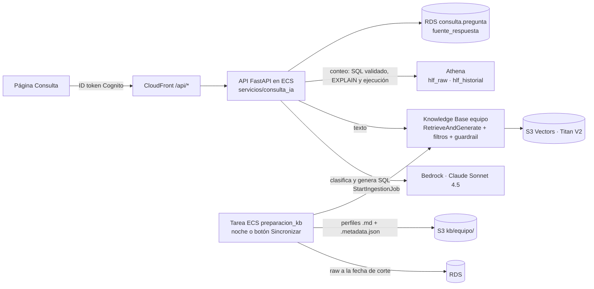

# F0009 · Consulta en lenguaje natural del equipo clínico

**Estado:** Implementado y desplegado en `demo` · **Depende de:** F0005, F0007, F0008 · **Tamaño:** L

## Objetivo

Que la Administradora (único rol, F0007) pregunte en lenguaje natural y reciba una respuesta trazable:

- **"¿Cuántos pacientes de cardiología en espera tienen un evento grave?"** → conteo exacto con Athena, mostrando el SQL ejecutado.
- **"Resume la evolución de la paciente 00028"** → resumen con RAG sobre los perfiles, citando los fragmentos de origen.

Es el flujo A de `docs/diagramas/flujos-aws.pdf`.

## Punto de partida (antes de F0009)

- **RDS, esquema `consulta` (F0003):**
  - `ingesta_kb` y `documento_kb` registran qué se indexó, con su fecha de corte.
  - `pregunta` y `fuente_respuesta` guardan cada respuesta con su SQL o sus fuentes.
  - Restricciones: la Knowledge Base del paciente no admite perfiles; una pregunta de conteo exige SQL y una de texto exige KB.
- **Roles:** `hlf_preparacion_kb` y `hlf_consulta_ia`.
- **Capa Athena** (`db/athena.py`): `hlf_raw` y `hlf_historial`; `Athena.ejecutar()` con parámetros y resultados tipados; `es_solo_lectura()`; workgroup con límite de 1 GB por consulta.
- Explicaciones con Bedrock (F0008): política IAM y guardrail reutilizables.
- No existe la generación de documentos, ni la Knowledge Base, ni las Lambdas, ni la interfaz de chat.

## Alcance

**Entra:**
- Lambda de preparación: perfiles, resúmenes y diccionario en `kb/equipo/`, con su sincronización.
- Knowledge Base del equipo clínico.
- Lambda de consulta, que enruta cada pregunta a texto o a conteo.
- API con autenticación y una página "Consulta" en la app.

**No entra:** la Knowledge Base del paciente con preguntas frecuentes (se crea en F0010).

## Diseño



| Decisión | Elección | Por qué |
|---|---|---|
| Entrada | **La API existente (ECS)**, en `/api/consulta*`, con la sesión de Cognito de F0007. El código vive en `servicios/consulta_ia` y no depende de FastAPI: un handler de Lambda podría llamarlo igual | El plan proponía API Gateway + Lambdas. Una Lambda que consulte RDS (subred aislada) debe estar en la VPC y, sin NAT, necesita endpoints privados para Bedrock, Athena y Secrets Manager. La API ya tiene la sesión, la conexión a RDS y salida a esos servicios |
| Preparación | **Tarea ECS** `python -m servicios.preparacion_kb`: la lanza la consolidación nocturna cuando entran datos nuevos, o el botón "Sincronizar" de la vista | Mismo patrón que F0006; ~6 minutos para 648 documentos |
| Enrutamiento | Claude clasifica en `texto`, `conteo` o `rechazada` (pide diagnóstico o datos fuera del alcance) | La misma pregunta nunca va a las dos rutas: queda una sola fuente por respuesta |
| Conteo | Claude genera SQL a partir del esquema de `hlf_raw` y `hlf_historial` (columnas y descripciones del diccionario) → `es_solo_lectura` → `EXPLAIN` → ejecución en el workgroup | Respuesta exacta y auditable. El SQL queda en `consulta.pregunta.sql_generado` y se muestra al usuario |
| Texto | `RetrieveAndGenerate` con filtros de metadatos (especialidad, estado, comuna) y guardrail | Los perfiles dan contexto que una fila suelta de CSV no tiene |
| Documentos | Un perfil Markdown por paciente (solicitud, eventos en orden, mediciones con rango, citas), resúmenes por especialidad y por box y mes, y el diccionario de datos | Lo descrito en el diagrama del RAG del equipo |
| Vectores | **S3 Vectors** con **Titan Text Embeddings V2** (1024 dimensiones, multilingüe) | Menor costo fijo para ~650 documentos; ambos permitidos en la cuenta |
| Fecha de corte | Los perfiles se generan con datos hasta `fecha_corte()` y se registra en `ingesta_kb` | El RAG no "ve el futuro" (ver F0003) |
| Validador de SQL | Determinista: una sentencia SELECT/WITH sin comentarios; sin palabras de escritura; solo `hlf_raw.*`, `hlf_historial.*` o CTE; nunca `nombre_fantasia`; si no agrega, `LIMIT` ≤ 50. Después `EXPLAIN` en Athena y recién entonces la ejecución | No confía en el modelo; el SQL rechazado queda registrado para auditar |
| Filtro previo | Órdenes de escritura ("borra…", "¿puedes cambiar la prioridad…?") y pedidos de datos identificatorios (RUT, nombre, teléfono) se rechazan sin llamar al modelo | Más rápido y no depende del clasificador |
| Minimización | Los perfiles no llevan el nombre (aunque sea ficticio): el paciente se identifica por su ID | Lo que llega a Bedrock y a la KB es lo mínimo |

## Cambios por carpeta

```
servicios/comun/diccionario.py   descripciones de tablas y columnas: documento "diccionario" y esquema del generador de SQL
servicios/comun/bedrock.py       cliente boto3 (Converse con respuesta estructurada) y log JSON por llamada (F0010 lo reutiliza)
servicios/preparacion_kb/        documentos.py (puro), proceso.py (S3, registro, ingesta), __main__.py (tarea ECS o --local)
servicios/consulta_ia/           clasificador, sql (generador y validador), rag, registro (RDS), servicio (orquesta)
servicios/nocturno/proceso.py    regenera la KB cuando entran datos nuevos
api/rutas/consulta.py            POST /api/consulta, GET /api/consulta/estado, /historial, POST /api/consulta/preparar
priorizacion/registro_postgres.py sin_version(): conexión compartida para la bitácora de la consulta
infra/stacks/consulta.py         bucket e índice de S3 Vectors, KB, fuente de datos S3, políticas de consulta y preparación
infra/stacks/backend.py          HLF_KB_ID y HLF_KB_DATA_SOURCE_ID; políticas en la API y en la tarea nocturna
web/src/paginas/Consulta.tsx     respuesta, ruta usada, SQL y tabla o fuentes citadas, latencia, historial, Sincronizar
scripts/evaluar_consulta.py      conjunto de evaluación contra la API desplegada
tests/test_consulta_ia.py        validador de SQL, filtro previo, orquestación con dobles, documentos
```

## Tareas

1. Generador de perfiles, resúmenes y diccionario, con pruebas a partir de los DataFrames del repositorio (sin AWS).
2. Lambda de preparación: subir a `kb/equipo/` con sus `.metadata.json`, registrar en `ingesta_kb` y `documento_kb`, lanzar la ingesta y esperar su fin.
3. Infraestructura de la KB y la primera ingesta.
4. Validador de SQL: solo lectura, solo las bases `hlf_raw` y `hlf_historial`, `LIMIT` obligatorio en consultas que no agregan. Probarlo con preguntas maliciosas ("borra la tabla", "muestra los RUT").
5. Lambda de consulta: clasificar, rutas texto y conteo, y registro en `pregunta` y `fuente_respuesta`.
6. API Gateway, autorizador y comportamiento de CloudFront.
7. Página Consulta.
8. Conjunto de evaluación: 20 preguntas con su respuesta esperada (10 de conteo verificadas con SQL escrito a mano y 10 de texto). Medir exactitud y latencia.

## Criterios de aceptación

- Las 10 preguntas de conteo del conjunto de evaluación dan el número exacto, y el SQL se muestra en la interfaz.
- Toda respuesta de texto cita al menos un fragmento, y cada fragmento existe en `consulta.documento_kb`.
- Una pregunta que pide modificar datos o un diagnóstico queda registrada con ruta `rechazada` y no ejecuta nada.
- Cada pregunta queda en `consulta.pregunta` con el usuario autenticado.
- Latencia p90 bajo 15 segundos.

## Riesgos y decisiones abiertas

- **SQL generado incorrecto que igual ejecuta:** mostrar siempre el SQL y el conteo de filas usadas. El conjunto de evaluación mide la tasa de error.
- **Costo de la ingesta:** volver a sincronizar los 500 perfiles en cada tick del reloj no es viable. Sincronizar una vez a la fecha inicial de la demo.
- **Disponibilidad de S3 Vectors** en la región: si no está, usar OpenSearch Serverless.

## Resultado

Implementado, probado y desplegado en `demo` el 16-10-2026. Primera sincronización: 648 documentos (500 perfiles, 7 resúmenes de especialidad, 140 de box y mes, y el diccionario), 0 fallidos, en 6 minutos.

**Conjunto de evaluación** (`scripts/evaluar_consulta.py`, contra la API desplegada con una sesión de Cognito):

| Grupo | Resultado | Cómo se mide |
|---|---|---|
| Conteo | **10 de 10** exactos | El valor de la API es igual al de un SQL escrito a mano, ejecutado en Athena por el script |
| Texto | **10 de 10** | Ruta texto, cita el documento esperado (perfil, resumen o diccionario) y menciona un término clave |
| Rechazos | **3 de 3** | "Borra la tabla…", "Muestra los RUT…" y "Diagnostica…" quedan en `rechazada` sin ejecutar nada |
| Latencia | mediana 8,5 s · **p90 10,4 s** | Meta: p90 bajo 15 s |

**Verificado en RDS:** cada pregunta quedó en `consulta.pregunta` con la persona autenticada; todas las de conteo tienen SQL e id de Athena; todas las de texto tienen al menos una fuente en `consulta.fuente_respuesta`, y cada fuente es un documento de `consulta.documento_kb`.

**Problemas encontrados y corregidos:**
- Con una plantilla de prompt propia, `RetrieveAndGenerate` no devolvía citas: falta `$output_format_instructions$`. Sin citas, la regla "sin fuentes no hay respuesta de texto" rechazaba todo (0 de 10 en la primera corrida).
- "¿Qué diagnóstico tiene el paciente…?" se rechazaba como si pidiera diagnosticar: el clasificador ahora distingue consultar el diagnóstico registrado (permitido) de diagnosticar (rechazado).
- El filtro previo con palabras sueltas rechazaba preguntas válidas ("¿cuántos tuvieron una modificación de tratamiento?"); ahora detecta órdenes de escritura y comandos SQL.

| Criterio | Resultado |
|---|---|
| 10 conteos exactos con el SQL en la interfaz | Sí (la vista muestra el SQL, la tabla, filas y MB escaneados) |
| Toda respuesta de texto cita al menos un fragmento registrado | Sí; una cita a un documento no registrado se descarta y, sin citas, la pregunta queda `rechazada` |
| Modificar datos o diagnosticar → `rechazada`, sin ejecutar | Sí |
| Cada pregunta con el usuario autenticado | Sí |
| p90 bajo 15 s | 10,4 s |

Suite: 181 pruebas con PostgreSQL y el dataset; 99 en modo CI; 32 de infraestructura.

**Diferencias con el plan:** la consulta corre en la API (ECS) y la preparación en una tarea ECS, no en Lambdas detrás de API Gateway (ver "Entrada" en Diseño). La KB se sincroniza cuando entran datos nuevos (consolidación nocturna) o a pedido, no "una vez": con F0006 la fecha de corte cambia por carga, no por un reloj que avanza solo.

