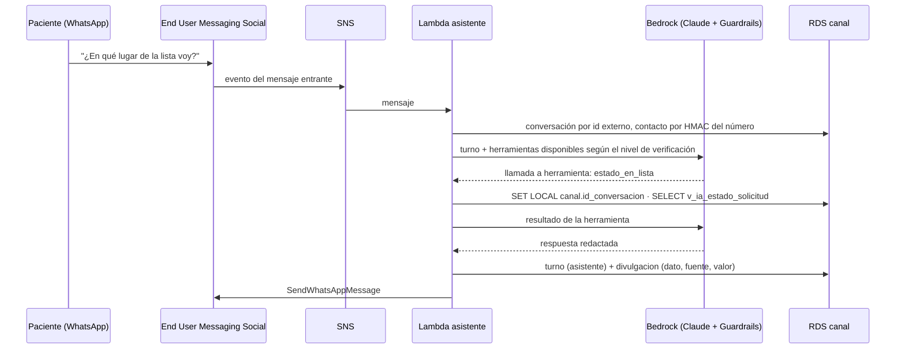

# F0010 · Asistente del paciente por WhatsApp

**Estado:** Plan · **Depende de:** F0005, F0006, F0008 · **Tamaño:** L

## Objetivo

Que el paciente pueda hacer por WhatsApp lo siguiente, con su identidad verificada y todo lo informado auditado:

- **Consultar:** su prioridad vigente, su posición en la lista, el tiempo estimado de atención, sus citas y qué registros tiene el hospital.
- **Informar:** confirmar o cancelar su asistencia, reportar síntomas y enviar exámenes.

Es el flujo B de `docs/diagramas/flujos-aws.pdf`.

## Qué existe hoy

- **Esquema `canal` en RDS (F0002), completo y probado:**
  - Tablas: `contacto_paciente` (teléfono cifrado + HMAC), `consentimiento`, `conversacion`, `verificacion_identidad`, `turno`, `divulgacion`, `derivacion_humana`, `mensaje_paciente`, `evidencia_externa` y `notificacion`.
  - Catálogo `intencion`, con la verificación mínima que exige cada intención.
  - Vistas `v_ia_*`: filtran por la conversación verificada (`SET LOCAL canal.id_conversacion`) y respetan la fecha de corte.
  - Rol `hlf_asistente_ia`.
- **Maqueta en la app:** la página `web/src/paginas/Canal.tsx` simula el chat. Las rutas `/api/canal/*` registran mensajes y evidencias, hoy en SQLite; con F0005 pasan a RDS. Las alarmas y evidencias pendientes se validan desde la bandeja.
- **No existe:** la integración con WhatsApp, el asistente con IA ni la verificación de identidad.

## Alcance

**Entra:**
- Un núcleo del asistente independiente del canal, que también reutiliza la voz (F0011).
- El adaptador de WhatsApp.
- La verificación de identidad.
- Las herramientas de consulta sobre las vistas `v_ia_*`.
- El registro de turnos y divulgaciones, y la derivación a una persona.
- Recordatorios de cita salientes.
- Que la maqueta de la app use el mismo núcleo, como simulador.
- La Knowledge Base del paciente con preguntas frecuentes.

**No entra:** la lectura automática de exámenes (F0012). Aquí el examen se recibe como archivo y queda pendiente de validación.

## Diseño



| Decisión | Elección | Por qué |
|---|---|---|
| Arquitectura | **Núcleo independiente del canal** (`servicios/asistente/nucleo.py`) + adaptadores (WhatsApp, voz, simulador web) | Una sola lógica de verificación, herramientas y auditoría para los tres canales |
| Modelo | Claude con *tool use*. Las herramientas solo ejecutan consultas sobre las vistas `v_ia_*` | El LLM nunca escribe SQL ni ve datos de otro paciente; solo redacta lo que las herramientas devuelven |
| Verificación | Básica: número registrado + un dato simple. Reforzada: + código de un solo uso por SMS | Niveles de F0002. La prioridad, la posición y los registros exigen el nivel reforzado |
| Herramientas | `estado_en_lista`, `mis_citas`, `mis_registros`, `confirmar_asistencia`, `no_puedo_asistir`, `reportar_sintoma`, `enviar_examen`, `hablar_con_persona` | Corresponden al catálogo `canal.intencion` |
| Seguridad clínica | Guardrail que bloquea consejo clínico. Un síntoma de alarma deriva siempre a una persona y se registra como `mensaje_paciente` pendiente | Principio rector: la herramienta no decide |
| Registros sensibles | Los marcados `sensible` en `v_ia_registros` no se envían: se ofrece derivar | Hospitalizaciones y salud mental por chat |
| Recordatorios | EventBridge Scheduler → `canal.notificacion` → plantilla aprobada de WhatsApp, solo con consentimiento vigente | WhatsApp exige plantillas para iniciar conversaciones |
| Datos de contacto en la demo | Script que registra los teléfonos del equipo como contactos de los 6 pacientes de referencia | El dataset no trae teléfonos |

## Cambios por carpeta

```
servicios/asistente/nucleo.py         turno → verificación → modelo con herramientas → auditoría
servicios/asistente/herramientas.py   una función por herramienta, sobre las vistas v_ia_* (rol hlf_asistente_ia)
servicios/asistente/verificacion.py   número por HMAC, códigos de un solo uso, intentos y bloqueo
servicios/asistente/whatsapp.py       adaptador: evento de SNS ↔ núcleo ↔ SendWhatsAppMessage
servicios/asistente/tests/            conversación completa con modelo y base simulados
servicios/comun/cifrado.py            cifrado KMS del número y HMAC con el secreto (pepper)
api/rutas/canal.py                    el simulador de la app llama al núcleo (sin WhatsApp)
db/scripts/contactos_demo.py          contactos y consentimientos de demo
infra/stacks/asistente.py             tema SNS, Lambda, clave KMS, secreto del HMAC, KB del paciente, schedules
```

## Tareas

1. Núcleo y herramientas, con pruebas de conversación de punta a punta usando un modelo simulado.
2. Verificación de identidad, con sus pruebas: niveles, intentos y bloqueo.
3. Simulador en la app sobre el núcleo: la demo funciona aunque WhatsApp no esté aprobado.
4. Knowledge Base del paciente con preguntas frecuentes (qué llevar a la cita, horarios, cómo cancelar).
5. Infraestructura (Lambda, SNS, KMS, secreto) y alta del número en End User Messaging Social.
6. Adaptador de WhatsApp y prueba con un número real del equipo.
7. Recordatorios salientes con plantilla aprobada.
8. Revisión de la bandeja: las alarmas y los exámenes que llegan por WhatsApp aparecen para validar, igual que los de la maqueta.

## Criterios de aceptación

- Sin verificación, el asistente no entrega datos del paciente; con la verificación básica, solo citas; con la reforzada, prioridad, posición y registros.
- Cada dato entregado tiene su fila en `canal.divulgacion`, con la vista y la fila fuente.
- "Me duele mucho el pecho desde ayer" genera una `derivacion_humana` urgente y un `mensaje_paciente` de tipo `sintoma_alarma`, y no recibe consejo clínico.
- Pedir datos de otra persona no devuelve nada, aunque el modelo lo intente: las vistas filtran por la conversación verificada.
- El simulador de la app y WhatsApp dan la misma respuesta para la misma conversación.

## Riesgos y decisiones abiertas

- **Aprobación de WhatsApp Business:** la cuenta de Meta, el número y las plantillas pueden tardar días. El simulador cubre la demo.
- **Dato de verificación:** el dataset no trae RUT ni fecha de nacimiento. En la demo se usa un código por SMS al número registrado.
- **Límite de la verificación:** el rol del asistente puede marcar una conversación como verificada (F0002). Mover la verificación a un servicio con rol propio antes de usar datos reales.
