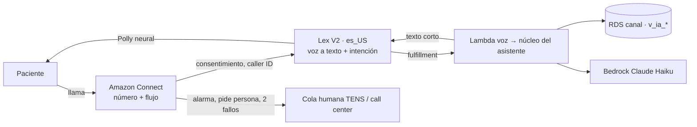

# F0011 · Asistente del paciente por teléfono (voz)

**Estado:** Implementado (falta desplegar, reclamar el número y medir la latencia con Bedrock) · **Depende de:** F0010 · **Tamaño:** M

## Objetivo

Que el paciente llame a un número del hospital y resuelva por voz lo mismo que por WhatsApp (F0010), con transferencia a una persona cuando haga falta. Es el flujo C de `docs/diagramas/flujos-aws.pdf`. Llega a quienes no usan WhatsApp, que en la lista de espera suelen ser personas mayores.

## Punto de partida (antes de F0011)

- Todo el modelo de datos de la llamada está en `canal` (F0002):
  - `conversacion` tiene `canal = 'voz'`, `id_externo` (= ContactId de Amazon Connect) y `uri_grabacion` (solo con consentimiento).
  - `turno.confianza_asr` guarda la confianza del reconocimiento de voz.
  - `derivacion_humana` registra los casos que pasan a una persona.
- F0010 deja listos el núcleo del asistente, las herramientas, la verificación y la auditoría.
- No existe nada de telefonía.

## Alcance

**Entra:**
- Instancia de Amazon Connect, número y flujo de contacto.
- Bot de Lex V2 en español.
- Lambda que conecta Lex con el núcleo del asistente.
- Voz de Polly.
- Cola de atención humana.
- Mensaje de consentimiento y grabación opcional.

**No entra:** llamadas salientes automáticas (recordatorios por voz); quedan como mejora.

## Diseño



| Decisión | Elección | Por qué |
|---|---|---|
| Telefonía | Amazon Connect, con flujo de contacto versionado en el repositorio (JSON) | Número, colas y transferencia en un solo servicio |
| Reconocimiento y diálogo | Lex V2 en una variante de español disponible (`es_US` o `es_419`), con intenciones del catálogo `canal.intencion` y una intención de respaldo hacia el núcleo | Lex resuelve el reconocimiento de voz y los turnos; Claude solo redacta |
| Modelo | Claude Haiku, con respuestas de 1 o 2 frases | Presupuesto de latencia de ~2 s por turno |
| Verificación | Caller ID → HMAC → `contacto_paciente`, más un código o dígitos marcados en el teclado (DTMF) | Igual que en F0010. Los dígitos no se transcriben ni se guardan |
| Voz | Polly neural en una voz en español | Naturalidad para personas mayores |
| Números y fechas | El núcleo devuelve los números en palabras para voz ("lugar tres de ciento veinte"; "catorce a treinta y cinco días") | Evita lecturas ambiguas |
| Grabación | Solo con consentimiento `grabacion_llamada` y retención según `retener_hasta` | F0002, retención y protección de datos |
| Transferencia | Síntoma de alarma, pedir una persona o dos turnos sin entender → cola humana, con el resumen en atributos del contacto | El agente no vuelve a preguntar lo mismo |

## Cambios por carpeta

```
servicios/asistente/voz.py            adaptador: evento de Lex ↔ núcleo; formatos para voz
servicios/asistente/tests/test_voz.py
infra/stacks/voz.py                   instancia Connect, número, cola, flujo, bot Lex, permisos de la Lambda
infra/connect/flujo_entrante.json     flujo de contacto (consentimiento → Lex → transferencia)
```

## Tareas

1. Adaptador de voz y formatos hablados, con pruebas de cifras y fechas en palabras.
2. Bot de Lex con intenciones y respaldo hacia el núcleo.
3. Instancia de Connect, número y flujo entrante.
4. Cola humana y transferencia con resumen.
5. Prueba de latencia: medir el tiempo de cada turno y ajustar (modelo, longitud, conexión reutilizada).
6. Ensayo de la demo: llamar, verificarse y preguntar posición, tiempo estimado y próxima cita. Luego sumar una exportación (F0006: la fecha de corte la fijan los datos) y comprobar que la posición cambia.

## Criterios de aceptación

- Una llamada completa con verificación responde la posición y el rango estimado, y queda registrada en `conversacion`, `turno` y `divulgacion`.
- La latencia por turno es menor a 2,5 s en el p90.
- "Quiero hablar con alguien" transfiere a la cola con el motivo visible para el agente.
- Sin consentimiento de grabación, `uri_grabacion` queda vacía y no hay audio en S3.

## Riesgos y decisiones abiertas

- **Números chilenos en Connect:** la disponibilidad depende de la región y del país. Para la demo puede bastar un número de otro país o un número gratuito; con datos reales se debe usar un número local.
- **Reconocimiento de nombres propios y RUT:** no se usan para verificar. Solo dígitos por teclado y códigos.
- **Región de Connect y Lex:** debe coincidir con la región de las Lambdas o justificar el cruce.

## Resultado

Implementado y probado en local; el despliegue queda pendiente porque las credenciales de la cuenta del hackatón vencieron durante la implementación.

| Pieza | Implementación |
|---|---|
| Adaptador | `servicios/asistente/voz.py`: evento de Lex V2 → núcleo de F0010 (canal `voz`, formato hablado) → respuesta para Lex. Cifras, fechas y horas en palabras ("lugar tres de ciento veinte", "catorce de octubre a las nueve y treinta") |
| Lambda | `lambda_voz.py`, sin VPC ni dependencias: Lex → `/api/interno/asistente/voz` (secreto de servicio) → Lex. Si la API falla, cierra con transferencia; nunca deja al paciente sin respuesta |
| Lex V2 | Bot `es_US` con voz neural de Polly (Lupe); intenciones del catálogo `canal.intencion` y la de respaldo, todas con el code hook. Lex resuelve la voz; Claude Haiku redacta |
| Connect | Instancia, horario (lunes a viernes, 08:00–17:00, America/Santiago), cola "Atención a pacientes", integración con Lex y flujo `infra/connect/flujo_entrante.json` (bienvenida → consentimiento de grabación por teclado → asistente → transferencia o despedida) |
| Verificación | Igual que F0010: número que llama (caller ID) → HMAC → contacto; el código llega por SMS y se marca en el teclado. Los dígitos no se guardan ni pasan al resumen |
| Transferencia | Síntoma de alarma (urgente), pedir una persona, verificación bloqueada o dos turnos sin entender (confianza < 0,4) → `transferir`, `motivo_transferencia` y `resumen_transferencia` en los atributos del contacto |
| Grabación | Solo si el paciente marca 1: el flujo graba y la API registra el consentimiento `grabacion_llamada` y `uri_grabacion`. Sin consentimiento, `uri_grabacion` queda vacía y el flujo no graba |
| Número | `voz_reclamar_numero` en `infra/config/entornos.py` (costo diario; país `voz_pais`), asociado al flujo con un recurso personalizado |

**Pruebas** (`tests/test_voz.py`): números y fechas en palabras; Lex sigue escuchando o cierra según el caso; dos turnos sin entender transfieren; transferencia con motivo, urgencia y resumen; los dígitos no aparecen en el resumen; el flujo de Connect es coherente (toda transición existe y solo el "1" graba); llamada completa en PostgreSQL con código por teclado que entrega posición y rango en palabras con sus divulgaciones; sin consentimiento no hay grabación; pedir una persona transfiere. Infraestructura: Lex `es_US` con voz neural, Lambda sin VPC, cola, integración y almacenamiento de grabaciones, sin número reclamado por defecto.

**Pendiente al desplegar:** `cdk deploy HlfDemo-Voz` (si la cuenta del hackatón no permite Connect, el resto no se ve afectado: es un stack aparte); crear un agente en la consola de Connect para la cola; reclamar el número; medir la latencia con `python scripts/latencia_voz.py` (meta p90 < 2,5 s).

