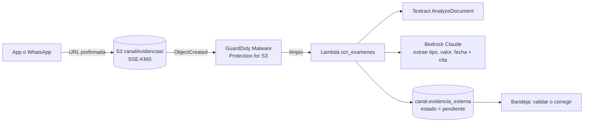

# F0012 · Exámenes externos: subida a S3 y lectura asistida

**Estado:** Plan · **Depende de:** F0005, F0010 · **Tamaño:** M

## Objetivo

Que un examen hecho fuera del hospital (PDF o foto), recibido por la app o por WhatsApp, quede guardado de forma segura y con una **propuesta de lectura** (tipo, valor y fecha, citando el texto del documento) que una TENS o enfermera confirma o corrige. El examen solo cuenta para la prioridad cuando está validado.

## Qué existe hoy

- `POST /api/canal/evidencias` recibe el archivo en base64, lo guarda en disco local y crea la evidencia `pendiente` con tipo y valor **escritos a mano** por quien la sube.
- La bandeja valida o rechaza (`POST /api/canal/evidencias/{id}/revision`). Al validar, el examen entra a la ficha y se recalcula la solicitud.
- `canal.evidencia_externa` (F0002) ya tiene `uri_archivo`, `sha256_archivo`, `tipo_mime` y la revisión obligatoria (`revisado_por` y `fecha_revision`).
- `docs/mvp.md`: "Extracción de exámenes externos (siguiente iteración): Textract (OCR) + Bedrock con cita literal, siempre como evidencia pendiente".

## Alcance

**Entra:**
- Subida directa a S3 con URL prefirmada.
- Revisión de malware.
- Extracción con IA citando el texto.
- Propuesta de lectura en la pantalla de validación.
- Archivos recibidos por WhatsApp.

**No entra:** que el sistema valide un examen por sí solo. Nunca: siempre lo valida una persona.

## Diseño



| Decisión | Elección | Por qué |
|---|---|---|
| Subida | URL prefirmada de S3 (PUT, 5 minutos, tipo y tamaño acotados) | El archivo no pasa por la API ni por CloudFront |
| Malware | GuardDuty Malware Protection for S3 antes de procesar | Archivos subidos por terceros |
| Extracción | Textract para el texto y tablas → Claude estructura `tipo_medicion`, `valor`, `unidad`, `fecha_examen` y la **cita literal** de cada uno | La cita permite al revisor verificar en segundos. Se descarta lo que no esté en el texto extraído (igual que `validar_texto_llm`) |
| Tipos admitidos | Los 8 de `raw.mediciones` | Lo que el motor sabe interpretar |
| Resultado | Propuesta guardada aparte de los valores validados | La propuesta nunca se confunde con el dato validado |

**Cambio de modelo de datos** (migración `db/sql/canal/002_*.sql`): una tabla `canal.lectura_examen` con la propuesta de la IA (`id_evidencia`, campo, valor propuesto, cita, confianza, modelo). `evidencia_externa` guarda solo los valores que confirmó la persona.

## Cambios por carpeta

```
servicios/ocr_examenes/          handler, extracción, validación de citas, tests con documentos de ejemplo sintéticos
db/sql/canal/002_lectura_examen.sql
api/rutas/canal.py               URL prefirmada; la evidencia se crea con la URI de S3, no con base64
web/src/paginas/Canal.tsx        subida directa; la validación muestra la propuesta con su cita
infra/stacks/asistente.py        bucket o prefijo de evidencias, KMS, GuardDuty, Lambda, permisos de Textract y Bedrock
```

## Tareas

1. Migración con `lectura_examen` y verificación en `db/verificacion.py`.
2. Subida con URL prefirmada (app) y descarga del archivo desde WhatsApp hacia S3 (F0010).
3. Lambda de extracción, con 10 documentos sintéticos de prueba (PDF y foto) y su resultado esperado.
4. Pantalla de validación con la propuesta, la cita y los campos editables.
5. GuardDuty y la regla de no procesar archivos marcados.

## Criterios de aceptación

- En los 10 documentos de prueba, toda propuesta trae una cita que aparece literal en el texto extraído. Lo que no se pudo leer queda vacío, nunca inventado.
- Un examen no cambia la prioridad hasta que alguien lo valida, aunque la propuesta tenga confianza alta.
- El archivo queda en S3 cifrado, con su sha256 en la base. No queda copia en disco del contenedor.

## Riesgos y decisiones abiertas

- **Formatos de laboratorios privados** muy variados: medir la tasa de lectura correcta y mostrar siempre el documento junto a la propuesta.
- **Unidades distintas** (mmol/L frente a mg/dL): convertir solo con una tabla explícita; si no se puede, dejar el campo para revisión.
