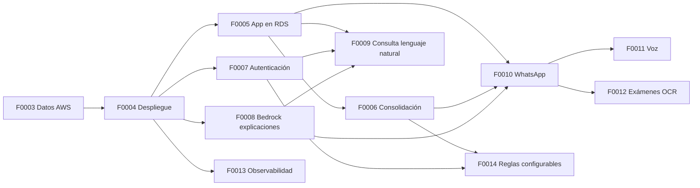

# Features: hoja de ruta

Cada feature tiene un documento `F00NN-nombre.md`. Las de estado **Hecha** describen lo implementado. Las de estado **Plan** describen qué construir, en qué orden y cómo saber que está terminada. Se implementan **una a la vez, en el orden de esta tabla**, cada una en su propia rama o PR.

## Estado

| ID | Feature | Estado | Depende de | Servicios AWS |
|---|---|---|---|---|
| [F0001](F0001-subida-datos-aws.md) | Datos crudos en RDS (esquema `raw`) | Hecha (probada en AWS) | — | RDS PostgreSQL, Secrets Manager |
| [F0002](F0002-modelo-datos-canales.md) | Modelo de datos de la app y de los canales del paciente | Hecha (DDL) | F0001 | RDS |
| [F0003](F0003-flujos-aws-datos.md) | Estructura de datos de los flujos AWS: reloj, `consulta`, S3 + Athena | Hecha (probada en AWS) | F0002 | S3, Athena, Glue Data Catalog |
| [F0004](F0004-despliegue-frontend-backend.md) | Despliegue del frontend y el backend en AWS | Hecha (desplegada en `demo`) | F0003 | CloudFront, S3, ECS Fargate, ALB, ECR, VPC, CDK |
| [F0005](F0005-persistencia-app-rds.md) | La app usa RDS, con cargas de datos incrementales y versionadas | Hecha (desplegada en `demo`) | F0004 | RDS, S3 |
| [F0006](F0006-proceso-nocturno-reloj.md) | Consolidación nocturna, recálculo por carga e histórico | Implementado | F0005 | EventBridge Scheduler, ECS, RDS, S3, Athena |
| [F0007](F0007-autenticacion-roles.md) | Autenticación de la Administradora | Implementado | F0004, F0005 | Cognito |
| [F0008](F0008-explicaciones-bedrock.md) | Explicaciones con IA generativa conectadas a Bedrock | Implementado | F0004 | Bedrock, Guardrails |
| [F0009](F0009-consulta-lenguaje-natural.md) | Consulta en lenguaje natural del equipo clínico | Implementado | F0005, F0007, F0008 | Bedrock Knowledge Bases, S3 Vectors, Athena, Lambda |
| [F0010](F0010-asistente-whatsapp.md) | Asistente del paciente por WhatsApp | Implementado | F0005, F0006, F0008 | End User Messaging Social, SNS, Lambda, Bedrock |
| [F0011](F0011-asistente-voz.md) | Asistente del paciente por teléfono (voz) | Implementado | F0010 | Amazon Connect, Lex V2, Polly, Lambda |
| [F0012](F0012-examenes-externos-ocr.md) | Exámenes externos: subida a S3 y lectura asistida | Implementado | F0005, F0010 | S3, Textract, Bedrock |
| [F0013](F0013-observabilidad-seguridad-costos.md) | Observabilidad, seguridad y control de costos | Implementado | F0004 (se amplía con cada feature) | CloudWatch, WAF, CloudTrail, Budgets, AWS Backup |
| [F0014](F0014-configuracion-reglas.md) | Configuración de las reglas, versionada | Implementado | F0005, F0006, F0007 | RDS |
| [F0015](F0015-rediseno-frontend.md) | Rediseño del frontend | Implementado | F0014 | CloudFront, S3 |

Los pendientes que dejaron las features ya implementadas, y las preguntas abiertas para el HLF, están en [pendientes.md](pendientes.md).

**Hecha (DDL)** significa que las tablas, vistas y roles existen y están probados, pero la app todavía no los usa. Conectarlos es el trabajo de F0005 en adelante.

## Orden y dependencias



**Para la demo del hackatón** el camino mínimo es F0004 → F0005 → F0006 → F0008: la app publicada en AWS, con datos en RDS, cargas por periodo que mueven la cola y las explicaciones de Bedrock. F0009 a F0011 son la visión (los canales con IA). F0007 y F0013 son obligatorias antes de usar datos reales del HLF.

## Estructura de carpetas objetivo

Cada pieza que se despliega por separado vive en su propia carpeta, con sus dependencias y sus pruebas. Así se puede escalar, versionar y desplegar una sin tocar las demás.

```
api/                    Backend HTTP (FastAPI). F0005 separa main.py en routers por dominio: api/rutas/
priorizacion/           Motor de dominio (reglas, evaluación, explicación). Sin dependencias de AWS
db/                     Esquemas SQL, carga, verificación y capa S3 + Athena
servicios/              Procesos que corren fuera de la API, uno por carpeta (handler + requirements + tests)
  comun/                Conexión a RDS, cliente de Bedrock, logging estructurado: compartido por los servicios
  nocturno/             F0006: consolidación nocturna con buzón (EventBridge → tarea ECS)
  preparacion_kb/       F0009: genera documentos de la Knowledge Base
  consulta_ia/          F0009: responde preguntas del equipo clínico
  asistente/            F0010 y F0011: lógica común de WhatsApp y voz
  ocr_examenes/         F0012: lectura de exámenes externos
web/                    Frontend React + Vite
infra/                  Infraestructura como código (AWS CDK en Python)
  app.py                Punto de entrada: instancia los stacks según el entorno (-c entorno=dev|demo)
  config/               Parámetros por entorno (región, tamaños, flags)
  stacks/               Un stack por responsabilidad: red, datos, backend, frontend, nocturno, consulta,
                        asistente, observabilidad
  tests/                Pruebas de los templates (aws_cdk.assertions)
docker/backend/         Dockerfile y entrypoint de la imagen del backend
requirements/           base.txt (ejecución), dev.txt (tests), notebooks.txt (EDA)
.github/workflows/      ci.yml (tests, build y cdk synth) y deploy.yml (despliegue manual)
tests/                  Pruebas del backend y de db (las de cada servicio viven en servicios/<x>/tests/)
docs/feature/           Estos planes
```

Reglas de la estructura:

- `priorizacion/` no importa nada de AWS. El motor se prueba sin red y se reutiliza en la API, en la tarea nocturna y en las Lambdas.
- Un servicio de `servicios/` no importa de otro. Lo compartido va en `servicios/comun/`.
- Cada stack de `infra/stacks/` recibe sus dependencias como parámetros (VPC, bucket, base), nunca las busca por nombre. Así el orden de despliegue queda explícito en `infra/app.py`.
- Ningún dato del hospital entra a una imagen, a un asset de CDK ni al repositorio.

## Plantilla de un plan

Todo plan sigue estas secciones, para que se pueda implementar y revisar de forma ordenada:

1. **Objetivo**: qué resuelve, en una o dos frases.
2. **Qué existe hoy**: el código y los datos actuales, con rutas de archivo.
3. **Alcance**: qué entra y qué no.
4. **Diseño**: servicios AWS, flujo y decisiones, con el porqué de cada una.
5. **Cambios por carpeta**: archivos nuevos y modificados.
6. **Tareas**: lista ordenada; cada una se puede revisar por separado.
7. **Criterios de aceptación**: cómo se comprueba que está terminada.
8. **Pruebas**: automáticas y manuales.
9. **Riesgos y decisiones abiertas.**
10. **Tamaño estimado**: S (≤ ½ día), M (1 día), L (2 a 3 días).
