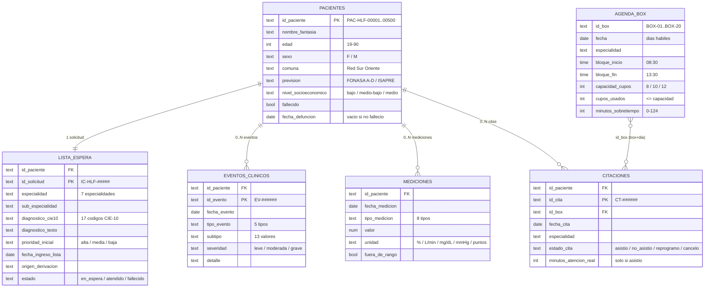
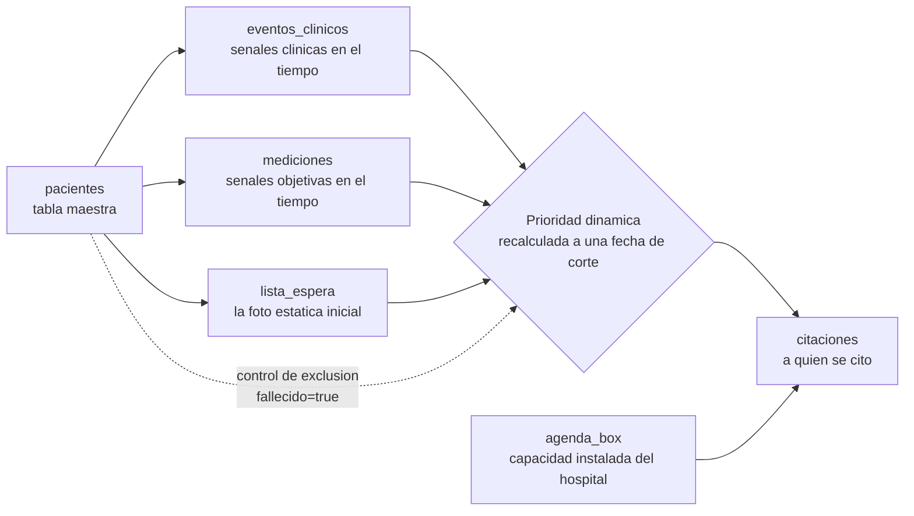

# Modelo de datos RAW – Dataset Atención Ambulatoria Dinámica HLF

Documentación del modelo de datos **en crudo (raw)** del reto *Priorización Clínica Evolutiva y Uso del Recurso Box*.

- **Fuente:** `data/dataset_hlf_ambulatorio/dataset_hlf_ambulatorio/`
- **Naturaleza:** datos 100% sintéticos · semilla `20261013` · fecha de referencia `2026-10-13` · 500 pacientes
- **Idea del reto:** la prioridad de la lista de espera debe *moverse* según cómo evoluciona el paciente mientras espera. El dataset es una **serie temporal de eventos**; no hay respuesta de referencia.
- **Validación:** las cabeceras, el conteo de filas y la integridad referencial de este documento fueron verificados contra los archivos reales (ver sección [Integridad verificada](#integridad-referencial-verificada)).

---

## 1. Tablas y grano

| Tabla (archivo) | Filas | Grano (1 fila =) | Llave |
|---|---:|---|---|
| `pacientes.csv` | 500 | un paciente | **PK** `id_paciente` |
| `lista_espera.csv` | 500 | una solicitud de interconsulta en espera | **PK** `id_solicitud` · **FK** `id_paciente` |
| `eventos_clinicos.csv` | 786 | un evento clínico fechado | **PK** `id_evento` · **FK** `id_paciente` |
| `mediciones.csv` | 2.487 | una medición fechada | **FK** `id_paciente` (sin PK propia) |
| `agenda_box.csv` | 2.188 | un bloque de agenda de un box en un día | **FK lógica** `id_box` (grano box+día; sin PK de una sola columna) |
| `citaciones.csv` | 257 | una cita ofrecida a un paciente | **PK** `id_cita` · **FK** `id_paciente`, `id_box` |
| `perfiles.json` | 500 | un objeto por paciente con sus series anidadas | igual que las tablas, ya consolidado |

> `perfiles.json` no es una tabla adicional: entrega **el mismo contenido ya unido** (eventos, mediciones y citas anidadas dentro de cada paciente). Útil para consumo por paciente sin hacer joins.

---

## 2. Diagrama entidad–relación

### Cómo se conecta la información

- **Llave principal `id_paciente`**: une `pacientes` con `lista_espera`, `eventos_clinicos`, `mediciones` y `citaciones`. Es el eje de todo el modelo.
- **`pacientes` → `lista_espera`**: relación **1 : 1** (cada paciente tiene exactamente una solicitud en espera; 500 y 500).
- **`pacientes` → `eventos_clinicos` / `mediciones` / `citaciones`**: relación **1 : 0..N**. No todos los pacientes tienen filas; la ausencia significa "sin señales registradas mientras espera" (estable o ingreso reciente), no es un error.
- **`citaciones` → `agenda_box`** vía `id_box`: enlaza el uso real (quién fue citado) con la capacidad instalada (el box del hospital). `agenda_box` es del **hospital**, no del paciente, por eso su grano es `box + día` y no tiene `id_paciente`.

---

## 3. Flujo lógico de la información

- `lista_espera` es la **fotografía estática** (`prioridad_inicial`) que el reto busca "despertar".
- `eventos_clinicos` + `mediciones` son el **motor dinámico**: para recalcular la prioridad a una fecha de corte se usan **solo** los registros con `fecha ≤ corte`, simulando lo que el hospital sabía ese día.
- `agenda_box` aporta la **capacidad** y `citaciones` el **uso real**, para analizar aprovechamiento del recurso box.
- **Control de exclusión:** pacientes con `fallecido = true` salen de la lista y no reciben nuevas citaciones; toda su actividad es anterior a `fecha_defuncion`.

---

## 4. Diccionario resumido de campos

### `pacientes.csv` — tabla maestra (500 filas)
| Campo | Tipo | Valores / rango |
|---|---|---|
| `id_paciente` | texto | `PAC-HLF-00001` … `PAC-HLF-00500` (PK) |
| `nombre_fantasia` | texto | nombre legible, no real |
| `edad` | entero | 19 – 90 |
| `sexo` | texto | `F`, `M` |
| `comuna` | texto | La Florida, La Granja, La Pintana, Pirque, Puente Alto, San José de Maipo, San Ramón |
| `prevision` | texto | FONASA A, FONASA B, FONASA C, FONASA D, ISAPRE |
| `nivel_socioeconomico` | texto | bajo, medio-bajo, medio |
| `fallecido` | booleano | `true`, `false` |
| `fecha_defuncion` | fecha | `AAAA-MM-DD` o vacío |

### `lista_espera.csv` — solicitud en espera (500 filas)
| Campo | Tipo | Valores / rango |
|---|---|---|
| `id_paciente` | texto | FK → `pacientes` |
| `id_solicitud` | texto | `IC-HLF-#####` (PK) |
| `especialidad` | texto | Broncopulmonar, Cardiología, Endocrinología, Gastroenterología, Neurología, Salud Mental, Traumatología |
| `sub_especialidad` | texto | 15 valores coherentes con la especialidad |
| `diagnostico_cie10` | texto | E03, E11, E66, F32, F41, G40, G43, I10, I20, I50, J44, J45, K21, K70, M17, M54, M75 |
| `diagnostico_texto` | texto | descripción del CIE-10 |
| `prioridad_inicial` | texto | alta, media, baja |
| `fecha_ingreso_lista` | fecha | 2025-04-21 … 2026-10 |
| `origen_derivacion` | texto | CESFAM/APS, Urgencia, Hospitalización, Otro hospital red |
| `estado` | texto | en_espera, atendido, fallecido (categorías posibles: + citado, egresado) |

### `eventos_clinicos.csv` — motor dinámico (786 filas)
| Campo | Tipo | Valores / rango |
|---|---|---|
| `id_paciente` | texto | FK → `pacientes` |
| `id_evento` | texto | `EV-######` (PK) |
| `fecha_evento` | fecha | dentro de [ingreso_lista, hoy o defunción] |
| `tipo_evento` | texto | cambio_farmaco, control_aps, examen_alterado, hospitalizacion, visita_urgencia |
| `subtipo` | texto | 13 valores (p. ej. aumento dosis, triage ESI 2, ingreso hospitalario) |
| `severidad` | texto | leve, moderada, grave |
| `detalle` | texto | texto libre (incluye la especialidad) |

### `mediciones.csv` — señales objetivas (2.487 filas)
| Campo | Tipo | Valores / rango |
|---|---|---|
| `id_paciente` | texto | FK → `pacientes` |
| `fecha_medicion` | fecha | dentro de [ingreso_lista, hoy o defunción] |
| `tipo_medicion` | texto | HbA1c, PHQ9, escala_dolor_eva, glicemia, peak_flow, presion_diastolica, presion_sistolica, saturacion_o2 |
| `valor` | numérico | según tipo |
| `unidad` | texto | %, L/min, mg/dL, mmHg, puntos |
| `fuera_de_rango` | booleano | `true`, `false` |

**Rangos normales de referencia:** presión sistólica 90–139 mmHg · diastólica 60–89 mmHg · HbA1c 4,0–6,4 % · glicemia 70–140 mg/dL · saturación O₂ 95–100 % · peak flow 350–600 L/min · EVA dolor 0–3 pts · PHQ-9 0–9 pts.

### `agenda_box.csv` — capacidad instalada (2.188 filas)
| Campo | Tipo | Valores / rango |
|---|---|---|
| `id_box` | texto | `BOX-01` … `BOX-20` |
| `fecha` | fecha | 2026-04-14 … 2026-10-13 (días hábiles) |
| `especialidad` | texto | las 7 especialidades |
| `bloque_inicio` | hora | 08:30 |
| `bloque_fin` | hora | 13:30 |
| `capacidad_cupos` | entero | 8, 10, 12 |
| `cupos_usados` | entero | 0 – 12 (≤ capacidad) |
| `minutos_sobretiempo` | entero | 0 – 124 |

### `citaciones.csv` — uso real (257 filas)
| Campo | Tipo | Valores / rango |
|---|---|---|
| `id_paciente` | texto | FK → `pacientes` |
| `id_cita` | texto | `CT-######` (PK) |
| `id_box` | texto | FK → `agenda_box` (`BOX-01`…`BOX-20`) |
| `fecha_cita` | fecha | 2026-01-31 … |
| `especialidad` | texto | las 7 especialidades |
| `estado_cita` | texto | asistio, no_asistio, reprogramo, cancelo |
| `minutos_atencion_real` | entero | 15 – 55, o vacío (solo si `estado_cita = asistio`) |

---

## 5. Integridad referencial verificada

Comprobado directamente sobre los CSV (no solo sobre la documentación):

| Verificación | Resultado |
|---|---|
| Filas por tabla | pacientes 500 · lista_espera 500 · eventos 786 · mediciones 2.487 · agenda_box 2.188 · citaciones 257 ✅ coinciden con el README |
| `id_paciente` únicos en `pacientes` | 500 |
| FK `lista_espera.id_paciente` | 500 pacientes únicos · **0 huérfanos** |
| FK `eventos_clinicos.id_paciente` | 381 pacientes con eventos · **0 huérfanos** |
| FK `mediciones.id_paciente` | 451 pacientes con mediciones · **0 huérfanos** |
| FK `citaciones.id_paciente` | 237 pacientes citados · **0 huérfanos** |
| FK `citaciones.id_box` → `agenda_box.id_box` | 20 boxes en ambos lados · **0 huérfanos** |

**Lecturas clave:**
- Cobertura temporal parcial: 381/500 pacientes tienen eventos y 451/500 tienen mediciones. La ausencia es información válida (paciente estable o de ingreso reciente), no un fallo de datos.
- Solo 237/500 pacientes han sido citados: el embudo lista de espera → cita está lejos de cubrir toda la lista.
- `agenda_box` no tiene PK de una sola columna: la clave natural es `id_box + fecha (+ bloque)`. `citaciones.id_box` referencia la **dimensión box**, no una fila concreta de agenda.

---

## 6. Notas de uso

1. **Enlace único entre tablas de paciente:** `id_paciente`. Para el uso de box: `citaciones.id_box → agenda_box.id_box`.
2. **Recalcular prioridad a una fecha de corte:** usar solo registros con `fecha ≤ corte`.
3. **Ausencias con significado:** sin filas en `eventos_clinicos`/`mediciones` ⇒ paciente sin señales registradas (no es error).
4. **Exclusión por fallecimiento:** `fallecido = true` ⇒ fuera de la lista, sin nuevas citaciones; toda su actividad es previa a `fecha_defuncion`.
5. **`perfiles.json`** entrega el modelo ya consolidado (eventos, mediciones y citas anidadas por paciente), equivalente a hacer los joins por `id_paciente`.
