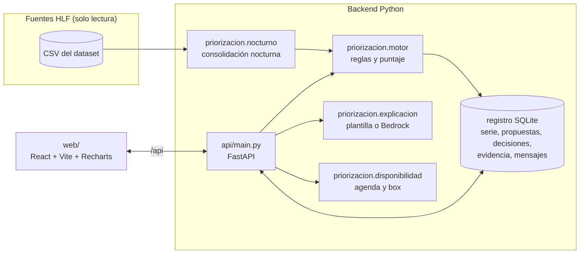

# MVP: priorización dinámica de la lista de espera

Prototipo funcional que implementa `docs/arquitectura.md` y la propuesta A de `docs/propuestas-solucion.md`, más una versión inicial de las propuestas B (agenda y box) y C (canal del paciente, como maqueta). Usa el dataset sintético del HLF (`docs/datos.md`).

> La herramienta **propone y explica**; el equipo clínico **decide**. La prioridad inicial nunca se sobrescribe.

## Cómo ejecutarlo

Requisitos: Python 3.11 y Node 20 o superior. El dataset debe estar en `data/dataset_hlf_ambulatorio/dataset_hlf_ambulatorio/`.

```bash
pip install -r requirements.txt
cd web && npm install && npm run build && cd ..
uvicorn api.main:app --port 8000          # abre http://127.0.0.1:8000
```

La primera vez, la API corre la consolidación nocturna sobre toda la historia (unos 10 s) y crea `data/processed/priorizacion.sqlite`. Para reiniciar la demo desde cero, borra ese archivo.

**Desarrollo** (recarga en caliente): `uvicorn api.main:app --reload --port 8000` en una terminal y `cd web && npm run dev` en otra, y abre http://localhost:5173.

| Tarea | Comando |
|---|---|
| Tests (motor + API) | `python -m pytest` |
| Consolidación con buzón (F0006) | `python -m servicios.nocturno --buzon data/buzon` |
| Recalcular la historia completa | `python -m priorizacion.nocturno` |
| Documentación interactiva de la API | http://127.0.0.1:8000/docs |
| Activar explicaciones con IA generativa | `pip install "anthropic[bedrock]"` y variables `LLM_PROVEEDOR=bedrock`, `AWS_REGION`, `BEDROCK_MODEL_ID` (por defecto `anthropic.claude-opus-5-5`), con credenciales AWS |

## Arquitectura



| Carpeta | Contenido |
|---|---|
| `priorizacion/` | Motor de dominio, sin interfaz: datos, reglas versionadas, motor, explicación, disponibilidad, consolidación nocturna, ficha consolidada, KPIs y registro |
| `api/` | API REST (FastAPI). En producción también sirve la app compilada |
| `web/` | App React (TypeScript, Vite, React Router, Recharts) |
| `tests/` | Pruebas del motor con los casos de referencia y prueba de humo de la API |
| `notebooks/` | EDA (`docs/eda.md`) |

## Vistas

| Vista | Pregunta que responde | Qué muestra |
|---|---|---|
| **Bandeja priorizada** | ¿A quién reviso primero hoy? | Colas individuales por especialidad, posición dinámica frente a la de la lista congelada, alertas, propuesta frente a prioridad vigente, motivo principal, disponibilidad y riesgo de no-show |
| **Ficha del paciente** | ¿Cómo evolucionó su prioridad y por qué? | Seis pestañas, descritas abajo |
| **Agenda y box** | ¿A quién llamo para los cupos libres de hoy? | Agenda propuesta con los pacientes listos de mayor prioridad, lista de reemplazo y acciones para los prioritarios que no están listos. Panel de box: demanda frente a capacidad, ocupación, no-show y sobretiempo |
| **Canal del paciente** (maqueta) | ¿Cómo entra la información que tiene el paciente? | Chat estilo WhatsApp para confirmar asistencia, enviar exámenes externos y responder un cuestionario de síntomas, junto a la bandeja de validación para TENS o enfermería |
| **KPIs** | ¿Funciona la herramienta? | Tiempo a reevaluación, cobertura, concordancia (κ), foto frente a película, los pacientes que la lista congelada no ve, pacientes en alta por noche y equidad |
| **Consolidación nocturna** | ¿Qué hace el proceso de cada noche? | Pasos con su servicio AWS, ejecución manual, bitácora de corridas y tabla de reglas y pesos vigentes |

Pestañas de la **ficha del paciente**:
- **Evolución de la prioridad.** Tres gráficos sincronizados en el tiempo:
  - nivel de la lista congelada frente a la propuesta de cada noche, las decisiones clínicas y los días con alerta;
  - puntaje de nivel con sus umbrales, con los eventos clínicos marcados;
  - posición en la cola con la lista congelada frente a la priorización dinámica.
- **Línea de tiempo clínica:** mediciones con su rango normal, eventos y citas.
- **Ficha consolidada:** diagnósticos, atenciones, fármacos y exámenes, cada uno con su fuente.
- **Explicación y factores:** gráfico de cascada del puntaje y explicación (plantilla o IA).
- **Validación clínica:** aceptar, ajustar o rechazar, con motivo.
- **Historial y trazabilidad:** cada propuesta con sus factores, versión de reglas y huella de datos.

La **fecha de corte** de la barra superior funciona como máquina del tiempo: todas las vistas muestran lo que el hospital sabía esa noche.

## Procesos de backend

| Proceso | Cuándo corre | Qué hace |
|---|---|---|
| Consolidación nocturna (`nocturno.ejecutar`) | Cada noche. En la demo, al iniciar si no hay datos, o con el botón de la vista | Para cada solicitud y cada noche desde su ingreso: evalúa con los datos ≤ esa noche y guarda la serie (puntajes, nivel, alerta y posición en la cola dinámica y en la congelada). Registra una propuesta con factores, fuentes y huella cuando cambia el nivel o se enciende una alerta |
| Reevaluación de una solicitud (`nocturno.recalcular_solicitud`) | Al registrar una decisión clínica o validar evidencia del paciente | Recalcula la serie del paciente y las posiciones de su cola. No espera a la noche |
| Evaluación a fecha de corte (`motor.evaluar`) | En cada consulta de la bandeja o la ficha | Exclusión → regla dura → puntaje de nivel → nivel → resguardo; además, el puntaje de orden |
| Agenda propuesta (`disponibilidad.proponer_agenda`) | A pedido | Asigna los cupos libres del día a los pacientes listos de mayor prioridad; para los no listos genera una acción sin quitarles el lugar |
| Canal del paciente | A pedido | La evidencia queda pendiente; solo la validada entra a la ficha y gatilla la reevaluación |

## Puntaje (reglas-v0.1)

Todas las reglas están en `priorizacion/reglas.py` y se ven en la vista de consolidación nocturna.

- **Puntaje de nivel** = base de la prioridad inicial (alta 20, media 10, baja 0) + señales clínicas + ajuste por riesgo basal.
  - Las señales clínicas son los eventos con decaimiento (vida media de 90 días), las mediciones (desviación del rango, tendencia y persistencia) y los patrones combinados.
  - El ajuste por riesgo basal multiplica las señales: ×1,25 en diagnósticos de riesgo alto y ×0,8 en los de riesgo bajo.
  - Umbrales: alta ≥ 20, media ≥ 10. **Solo las señales clínicas mueven a un paciente de nivel.**
- **Puntaje de orden** = puntaje de nivel + contexto (riesgo basal del diagnóstico, edad y espera frente al plazo de referencia). Ordena dentro del nivel. Así dos pacientes del mismo nivel con distinto riesgo basal no quedan empatados, lo que resuelve el pendiente de `docs/enfoque.md`.
- **Regla dura:** un evento grave en los últimos 30 días deja la propuesta en alta con alerta. Una alarma informada por el paciente y validada enciende la alerta sin cambiar el nivel.
- **Resguardo:** para bajar de nivel se exige evidencia de mejora; la falta de datos nunca baja la prioridad.
- **Nivel vigente:** la última decisión clínica; si no hay ninguna, la prioridad inicial.

**Calibración pendiente.** Con estos pesos, al 2026-10-13 cerca del 31 % de la lista queda propuesta en alta, frente al 19 % de la lista congelada. Los pesos y umbrales son un punto de partida para ajustar con el equipo clínico. Cada cambio debe crear una nueva `VERSION_REGLAS`.

## Servicios AWS propuestos

El MVP corre local; cada pieza tiene un equivalente directo en AWS.

| Pieza del MVP | En AWS |
|---|---|
| CSV en `data/` | S3 `raw/`, con cifrado y acceso restringido |
| `nocturno.ejecutar` | EventBridge Scheduler (cron diario) → AWS Glue (PySpark) o Lambda si el volumen es chico |
| Ficha consolidada y serie nocturna | S3 `procesado/` en Parquet, consultable con Athena |
| `registro` (SQLite) | Amazon RDS for PostgreSQL (propuestas, factores, decisiones: transaccional y auditable) |
| `api/main.py` | Contenedor en App Runner o ECS Fargate, o Lambda + API Gateway |
| `web/dist` | S3 + CloudFront |
| Explicación con IA | Amazon Bedrock (Claude), solo para redactar y validado contra los factores |
| Extracción de exámenes externos (siguiente iteración) | Textract (OCR) + Bedrock con cita literal, siempre como evidencia pendiente |
| Canal del paciente (siguiente iteración) | AWS End User Messaging (SMS o WhatsApp) + Lambda |
| Identidad y auditoría | Cognito (profesionales), CloudTrail, KMS |

### Partición y procesamiento de los datos

- **Ingesta:** `s3://…/raw/fuente=<lista|rce|urgencia|farmacia|…>/fecha_carga=AAAA-MM-DD/`. Las fuentes no se modifican.
- **Consolidado por paciente:** `s3://…/procesado/ficha/fecha_corte=AAAA-MM-DD/especialidad=<…>/`, en Parquet. Cada noche escribe una partición nueva; la historia completa permite reproducir cualquier propuesta.
- **Serie nocturna:** `s3://…/procesado/serie/fecha_corte=…/especialidad=…/`, una fila por solicitud activa y noche (en el dataset, unas 148 mil filas por año y medio de historia).
- **Procesamiento incremental:** cada noche solo hace falta evaluar las solicitudes activas a la fecha (unas 400 en el dataset; 26 mil en la lista real del HLF). La evaluación es independiente por paciente, así que se paraleliza por especialidad o por bloque de pacientes.
- **Tiempo a reevaluación:** un dato que llega en el día se refleja esa misma noche (< 24 h). Si se necesita menos, un disparador por evento (urgencia u hospitalización) puede llamar a `recalcular_solicitud`.

## Cómo se incorporó la información recopilada por el equipo

| Tema | Estado en el MVP |
|---|---|
| Enfermedad detectada | Riesgo basal por diagnóstico CIE-10 (alto, medio o bajo; tabla a validar con clínicos): ajusta el peso de las señales y ordena dentro del nivel |
| Antecedentes y situación personal | Edad en el orden. Las variables sociales (comuna, previsión, nivel socioeconómico) **no** entran al puntaje: se usan para auditar la equidad |
| Tasa de deterioro | Tendencia de las mediciones (pendiente normalizada) y decaimiento de los eventos |
| Posición en la cola | Días de espera frente a un plazo de referencia por riesgo basal; ordena dentro del nivel |
| Combinación de síntomas históricos | Patrones: aumento de dosis + examen alterado; medición alterada antes de un evento |
| Exámenes en el sector privado | Canal del paciente: evidencia pendiente → validación por TENS o enfermería → reevaluación. Se evalúa con el mismo criterio que la interna |
| Faltan exámenes para la consulta | Eje de disponibilidad: no pierde su lugar, se gatilla una acción y se llama al siguiente que está listo |
| Ficha que concentre diagnósticos y fármacos | Ficha consolidada por tipo, con la fuente de cada dato |
| Consolidación nocturna / bases no unificadas | Proceso nocturno de solo lectura sobre las fuentes |
| Urgencias que no actualizan el score; sin activador determinista | Regla dura: evento grave reciente → alta + alerta esa misma noche |
| Sin cruce de especialidades | La ficha es por paciente, no por especialidad: un evento de cualquier especialidad cuenta para todas sus solicitudes. En el dataset cada paciente tiene una sola solicitud |
| Colas individuales por especialidad | Bandeja por especialidad con posición dinámica y congelada |
| Trazabilidad | Factores con referencia de origen, versión de reglas, huella de datos, propuestas y decisiones registradas |
| CUD frente a Thalamus | Canal de origen derivado de `origen_derivacion`: APS y red → CUD; urgencia y hospitalización → Thalamus. **Supuesto a confirmar con el HLF** |
| ACG (G1–G3) y GRD | No vienen en el dataset. ACG se puede agregar como factor de riesgo basal y GRD como peso de la hospitalización |
| QALY, probabilidad de vida, esperanza de vida | **No incluidos a propósito.** Priorizar por años de vida esperados desfavorece a personas mayores y con enfermedades crónicas, justo el grupo que el desafío busca proteger. Si el HLF quiere usarlos, la decisión debe pasar por su comité de ética |

## Limitaciones

- Datos sintéticos con secuencias deterministas (`docs/eda.md`): las reglas no deben ajustarse a esos artefactos.
- No hay priorización experta: el κ solo se calcula con las decisiones que se registren en la app.
- Sin texto libre: no se pueden medir los controles visibles ni probar la extracción con LLM sobre notas reales.
- La agenda usa los cupos libres registrados; `citaciones` y `agenda_box` casi no cruzan (`docs/datos.md`).
- La explicación con Bedrock está implementada pero no se probó contra el servicio (faltan credenciales en este entorno). Sin ellas, la app usa la plantilla.
- Sin autenticación: la maqueta registra el nombre que se escribe en el formulario.
